# Atlian-Assiant: architecture

This document explains **how the code is built and how a call flows through it**. It is written from the source (`atlian_assiant/`, about
40,000 lines in 250 modules). The longer, original design specification, with every table and decision record, is
[`docs/architecture_design.md`](docs/architecture_design.md); this file is the map, that one is the encyclopedia.

* [Part 1: High-level architecture](#part-1-high-level-architecture)
  * [1.1 What the system does](#11-what-the-system-does) · [1.2 System context](#12-system-context) · [1.3 Layers](#13-layers) ·
    [1.4 Package map](#14-package-map) · [1.5 Core abstractions](#15-core-abstractions) · [1.6 Backends](#16-backends) ·
    [1.7 Routing presets](#17-routing-presets) · [1.8 Access policy](#18-access-policy) · [1.9 Agent layer](#19-agent-layer) ·
    [1.10 Event plane](#110-event-plane) · [1.11 Mirror](#111-mirror) · [1.12 Cross-cutting concerns](#112-cross-cutting-concerns) ·
    [1.13 Deployment shapes](#113-deployment-shapes) · [1.14 Build-time tooling](#114-build-time-tooling)
* [Part 2: Low-level sequences](#part-2-low-level-sequences) (15 sequence diagrams)
* [Part 3: Extension points](#part-3-extension-points) · [Part 4: Verification status and known gaps](#part-4-verification-status-and-known-gaps)

---

## Part 1: High-level architecture

### 1.1 What the system does

Jira and Confluence can be reached in many ways: Cloud REST, Data Center REST, the remote MCP server, the GraphQL gateway, three CLIs, the web UI,
Data Lake shares, the org-admin API and Forge. Each one covers a different subset, authenticates differently and fails differently. Atlian-Assiant
puts **one typed client** in front of all of them:

1. **One operation catalog.** 203 named operations (`jira.issue.get`, `confluence.search.cql`, ...), each with an access class (read, search,
   write, delete, manage, analytics, org_admin), plus a generated tier for the rest of the OpenAPI surface.
2. **Many interchangeable backends.** Each backend declares which operations it supports; a router picks one per call and **falls back safely**.
3. **One access policy** in front of every backend: read-only by default, writes previewed and confirmed, credits and risky backends opt-in.
4. **The same operations, three ways:** a Python API (async and blocking), LLM tools (Anthropic / OpenAI / MCP formats) and a CLI.
5. **An event plane** that turns 49 ways of being notified (webhooks, Forge, polling, queues, Slack, email, ...) into one normalized
   `ChangeEvent` stream, always re-reading the real state before acting.

### 1.2 System context

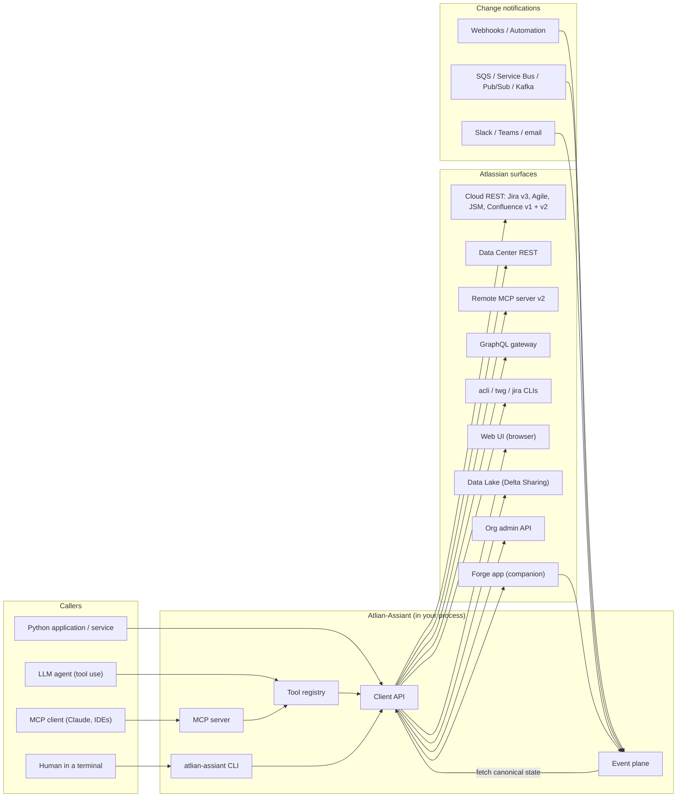

### 1.3 Layers

Every call goes down the same stack. Each layer has one job and a narrow interface to the next one.

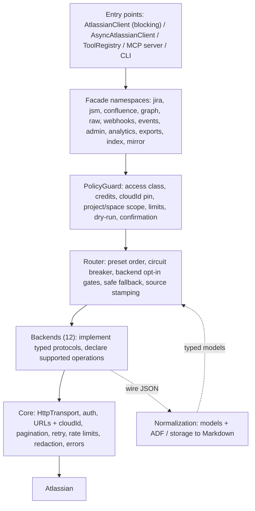

Rules that hold across layers:

* **Facade methods never talk to Atlassian.** They name an operation and a protocol method and call `Router.call`.
* **Backends never decide policy.** They only answer "can I serve this?" (`supported_operations()`, `gate()`) and raise
  `UnsupportedOperationError` *before sending anything* when they cannot.
* **All models are backend-neutral.** Every result carries a `SourceRef` stamped by the router (backend, site, cloudId).

### 1.4 Package map

| Package | Lines | Responsibility |
|---|---:|---|
| `facade/` | 5,850 | Public API: `AsyncAtlassianClient`, namespaces (mostly generated by `tools/gen_facade.py`), blocking `SyncProxy`, operation index |
| `testing/` | 4,470 | Fakes for every backend: scenario dataset, fake REST server, fake MCP / GraphQL gateway / CLIs / browser / lake / DB |
| `events/` | 8,100 | Event plane: catalog of 49 delivery methods, provisioners, sources, receivers, pipeline, enricher, stores, sinks, relays |
| `backends/` | 8,500 | 12 backends (see 1.6) plus the shared `OpTransport` adapter |
| `core/` | 1,500 | HTTP transport, auth strategies, URL / cloudId resolution, pagination strategies, retry, rate limiting, redaction, errors |
| `models/` | 710 | Pydantic models: `Issue`, `Content`, `Page[T]`, `SourceRef`, ... |
| `protocols/` | 670 | 37 `typing.Protocol` interfaces (`JiraIssueReader`, `ConfluenceSearcher`, ...) |
| `formats/` | 640 | ADF and Confluence storage format to and from Markdown |
| `agent/` | 590 + docs | Tool registry and exporters, MCP server, `describe()`, generated `AGENT_GUIDE.md` / `llms.txt` |
| `mirror/` | 900 | Keep a local copy (SQL, OpenSearch, vector index) in sync |
| `relay/` | 240 | Serverless webhook relays (AWS Lambda, Azure, GCP, Cloudflare Worker) and their IaC |
| top level | 1,770 | `operations.py` (catalog), `capabilities.py` (enums), `routing.py`, `policy.py`, `factory.py`, `matrix.py`, `config.py`, `cli.py` |

### 1.5 Core abstractions

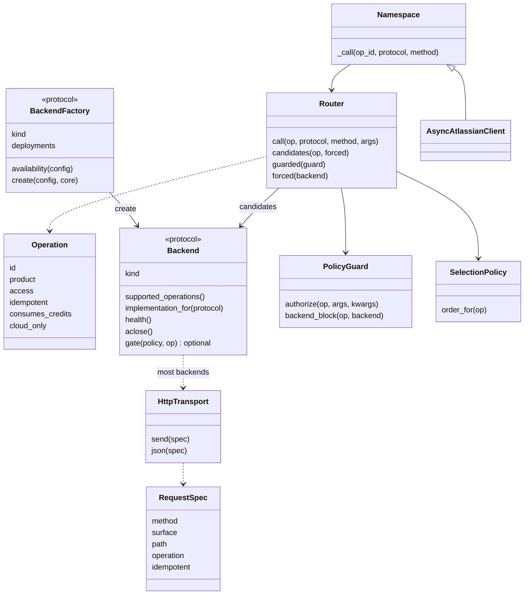

* **Operation** (`operations.py`, `capabilities.py`): the unit of everything: routing, policy, tools, docs and tests are keyed by its id.
  The 203 curated operations break down as read 104, write 62, manage 18, delete 6, search 5, analytics 4, org_admin 4.
* **Protocols** (`protocols/`): 37 small interfaces. A backend is a bag of *parts*, each implementing some protocols;
  `implementation_of(backend, Protocol)` finds the part.
* **Matrix** (`matrix.py`): which operation rows each backend claims, `full` or `partial`. It mirrors section 11 of the design document, and a test
  keeps them equal.
* **Page[T] and Cursor** (`core/pagination.py`): opaque cursors encode the backend, the pagination strategy and its state, so the next page always
  goes to the backend that produced the first one.
* **ChangeEvent** (`events/model.py`): the normalized event: source, product, entity, action, key / id / version, delivery metadata, `dedup_key`,
  and (after enrichment) `canonical`, the freshly read object.

### 1.6 Backends

Twelve backends are registered in `factory.default_registry()`. They fall into three families by how they reach Atlassian:

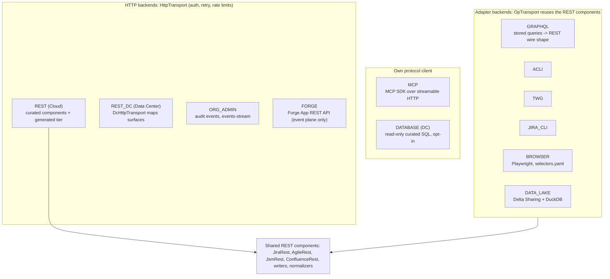

**The `OpTransport` trick** (`backends/optransport.py`). The Cloud REST components describe each call as a `RequestSpec` that carries the
operation id. `OpTransport` is an `HttpTransport` look-alike that never does HTTP: it looks the operation up in a handler table and returns JSON
**in the REST wire shape**. So the CLI, GraphQL, browser and Data Lake backends reuse all of the REST parsing, normalization and pagination; each
one only translates a request into its own medium and back:

| Backend | Handler translates a REST request into... | Translation table |
|---|---|---|
| ACLI / TWG / JIRA_CLI | a CLI command line (`CommandMap.render`), then CLI stdout back into REST JSON (`shape`) | `backends/cli/command_maps/*.py` |
| GRAPHQL | a stored GraphQL document plus variables, then the result back into REST JSON (`Binding.adapt`) | `backends/graphql/ops.py` + `queries/*.graphql` |
| BROWSER | a UI page and selectors, read from the rendered DOM | `backends/browser/ops.py` + `selectors.yaml` |
| DATA_LAKE | SQL over shared Delta tables | `backends/data_lake/ops.py` |

An operation with no handler raises `UnsupportedOperationError` before anything runs, which is what makes the router fall back.

**Per-backend notes**

* **REST** also exposes the **generated tier** (`backends/rest_cloud/generated/`): an operation index produced from OpenAPI specs by
  `tools/codegen.py`. Any generated operation is callable by id through `client.index.call(...)` and goes through the same transport and policy.
* **MCP** (`backends/mcp/`) speaks the live Rovo MCP v2 surface recorded in `catalog_v2.json`: about 20 direct tools, plus `executeRead`,
  `executeWrite` and `executeDestructive` over a catalogue of about 316 operations. It resolves the cloudId once, routes each tool directly or
  through the right execute tool, and maps the server's "successful call carrying an error" replies to typed errors.
* **CLI backends** run the third-party binary through `CliRunner` with a **clean environment** (no tokens passed through) and check the installed
  version and flags once, lazily, with `CapabilityProbe`.
* **BROWSER**, **DATA_LAKE** and **DATABASE** have a `gate()`: the router skips them unless the policy opts in (`allow_browser_writes`,
  `ANALYTICS` access, `allow_direct_db`).

### 1.7 Routing presets

A preset is a backend order per operation pattern (exact id, then the longest `prefix.*`, then `*`). From `routing.PRESET_ORDERS`:

| Preset | Default order (`*`) | Notable overrides |
|---|---|---|
| `service` | REST, MCP, GraphQL, ACLI, TWG, jira-cli, browser | `graph.*`: MCP, GraphQL, TWG · `analytics.*`: Data Lake · `admin.*`: org admin |
| `agent` | MCP, REST, TWG, GraphQL, ACLI, jira-cli, browser | `jira.jql.*` and `confluence.content.delete`: REST only |
| `shell` | ACLI, TWG, jira-cli, REST, MCP, browser | `confluence.*`: TWG, REST, MCP, browser |
| `analytics` | REST, MCP | `analytics.*`: Data Lake · `jira.issue.search`: REST |
| `data_center` | REST_DC, jira-cli, browser, database | (chosen automatically when `deployment = data_center`) |

Only backends that were **built** (credentials present, tool installed, extra installed) and that **declare** the operation become candidates.
A small circuit breaker skips a backend after repeated "unavailable" failures for a cool-down period.

### 1.8 Access policy

`AccessPolicy` (`policy.py`) is a frozen value: allowed access classes (default **read + search**), access classes that need confirmation
(write, delete, manage), `allow_credit_consuming`, an optional cloudId / project / space allow-list, result and attachment-size limits, and the
backend opt-ins. `PolicyGuard.authorize` enforces it before routing, in this order:

1. The access class is allowed (for `raw.request`, the *HTTP method* decides: POST/PUT/PATCH count as write, DELETE as delete).
2. Rovo credits were acknowledged, if the operation consumes them.
3. The session's cloudId is allowed.
4. Scope: JQL and CQL are **rewritten** to the allowed projects / spaces, keys are checked, id-only reads that cannot be scoped are refused.
5. Limits are clamped (`limit`, `page_size`, attachment `max_bytes`).
6. Writes: a `PlannedAction` is built. `dry_run=True` returns it without executing. Otherwise the `ConfirmationHandler` decides, and **delete and
   manage always need confirmation**, whatever the policy says. The `agent` preset refuses `AutoApprove`.

### 1.9 Agent layer

* **`ToolRegistry`** (`agent/tools.py`): 58 tools defined over the facade (37 visible under the default read-only policy). `export()` produces
  Anthropic, OpenAI, JSON Schema or MCP tool definitions. `ainvoke()` validates arguments with a generated Pydantic model, calls the facade (so
  policy and routing apply), and renders a bounded text answer wrapped as *data* (`<atlassian-data ...>` with a preamble telling the model not to
  follow instructions inside it). Errors come back as `ToolResult(ok=False)` with a hint; nothing raises into the agent loop.
* **MCP server** (`agent/mcp_server.py`): `tools/list` and `tools/call` backed by the registry, with read-only and destructive hints.
  stdio or HTTP; HTTP requires a bearer token and refuses non-loopback binds unless explicitly allowed.
* **Discovery**: `client.describe()` explains what is configured and why not; `client.index.discover(query)` searches all operations, including
  the generated tier; the generated `AGENT_GUIDE.md` / `llms.txt` describe the tools for model context.

### 1.10 Event plane

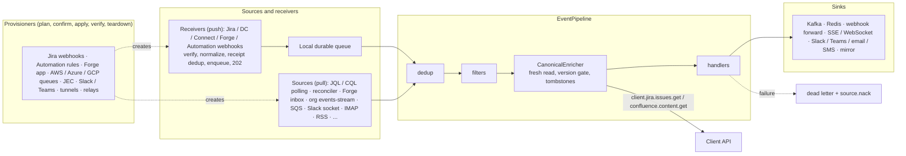

* **Catalog** (`events/catalog.py`): 49 delivery methods (DM-01 to DM-49: 11 machine push, 11 machine pull, 15 human channels, 8 transports,
  2 guards, 1 in-Atlassian, 1 live UI) and 15 cross-cutting rules. Each entry names its provisioner, source or receiver, and the research section it
  comes from; `events/planner.py` recommends methods for your constraints (no public URL, Confluence needed, AWS approved, ...).
* **Principle:** an event is a *hint*. The enricher always re-reads the issue or page through the client, drops out-of-order deliveries with a
  per-entity version store, and turns "not found" into a tombstone.
* **`EventPlane`** (`events/plane.py`) assembles provisioners, an ASGI receiver app, sources and the pipeline from a plan:
  `provision()`, `verify()`, `run()`, `teardown()`.

### 1.11 Mirror

`client.mirror.jira(store, jql=...)` and `.confluence(store, cql=...)` keep a local copy of a scope: `initial_load()`, `apply_event()` (plug it in as an
event-plane sink) and a nightly `reconcile()` that tombstones deleted items and refreshes changed ones. Stores: in-memory, SQL (SQLite /
PostgreSQL), OpenSearch, and a vector store (`HashingEmbedder` or your own embedder; Chroma, pgvector, Weaviate, Pinecone adapters). A version store
makes every write idempotent.

### 1.12 Cross-cutting concerns

| Concern | Where | How |
|---|---|---|
| Errors | `core/errors.py` | One hierarchy (`AtlassianError` with `hint`, `retryable`, `operation`, `backend`). HTTP status maps to `NotFoundError`, `PermissionDeniedError`, `RateLimitedError`, ... Router control flow uses `UnsupportedOperationError` and `BackendUnavailableError`. |
| Retries | `core/retry.py` | Only idempotent requests, only retryable statuses, exponential backoff with jitter, honouring `Retry-After`. |
| Rate limits | `core/ratelimit.py` | Concurrency limit per API family, `RateLimit-*` header observer, and a per-issue write serializer (no two concurrent writes to one issue). |
| Auth | `core/auth/` | Basic (email + token), service-account bearer, OAuth 2.0 (3LO) with refresh-token rotation, DC PAT. A credential is only applied to surfaces it supports. |
| URLs and cloudId | `core/urls.py` | Site URLs or `api.atlassian.com/ex/{product}/{cloudId}`. The cloudId is resolved once and can be pinned. Absolute URLs are only allowed on the configured site. |
| Secrets | `core/redaction.py`, `core/telemetry.py` | Known secrets and auth headers are redacted from logs, telemetry and error messages. |
| Formats | `formats/` | ADF to and from Markdown, storage format to Markdown, so agents work in Markdown. |
| Config | `config.py`, `events/config.py` | Pydantic settings from `ATLASSIAN_*` environment / `.env` / named profiles with secret references. |

### 1.13 Deployment shapes

| Shape | What runs | Typical use |
|---|---|---|
| Library | `AtlassianClient` in your process | scripts, services, ETL |
| Agent tools | `client.tools.export()` + your LLM loop | custom agents |
| MCP server | `atlian-assiant mcp serve` (stdio or HTTP) | Claude Desktop, IDEs, other MCP clients |
| Webhook receiver | `EventPlane.asgi_app()` behind your web server | public-URL webhooks |
| Private worker | `EventPlane.run()` with pull sources | no inbound internet (polling, Forge inbox, queues, Slack socket) |
| Serverless relay | `relay/` handlers on Lambda / Azure / GCP / Cloudflare | receive publicly, deliver into a private queue |
| Forge companion | `forge_templates/event-inbox` deployed to the site | Jira + Confluence events without a public URL |

### 1.14 Build-time tooling

Generated artifacts are committed and checked in CI, so drift fails the build:

| Tool | Produces / checks |
|---|---|
| `tools/gen_facade.py` | the facade namespaces (`facade/_generated_*.py`) from one table of methods |
| `tools/gen_stubs.py` | `facade/sync.pyi`, so the blocking client is fully typed |
| `tools/docgen.py` | docstring lint (every public method documents Args / Returns / Raises / Access / Example, and examples run) and the generated docs |
| `tools/codegen.py` | the generated REST tier from OpenAPI specs (`--fetch` gets the real specs; a nightly workflow opens a PR on drift) |
| `tools/api_surface.py` | `docs/api_surface.json`: the public API may grow but not lose anything by accident |
| `tools/gql_schema_subset.py` | the recorded GraphQL schema subset, and validation of every stored query against it |

---

## Part 2: Low-level sequences

Participants use the real class names. `Svc` means `CoreServices` / `HttpTransport`.

### 2.1 Building a client

`ClientFactory.build_async` (`factory.py`). Nothing is contacted at build time; backends are built only if they *could* work.

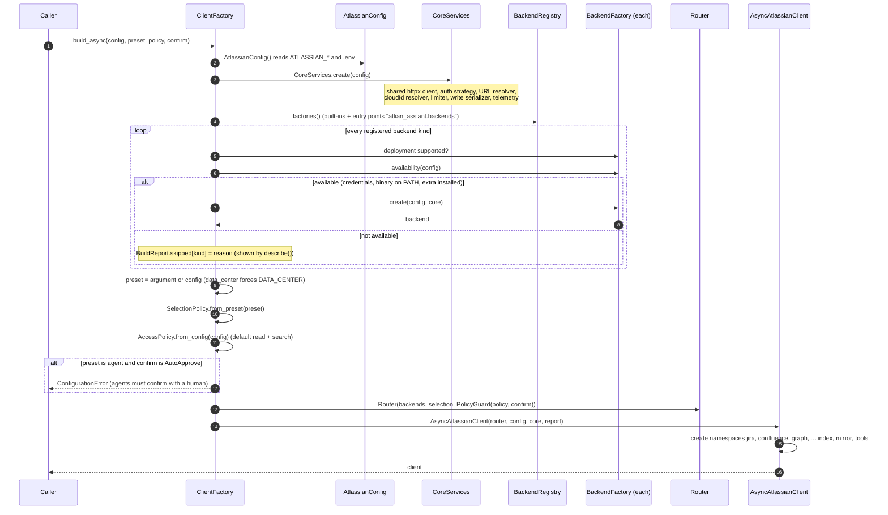

### 2.2 A read call through the blocking client

`atl.jira.issues.get("PROJ-1")` with the default `service` preset, served by Cloud REST.

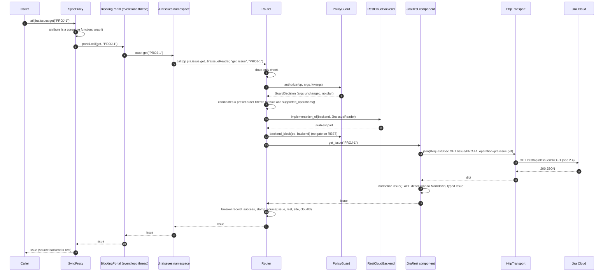

### 2.3 Fallback and failure semantics in `Router.call`

The router only moves to the next backend when the current one **provably sent nothing**.

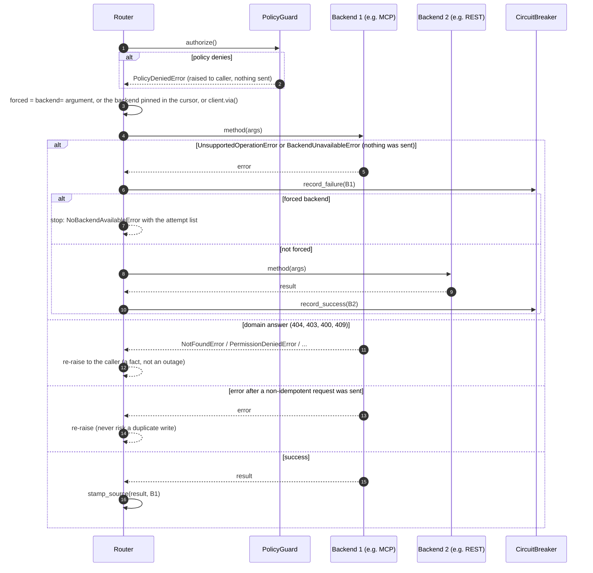

### 2.4 Inside `HttpTransport.send`

`core/http.py`. Shared by REST, REST_DC, org admin and Forge.

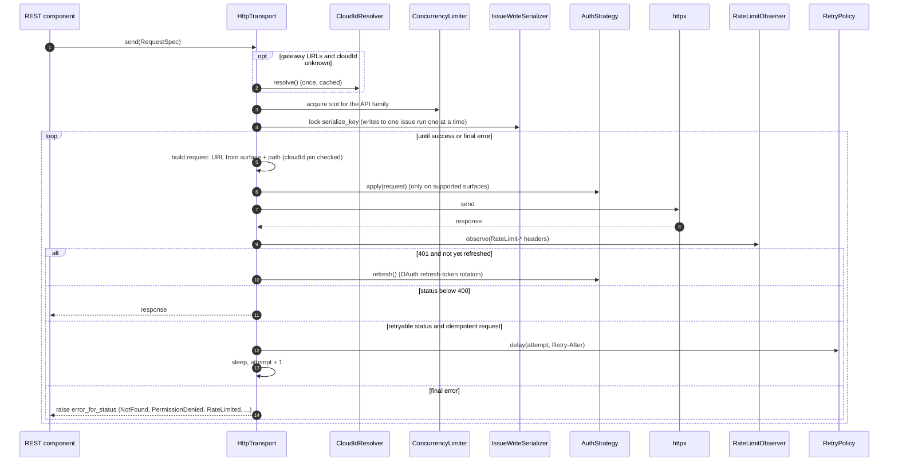

### 2.5 A write: dry run, then confirmed execution

`atl.jira.issues.transition("PROJ-1", "Done")` with `access=read,search,write`.

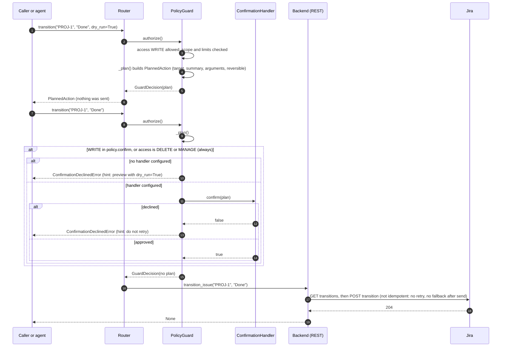

### 2.6 Paging with a cursor

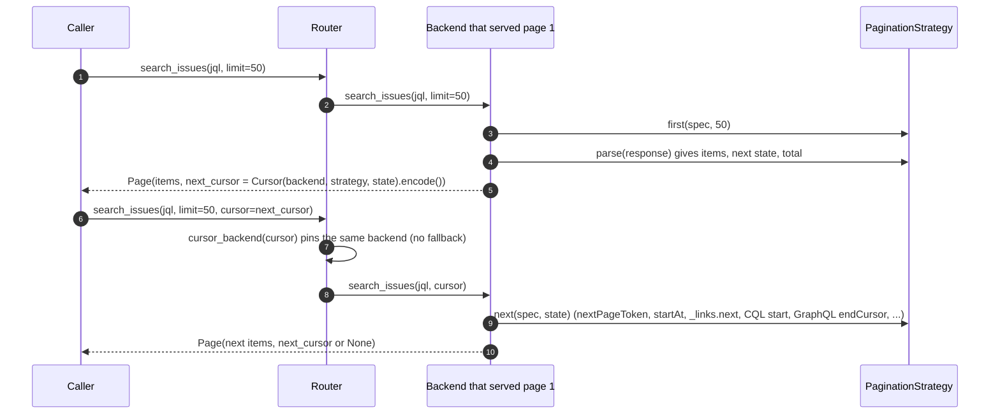

### 2.7 MCP backend call

`backends/mcp/backend.py`, against the live Rovo MCP v2 server.

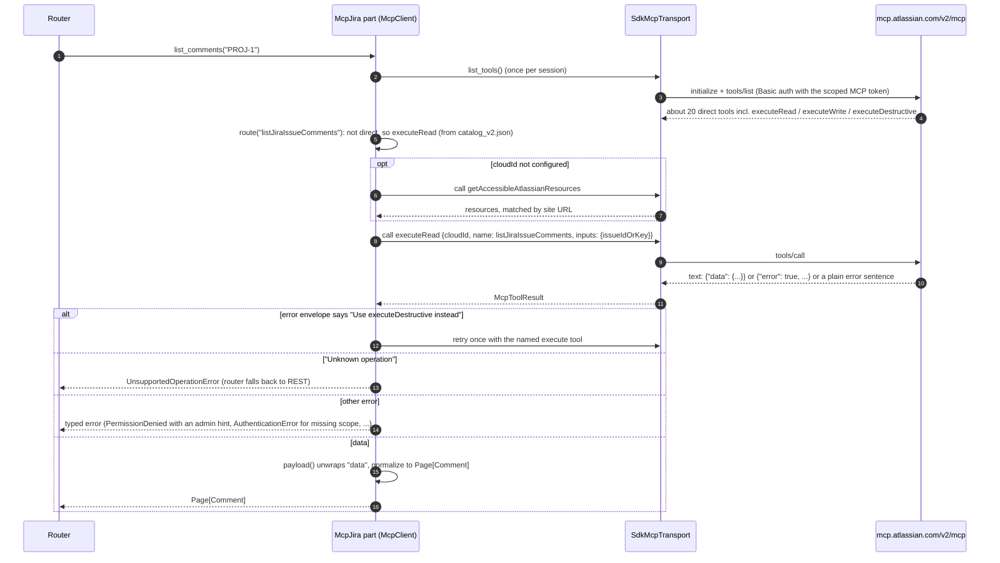

### 2.8 CLI backend call (acli, twg, jira-cli)

`backends/cli/`. The REST component issues a normal `RequestSpec`; the CLI transport turns it into a command.

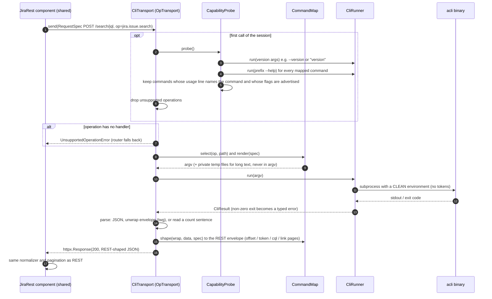

### 2.9 GraphQL stored query and schema check

`backends/graphql/`.

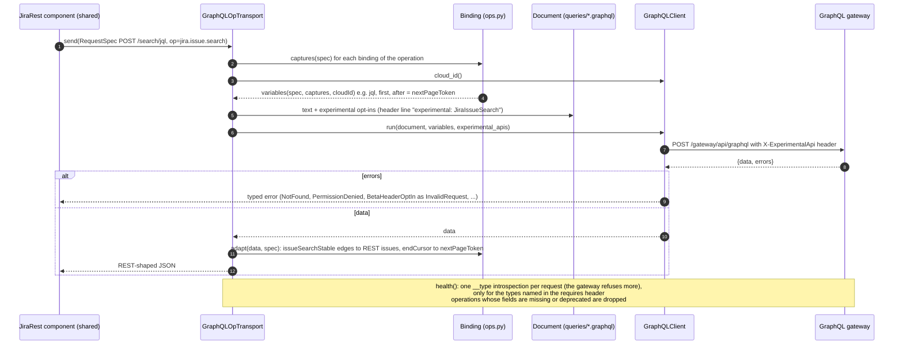

### 2.10 Agent tool call through the MCP server

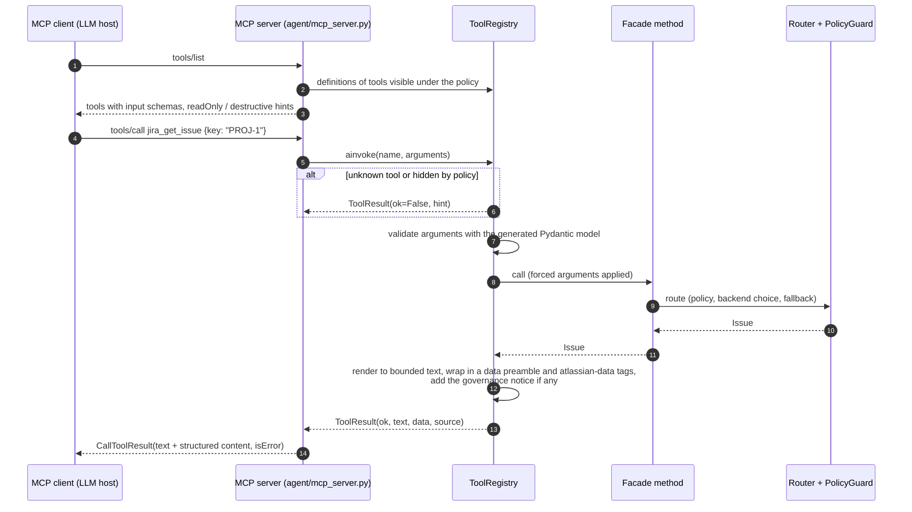

### 2.11 Webhook ingestion and event processing

Receiver front half (`events/receivers/base.py` `QueueEndpoint.handle`) and worker back half (`events/pipeline.py`, `events/enrich.py`).

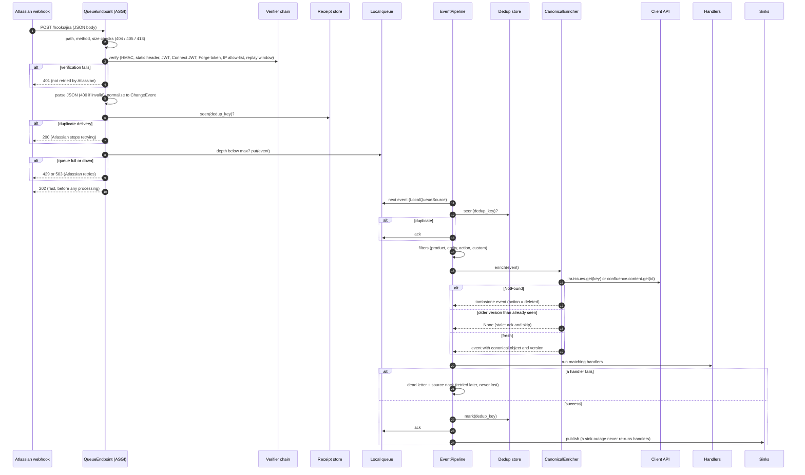

### 2.12 Polling source with checkpoint and overlap

`events/sources/polling.py` (`JqlPollingSource`; `CqlPollingSource` is the same with `lastmodified`). The transport can be REST, ACLI, MCP or GraphQL.

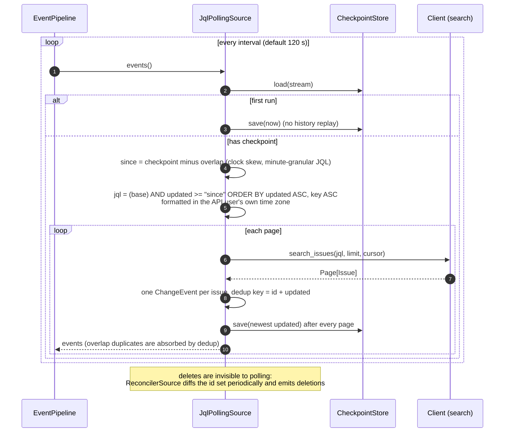

### 2.13 Mirror: initial load, live update, reconcile

`mirror/jira.py` (Confluence is the same shape).

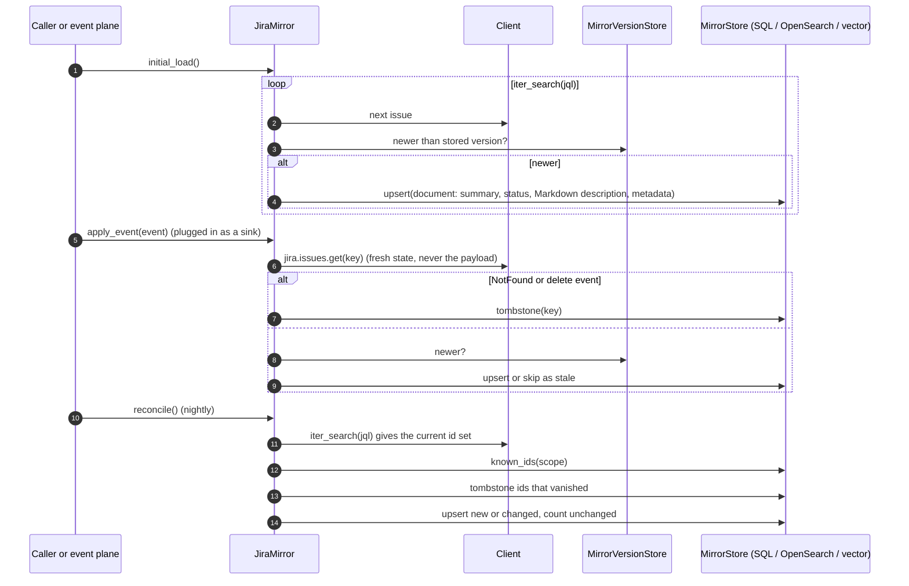

### 2.14 Forge inbox (private network, no public URL)

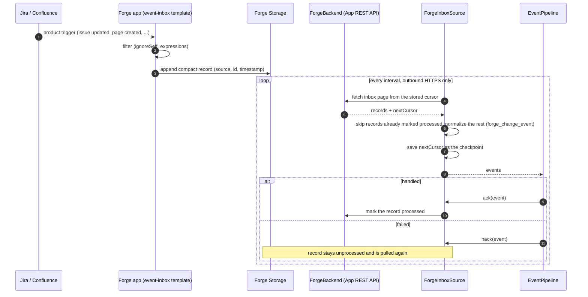

### 2.15 Slack Socket Mode source

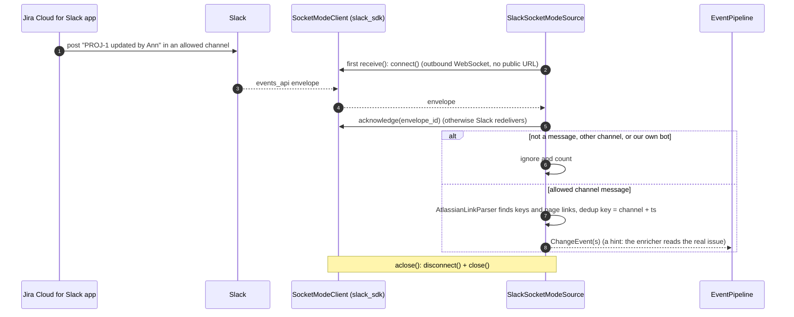

---

## Part 3: Extension points

| You want to... | Do this |
|---|---|
| **Add a backend** | Implement the parts (protocols) and a `BackendFactory` (`kind`, `deployments`, `availability`, `create`). Register it with `BackendRegistry.register()` or ship it as a package with an entry point in the group `atlian_assiant.backends`. Declare its cells in `matrix.py` and section 11 of the design; `tests/contract/test_matrix_matches_design.py` keeps them equal. |
| **Reuse REST logic over a new medium** | Subclass `OpBackend` and give `OpTransport` a handler per operation that returns REST-shaped JSON (as the CLI and GraphQL backends do). |
| **Add an operation** | Add it to `operations.py` (id, access class, idempotency), a protocol method, the REST implementation and a facade entry in `tools/gen_facade.py`; then regenerate (`gen_facade`, `gen_stubs`, `docgen --write`). |
| **Change routing** | `SelectionPolicy.from_preset(preset, overrides={"jira.issue.search": (BackendKind.MCP, BackendKind.REST)})`, or `client.via("mcp")` for one call. |
| **Plug in confirmation** | Any object with `async confirm(PlannedAction) -> bool` (`CallbackConfirmation`, `CliConfirmation`, your UI). |
| **Add an event source or sink** | A source implements `events()`, `ack()`, `nack()`, `aclose()`; a sink implements `publish(event)`. Register new delivery methods in `events/catalog.py`. |
| **Add a mirror store** | Implement `MirrorStore` (`upsert`, `tombstone`, `known_ids`, ...) or a `VectorIndex` + `Embedder`. |

---

## Part 4: Verification status and known gaps

Verified live against a Jira + Confluence Cloud site (October 2026): REST reads, MCP v2 reads, 13 GraphQL read queries, acli and twg command
maps, the blocking client including `index.discover`, and a mirror initial load. Everything else (writes, the event plane, browser, Data
Center, Data Lake, org admin, Forge, jira-cli) is tested against the fakes in `atlian_assiant/testing/` only. See the README status table.

Known gaps worth knowing when reading the code:

* The generated REST tier ships with a **hand-written seed subset** of the OpenAPI specs (48 operations); `python -m tools.codegen --fetch`
  (and the nightly workflow) replaces it with the full specs.
* `client.browser` on the facade is a placeholder that raises a clear error; the browser is reachable as a **backend** through routing.
* The jira-cli backend cannot authenticate yet: the CLI reads `JIRA_API_TOKEN`, and `CliRunner` deliberately strips tokens from the environment.
* Several backends contain flags or field names that are only as good as their last live check; each one re-checks itself at run time
  (`CapabilityProbe` for CLIs, schema `health()` for GraphQL, the recorded catalogue for MCP) and degrades to "unsupported" rather than failing.
