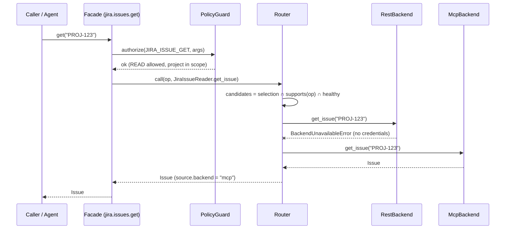
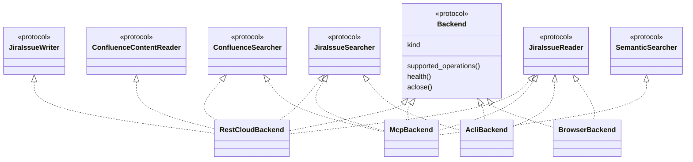
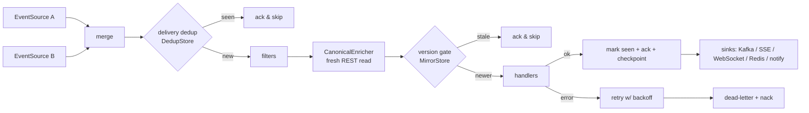

# `AtlassianClient` — Python Architecture Design

**Status:** Design v1.0 (ready for implementation)
**Date:** 2 October 2026
**Target runtime:** Python ≥ 3.11
**Derived from:**

- [atlassian_jira_confluence_data_access_research.md](research/atlassian_jira_confluence_data_access_research.md), cited below as **DA §n**
- [atlassian_webhook_event_stream_private_delivery_research.md](research/atlassian_webhook_event_stream_private_delivery_research.md), cited below as **EV §n**
- [combined_atlassian_integration_flow.md](research/combined_atlassian_integration_flow.md)

> **One-line summary.** `AtlassianClient` is a single, documented facade over **every access method** found in the research
> (REST, Data Center REST, MCP v2, GraphQL, ACLI, TWG CLI, jira-cli, browser automation, Data Lake, Forge, Org Admin, direct DB)
> and **every event-delivery and notification method** in the event research: 49 delivery methods (`DM-01` … `DM-49`)
> covering webhooks, Forge, polling, queues, relays, tunnels, JEC, SSM, Automation, email, Slack, Teams, SMS, RSS, on-call
> and the audit stream. Each has a setup step, a consumer, a verifier and a test, and CI enforces the coverage.
> Each way of doing a task is a **backend** that implements typed **protocols**. A **factory** builds the backends, and a
> **router** picks one for each operation, with fallback. An **agent layer** exposes the same operations as self-describing
> LLM tools under an access policy, so they are safe to use without setup.

---

## Table of contents

1. [Goals, non-goals and design principles](#1-goals-non-goals-and-design-principles)
2. [Requirements traceability (research → design)](#2-requirements-traceability-research--design)
3. [Architecture overview](#3-architecture-overview)
4. [Package layout](#4-package-layout)
5. [Core vocabulary: operations, access, backends](#5-core-vocabulary-operations-access-backends)
6. [Configuration](#6-configuration)
7. [Core infrastructure](#7-core-infrastructure)
8. [Domain models](#8-domain-models)
9. [Protocols (the contracts)](#9-protocols-the-contracts)
10. [Backends (the implementations)](#10-backends-the-implementations)
11. [Operation × backend support matrix](#11-operation--backend-support-matrix)
12. [Factory, registry and routing](#12-factory-registry-and-routing)
13. [The `AtlassianClient` facade](#13-the-atlassianclient-facade)
14. [Event plane](#14-event-plane)
15. [Mirror / sync engine](#15-mirror--sync-engine)
16. [Agent & LLM layer](#16-agent--llm-layer)
17. [Security model](#17-security-model)
18. [Testing strategy](#18-testing-strategy)
19. [Packaging and dependencies](#19-packaging-and-dependencies)
20. [Implementation roadmap](#20-implementation-roadmap)
21. [Architecture decision records](#21-architecture-decision-records)
22. [Items to verify against live documentation](#22-items-to-verify-against-live-documentation)

---

## 1. Goals, non-goals and design principles

### 1.1 Goals

| # | Goal |
|---|---|
| G1 | Support **every access method and API family** covered by the research, for Jira Platform, Jira Software, JSM, Confluence, Teamwork Graph, Org Admin and Data Lake. |
| G2 | When a task can be done in several ways, **implement all of them** as interchangeable backends behind one typed protocol. |
| G3 | Use **protocols** (structural typing) for contracts and the **factory pattern** to build and select concrete sub-clients. |
| G4 | **Agent-ready without setup.** Any LLM or agent can discover, understand and call the client safely, via Python, JSON-schema tools, or an MCP server. |
| G5 | Make the **event-driven read-and-react** flow (EV §51) a first-class part of the client: the event is a signal, REST is the source of truth, and reconciliation guarantees correctness. |
| G6 | **Every event and notification method in the event research is implemented.** There are 49 delivery methods; each has a provisioner, a consumer, an end-to-end verifier and a contract test, and CI checks them against the research document (§14). The no-public-URL options are chosen automatically from stated requirements. |
| G7 | **Cloud and Data Center** from one API; cloud-only features fail with a clear error on DC. |
| G8 | Cover **"every API"** in two tiers: curated high-level operations plus a **generated client from Atlassian's OpenAPI files** for the long tail (DA §31). |

### 1.2 Non-goals

- Running inside the Forge runtime. Forge executes JavaScript/TypeScript, so the design ships a **generated Forge companion app** that Python scaffolds, deploys and consumes (§14.6).
- Reverse-engineering private browser XHR or GraphQL calls (DA §13). The browser backend reads only the rendered UI and uses native exports.
- Pretending Atlassian offers a Kafka, AMQP or SSE product feed. None is documented (EV §48). Requests for one are refused with a hint, and the client provides an **internal** stream through sinks instead (§14.12, §14.17).

### 1.3 Design principles

1. **Protocols over inheritance.** Backends satisfy `typing.Protocol` contracts structurally. Third-party backends and test fakes need no base class.
2. **Route per operation.** MCP, the CLIs and GraphQL each cover only part of REST, so the router decides for each operation, not for each protocol.
3. **Never silently duplicate a write.** Fallback to another backend happens only when nothing was sent (§12.4).
4. **Events are signals.** Canonical state always comes from a fresh read (EV §51). Payloads are kept for audit but never trusted as the system of record.
5. **Safe defaults for agents.** Read and search only. Writes need confirmation, delete and manage must be enabled explicitly, and Rovo-credit spending must be acknowledged (DA §28, §11).
6. **Opaque, resumable cursors.** Every list operation returns `Page[T]` with an opaque `next_cursor` that pins the backend which produced it.
7. **One source of truth for documentation.** Docstrings → tool schemas → `AGENT_GUIDE.md` → `llms.txt` are generated from the same metadata, and CI fails on drift.
8. **Async-first, sync-friendly.** The core is `async`; `AtlassianClient` is a generated synchronous mirror.
9. **Honest capability reporting.** `client.describe()` states what is configured, what is missing, and why.
10. **No secrets in logs, URLs or tool output.** Ever.

---

## 2. Requirements traceability (research → design)

| Research finding | Ref | Design component |
|---|---|---|
| Basic auth (email + API token), OAuth 2.0 3LO, Forge-managed auth | DA §2.1 | `core/auth`: `BasicTokenAuth`, `OAuth3LOAuth`; Forge via companion app (§10.10) |
| Direct site URL vs `api.atlassian.com/ex/{product}/{cloudId}` gateway | DA §2.1.2 | `core/urls.UrlResolver` |
| Jira Platform REST v3, all resource groups | DA §3.1 | `backends/rest_cloud/jira_platform.py` (curated) + `jira.api.*` (generated) |
| Enhanced JQL `/search/jql`, `nextPageToken`, `reconcileIssues`; legacy `/search` removed | DA §3.1 | `NextPageTokenPagination`; `search_issues(reconcile_issue_ids=…)`; legacy endpoint never used |
| JQL helper APIs (autocomplete, parse, sanitize, match, pdcleaner) | DA §3.1 | `JiraJqlTools` protocol |
| ADF rich text | DA §3.1 | `formats/adf.py` (ADF ⇄ Markdown ⇄ text) |
| Jira Software Agile + DevOps APIs | DA §3.2 | `JiraAgileReader/Writer`; DevOps groups through the generated tier |
| JSM `/rest/servicedeskapi` | DA §3.3 | `JsmReader/JsmWriter` |
| Confluence v2 (pages, blogs, whiteboards, databases, folders, …), cursor pagination | DA §4.1 | `Confluence*` protocols; `LinkCursorPagination` |
| Confluence v1 CQL search; "search IDs, then batch-fetch bodies" | DA §4.2 | `ConfluenceSearcher`; `SearchThenHydrate` helper |
| Per-API pagination | DA §5.1 | `core/pagination` strategy family |
| Points quotas, burst limits, per-issue write limits, `Retry-After` | DA §5.2 | `RetryPolicy`, `RateLimitObserver`, `IssueWriteSerializer` |
| Jira/Confluence incremental mirror recipes | DA §6 | `mirror/` engine (§15) |
| Atlassian MCP v2, primary + deferred tools, permission groups, OAuth 2.1 / API token / service-account key | DA §7–11 | `backends/mcp`; `Access` enum mirrors permission groups; MCP tool map (§10.3) |
| Teamwork Graph and Rovo search (costs credits) | DA §11 | `TeamworkGraphReader`, `SemanticSearcher`; `Operation.consumes_credits` |
| MCP vs REST guidance | DA §12 | Selection presets `SERVICE` / `AGENT` (§12.3) |
| Integrated browser / computer use | DA §13 | `backends/browser` (Playwright, read and export only by default) |
| ACLI | DA §14 | `backends/cli/acli.py` |
| TWG CLI | DA §15 | `backends/cli/twg.py` |
| Community jira-cli; curl/HTTPie | DA §16 | `backends/cli/jira_cli.py`; `RawRequester` |
| Atlassian GraphQL Gateway | DA §17 | `backends/graphql` |
| Forge `requestJira` / `requestConfluence` / `requestGraph` | DA §18 | `forge_templates/` (JS) + `backends/forge` (Python side) |
| Webhooks + Automation | DA §19–20 | Event plane (§14) + `AutomationClient` |
| Data Lake / data shares (Delta Sharing), **not row-level permissioned** | DA §21, §26 | `backends/datalake`; `Access.ANALYTICS`, off by default |
| Native exports | DA §22 | `ExportsClient` (REST / MCP / ACLI / browser) |
| Data Center REST / PAT | DA §23 | `backends/rest_dc` |
| Direct DB (DC only, discouraged) | DA §24 | `backends/database` (read-only, opt-in, version-pinned) |
| Reference architectures (service, agent, analytics) | DA §27–29 | Presets + mirror + agent layer |
| OpenAPI as operation-level truth; regenerate in CI | DA §30–31, §33 | `tools/codegen` + API-drift CI job |
| **Every** event and notification mechanism, EV §1–§63: webhooks (admin UI, admin REST, dynamic, Connect), failed replay, Forge (native, inbox, dynamic, remote, realtime), org audit (API, stream, webhooks, exclusions), Automation (web request, SNS/SQS, SSM, JEC, email, Slack, Teams, Twilio, other connectors), notification schemes, custom events, watchers, filter subscriptions, RSS, Slack/Teams apps, JSM on-call, JQL/CQL polling, reconciliation, managed relays (AWS, Azure, GCP, Cloudflare, brokers), tunnels, DC webhooks, MCP, non-paths, blueprints, PoCs | EV | **Delivery-method ledger §14.2**: 49 methods (`DM-01` … `DM-49`) + 15 cross-cutting rules (`CC-01` … `CC-15`). All 63 research sections are mapped and CI-enforced (§14.19). |

---

## 3. Architecture overview

### 3.1 Layer diagram

```text
┌─────────────────────────────────────────────────────────────────────────────────────────┐
│  CONSUMERS: Python apps · AI agents (Claude, GPT, …) · MCP clients · shell / CI         │
└───────────────┬───────────────────────────┬──────────────────────────┬──────────────────┘
                │ Python API                 │ JSON tools               │ MCP (stdio/http)
┌───────────────▼───────────────────────────▼──────────────────────────▼──────────────────┐
│  AGENT LAYER   ToolRegistry · AccessPolicy · ConfirmationHandler · describe()/help()    │
├─────────────────────────────────────────────────────────────────────────────────────────┤
│  FACADE        AtlassianClient (sync) ⇄ AsyncAtlassianClient                            │
│                .jira  .jsm  .confluence  .graph  .analytics  .exports  .automation      │
│                .admin  .webhooks  .events  .notifications  .mirror  .browser  .raw  .tools│
├─────────────────────────────────────────────────────────────────────────────────────────┤
│  ROUTING       Router · SelectionPolicy (presets) · CircuitBreaker · PolicyGuard        │
├─────────────────────────────────────────────────────────────────────────────────────────┤
│  CONTRACTS     typing.Protocol per capability (JiraIssueReader, ConfluenceSearcher …)   │
├─────────────────────────────────────────────────────────────────────────────────────────┤
│  BACKENDS      rest · rest_dc · mcp · graphql · acli · twg · jira_cli · browser ·       │
│  (Adapters)    data_lake · org_admin · forge · database        ← built by BackendFactory│
├─────────────────────────────────────────────────────────────────────────────────────────┤
│  CORE          HttpTransport · Auth strategies · UrlResolver/CloudIdResolver ·          │
│                Pagination strategies · Retry/RateLimit · Errors · Formats (ADF/Storage) │
│                Field/User resolvers · Cache · Telemetry/Redaction · CliRunner           │
├─────────────────────────────────────────────────────────────────────────────────────────┤
│  EVENT PLANE   Delivery-method catalog (DM-01…DM-49) · Provisioners · EventSources ·    │
│                Webhook endpoints + verifiers · Pipeline · Enricher · Sinks · Stores ·   │
│                Reconciler · Blueprints/planner · Guards · PoC harness · Mirror          │
└─────────────────────────────────────────────────────────────────────────────────────────┘
```

### 3.2 Design patterns used

| Pattern | Where | Why |
|---|---|---|
| **Protocol (structural interface)** | `protocols/*` | Contracts without inheritance; easy fakes; third-party backends |
| **Abstract Factory** | `BackendFactory`, `ClientFactory` | Builds coherent backend families from config |
| **Registry + plugin entry points** | `BackendRegistry` | Backends can live in separate packages |
| **Strategy** | Auth, pagination, retry, selection, verifiers, body formats | Swap behaviour per API surface |
| **Chain of Responsibility** | `Router` fallback across candidate backends | "Many ways to do a task" |
| **Facade** | `AtlassianClient` namespaces | One discoverable entry point |
| **Adapter** | Every backend (MCP tool → protocol method, CLI argv → protocol method) | Uniform interface over heterogeneous tools |
| **Proxy** | `SyncProxy` (sync over async), `PolicyGuard` | Cross-cutting concerns |
| **Decorator** | `@agent_tool`, `@operation` | Metadata for tools/docs/routing |
| **Template Method** | `PollingSource` base (JQL/CQL/RSS/events-stream) | Shared checkpoint and overlap logic |
| **Observer / pub-sub** | `EventPipeline.on(...)` handlers | Event dispatch |
| **Repository** | `CheckpointStore`, `DedupStore`, `MirrorStore` | Pluggable persistence |
| **Circuit Breaker** | `CircuitBreaker` in router | Skip unhealthy backends during fallback |

### 3.3 Request lifecycle (single operation)



---

## 4. Package layout

```text
atlian_assiant/
├── __init__.py                 # AtlassianClient, AsyncAtlassianClient, ClientFactory, from_env, Preset
├── _version.py
├── capabilities.py             # Access, BackendKind, Product, Deployment, Operation
├── operations.py               # Canonical operation catalog (single source of truth)
├── config.py                   # AtlassianConfig (pydantic-settings), profiles, SecretProvider
├── factory.py                  # BackendFactory protocol, BackendRegistry, ClientFactory, presets
├── routing.py                  # Router, SelectionPolicy, CircuitBreaker
├── policy.py                   # AccessPolicy, PolicyGuard, ConfirmationHandler, PlannedAction
├── facade/
│   ├── client.py               # AsyncAtlassianClient
│   ├── sync.py                 # AtlassianClient + SyncProxy (+ generated .pyi stubs)
│   ├── jira.py  jsm.py  confluence.py  graph.py  analytics.py  exports.py
│   ├── automation.py  admin.py  webhooks.py  events.py  mirror.py  browser.py  raw.py
├── protocols/
│   ├── base.py                 # Backend, BackendHealth
│   ├── jira.py  agile.py  jsm.py  confluence.py  graph.py  analytics.py
│   ├── exports.py  admin.py  automation.py  webhooks.py  raw.py  identity.py
├── models/
│   ├── common.py               # Page[T], SourceRef, UserRef, BodyInput, Tombstone
│   ├── jira.py  jsm.py  confluence.py  graph.py  admin.py  events.py
├── core/
│   ├── http.py                 # HttpTransport (httpx.AsyncClient wrapper)
│   ├── auth/                   # basic.py oauth3lo.py oauth21.py bearer.py pat.py org_key.py
│   ├── urls.py                 # ApiSurface, UrlResolver, CloudIdResolver
│   ├── pagination.py           # strategies + Cursor codec
│   ├── retry.py  ratelimit.py  concurrency.py
│   ├── errors.py               # error hierarchy with hints
│   ├── resolvers.py            # FieldResolver, UserResolver, SpaceResolver
│   ├── cache.py  telemetry.py  redaction.py
│   └── cli_runner.py           # subprocess runner + capability probe (ACLI/TWG/jira-cli)
├── formats/
│   ├── adf.py                  # ADF ⇄ Markdown ⇄ plain text
│   ├── storage.py              # Confluence storage (XHTML) ⇄ Markdown, macro placeholders
│   └── render.py               # to_agent_text() renderers with truncation
├── backends/
│   ├── rest_cloud/             # jira_platform.py agile.py jsm.py confluence_v2.py confluence_v1.py
│   │   │                       # webhooks.py exports.py automation.py identity.py
│   │   └── generated/          # OpenAPI-generated low-level clients (every operation)
│   ├── rest_dc/                # jira.py confluence.py webhooks.py
│   ├── mcp/                    # session.py tool_map.py mappers.py backend.py
│   ├── graphql/                # backend.py
│   ├── cli/                    # acli.py twg.py jira_cli.py command_maps/*.yaml
│   ├── browser/                # session.py jira.py confluence.py exports.py selectors.yaml
│   ├── datalake/               # delta_sharing backend
│   ├── org_admin/              # events API
│   ├── forge/                  # app_rest.py remote.py subscriptions.py cli_runner.py
│   └── database/               # DC read-only SQL (opt-in)
├── events/
│   ├── catalog.py              # DeliveryMethod DM-01…DM-49 + CrossCuttingRule CC-01…CC-15 (§14.19)
│   ├── config.py               # EventPlaneConfig (§14.3)
│   ├── model.py                # ChangeEvent, EntityType, ChangeAction, EventSourceKind
│   ├── normalize.py            # native event name → (entity, action) tables (§14.11)
│   ├── provision/              # one EventProvisioner per method family (§14.3)
│   ├── sources/                # one module per EventSource (§14.4)
│   ├── receivers/              # WebhookEndpoint impls, verifiers, URL preflight, ASGI/FastAPI/Flask adapters
│   ├── automation.py           # AutomationRuleTemplate + PayloadMapping (§14.7)
│   ├── human/                  # AtlassianLinkParser + IMAP/Slack/Teams/Twilio/RSS/JSM Ops consumers (§14.10)
│   ├── sinks/                  # Kafka, Redis Streams, SSE, WebSocket, webhook-forward, notify sinks (§14.12)
│   ├── pipeline.py  enrich.py  reconcile.py  planner.py  guards.py  verify.py  poc.py  references.py
│   └── stores/                 # memory, sqlite, redis, postgres (checkpoint/dedup/queue/DLQ)
├── mirror/                     # JiraMirror, ConfluenceMirror, MirrorStore
├── relay/                      # aws_lambda.py azure_function.py gcp_function.py cloudflare_worker/ + IaC templates
├── tunnels/                    # ngrok.py cloudflared.py (DM-44)
├── connect/                    # legacy Connect descriptor, lifecycle, JWT (DM-04)
├── agent/
│   ├── tools.py                # @agent_tool, ToolSpec, ToolRegistry, ToolResult
│   ├── exporters.py            # anthropic / openai / json-schema / mcp formats
│   ├── mcp_server.py           # `atlian-assiant mcp serve`
│   ├── describe.py             # capability manifest
│   └── docs/AGENT_GUIDE.md  llms.txt
├── forge_templates/
│   └── event-inbox/            # Forge app (JS): modes native | inbox | remote | realtime panel (§14.6)
├── testing/                    # FakeBackend (all protocols), fixtures, respx helpers
└── cli.py                      # `atlian-assiant` command-line entry point
tools/
├── codegen.py                  # OpenAPI → generated/ + operations index
└── docgen.py                   # docstrings → AGENT_GUIDE.md, llms.txt, operations.md, DM ledger
docs/research/                  # vendored research documents (input to the coverage test)
tests/events/methods/           # test_dm_01.py … test_dm_49.py (one contract test per delivery method)
```

---

## 5. Core vocabulary: operations, access, backends

### 5.1 Enumerations

```python
# atlian_assiant/capabilities.py
from __future__ import annotations

from dataclasses import dataclass, field
from enum import StrEnum


class Access(StrEnum):
    """Permission class of an operation. Mirrors Atlassian MCP v2 permission groups (DA §9–11)."""

    READ = "read"            # read_jira / read_confluence / read:all:twg
    SEARCH = "search"        # search_jira / search_confluence / search_rovo
    WRITE = "write"          # write_jira / write_confluence / write:all:twg
    DELETE = "delete"        # delete_jira (admin must enable in MCP)
    MANAGE = "manage"        # manage_jira (projects, workflows, screens)
    ORG_ADMIN = "org_admin"  # organization audit / admin APIs
    ANALYTICS = "analytics"  # Data Lake: NOT row-level permissioned (DA §21)


class BackendKind(StrEnum):
    REST = "rest"            # Cloud REST: Jira v3, Agile, JSM, Confluence v2 + v1/CQL
    REST_DC = "rest_dc"      # Data Center / Server REST
    MCP = "mcp"              # https://mcp.atlassian.com/v2/mcp
    GRAPHQL = "graphql"      # Atlassian GraphQL Gateway
    ACLI = "acli"            # official Atlassian CLI (Jira)
    TWG = "twg"              # Teamwork Graph CLI
    JIRA_CLI = "jira_cli"    # community ankitpokhrel/jira-cli
    BROWSER = "browser"      # Playwright UI automation over a signed-in session
    DATA_LAKE = "data_lake"  # Delta Sharing data shares
    ORG_ADMIN = "org_admin"  # api.atlassian.com/admin
    FORGE = "forge"          # Forge App REST API / Forge Remote
    DATABASE = "database"    # DC direct DB: read-only, opt-in, discouraged


class Product(StrEnum):
    JIRA = "jira"
    JIRA_SOFTWARE = "jira_software"
    JSM = "jsm"
    CONFLUENCE = "confluence"
    PLATFORM = "platform"    # graph, org admin, analytics


class Deployment(StrEnum):
    CLOUD = "cloud"
    DATA_CENTER = "data_center"


@dataclass(frozen=True, slots=True)
class Operation:
    """Canonical, backend-independent identity of one task (e.g. "jira.issue.get")."""

    id: str
    product: Product
    access: Access
    summary: str
    idempotent: bool = True          # governs retry and fallback rules (§12.4)
    consumes_credits: bool = False   # Rovo / Teamwork Graph enrichment (DA §11)
    cloud_only: bool = False         # MCP, TWG, Data Lake, Org Admin, Forge
    tags: frozenset[str] = field(default_factory=frozenset)
```

### 5.2 Operation catalog (`operations.py`)

The operation catalog is the **single source of truth**. Routing, policy, tool schemas, docs and the support matrix (§11) are all keyed by `Operation.id`.

```python
# atlian_assiant/operations.py (excerpt)
from .capabilities import Access, Operation, Product

J, JS, SM, C, P = Product.JIRA, Product.JIRA_SOFTWARE, Product.JSM, Product.CONFLUENCE, Product.PLATFORM

JIRA_ISSUE_GET = Operation("jira.issue.get", J, Access.READ, "Fetch one issue by key or id")
JIRA_ISSUE_SEARCH = Operation("jira.issue.search", J, Access.SEARCH, "Search issues with JQL")
JIRA_ISSUE_COUNT = Operation("jira.issue.count", J, Access.SEARCH, "Approximate JQL match count")
JIRA_ISSUE_CREATE = Operation("jira.issue.create", J, Access.WRITE, "Create an issue", idempotent=False)
JIRA_ISSUE_TRANSITION = Operation("jira.issue.transition", J, Access.WRITE, "Move issue through workflow", idempotent=False)
JIRA_ISSUE_DELETE = Operation("jira.issue.delete", J, Access.DELETE, "Delete an issue")
JIRA_PROJECT_CREATE = Operation("jira.project.create", J, Access.MANAGE, "Create a project", idempotent=False)
JIRA_SPRINT_LIST = Operation("jira.agile.sprint.list", JS, Access.READ, "List sprints of a board")
JSM_REQUEST_SLA = Operation("jsm.request.sla", SM, Access.READ, "SLA status of a request")
CONF_CONTENT_GET = Operation("confluence.content.get", C, Access.READ, "Fetch page/blog/whiteboard/... by id")
CONF_SEARCH_CQL = Operation("confluence.search.cql", C, Access.SEARCH, "Search content with CQL")
GRAPH_CONTEXT = Operation("graph.context", P, Access.READ, "Teamwork Graph context", consumes_credits=True, cloud_only=True)
GRAPH_SEMANTIC_SEARCH = Operation("graph.search.semantic", P, Access.SEARCH, "Rovo semantic search", consumes_credits=True, cloud_only=True)
ANALYTICS_LOAD_TABLE = Operation("analytics.table.load", P, Access.ANALYTICS, "Load a Data Lake table", cloud_only=True)
ORG_EVENTS_STREAM = Operation("admin.audit.stream", P, Access.ORG_ADMIN, "Poll org audit events-stream", cloud_only=True)
```

Full catalog, grouped by namespace:

| Namespace | Operation ids |
|---|---|
| `jira.issue.*` | `get`, `search`, `count`, `comments.list`, `comment.add`, `comment.edit`, `comment.delete`, `changelog.list`, `worklogs.list`, `worklog.add`, `transitions.list`, `transition`, `create`, `bulk_create`, `edit`, `assign`, `delete`, `links.list`, `link.create`, `remote_links.list`, `remote_link.create`, `attachments.list`, `attachment.download`, `attachment.upload`, `attachment.delete`, `watchers.list`, `watch`, `property.get`, `property.set`, `hierarchy.convert`, `archive` |
| `jira.project.*` | `list`, `get`, `components.list`, `versions.list`, `version.manage`, `version.related_work`, `create`, `update` |
| `jira.meta.*` | `fields.list`, `issue_types.list`, `create_fields`, `statuses.list`, `priorities.list`, `resolutions.list`, `link_types.list`, `server_info` |
| `jira.user.*` | `myself`, `get`, `search`, `lookup_account_id`, `assignable` |
| `jira.filter.*` / `jira.dashboard.*` | `list`, `get` |
| `jira.jql.*` | `parse`, `sanitize`, `autocomplete`, `suggest`, `match`, `pdcleaner` |
| `jira.expression.*` | `evaluate` |
| `jira.admin.*` | `workflows.list`, `workflow.get`, `workflow.editor_link`, `screen.get`, `screen.update` |
| `jira.agile.*` | `board.list`, `board.get`, `board.config`, `board.issues`, `board.create`, `sprint.list`, `sprint.get`, `sprint.issues`, `sprint.manage`, `backlog.list`, `epic.list`, `issue.rank`, `issue.move_to_sprint` |
| `jsm.*` | `info`, `service_desk.list`, `request_type.list`, `request.list`, `request.get`, `request.create`, `request.comments`, `request.comment.add`, `request.sla`, `request.transition`, `request.approve`, `kb.search`, `organization.list`, `customer.list`, `customer.add` |
| `confluence.content.*` | `get`, `list`, `children`, `ancestors`, `descendants`, `versions`, `version.get`, `diff`, `create`, `update`, `move`, `copy`, `archive`, `unarchive`, `restore_version`, `set_status`, `convert_mode`, `delete`, `macros.resolve`, `export`, `public_link.get`, `public_link.set` |
| `confluence.comment.*` | `list`, `get`, `create`, `update`, `resolve`, `delete` |
| `confluence.attachment.*` | `list`, `get`, `download`, `upload`, `delete` |
| `confluence.label.*` / `.property.*` / `.task.*` / `.reaction.*` / `.watch.*` / `.star.*` | read / add / remove / complete / reopen / watch / unwatch / star / unstar |
| `confluence.permission.*` | `get`, `restrictions.get`, `restrictions.set`, `add`, `remove`, `replace` |
| `confluence.space.*` | `list`, `get`, `personal`, `instructions.get`, `instructions.set`, `permissions.list`, `create` |
| `confluence.search.*` | `cql` |
| `confluence.template.*` | `list`, `get` |
| `confluence.special.*` | `infographic.create/edit`, `maui_app.get/create/edit` (MCP-only features) |
| `graph.*` | `context`, `object.get`, `context.add`, `search.semantic`, `graphql.execute` |
| `analytics.*` | `share.list`, `table.list`, `table.load`, `table.query` |
| `export.*` | `jira.csv`, `confluence.page` (pdf/word/html/markdown), `confluence.space` |
| `automation.*` | `incoming_webhook.trigger` |
| `admin.audit.*` | `list`, `get`, `actions`, `stream` |
| `webhook.*` | `jira.dynamic.{list,register,delete,refresh,failed}`, `jira.admin.{list,register,update,delete}`, `confluence_dc.{list,register,update,delete,test,stats}` |
| `identity.*` | `whoami`, `accessible_resources` |
| `raw.*` | `request`, `paginate`, `generated.call` |

---

## 6. Configuration

### 6.1 `AtlassianConfig`

```python
# atlian_assiant/config.py
from __future__ import annotations

from pathlib import Path

from pydantic import Field, HttpUrl, SecretStr
from pydantic_settings import BaseSettings, SettingsConfigDict

from .capabilities import Access, BackendKind, Deployment


class AtlassianConfig(BaseSettings):
    """All settings for every backend. Unset sections simply disable that backend."""

    model_config = SettingsConfigDict(env_prefix="ATLASSIAN_", env_file=".env", extra="ignore")

    # --- tenancy -------------------------------------------------------------
    deployment: Deployment = Deployment.CLOUD
    site: str | None = None                      # "example.atlassian.net"
    cloud_id: str | None = None                  # resolved automatically when None
    pin_cloud_id: bool = True                    # refuse calls to other cloudIds (DA §7.3)

    # --- Cloud REST auth (pick one) --------------------------------------------
    email: str | None = None
    api_token: SecretStr | None = None           # Basic: email + API token
    service_account_key: SecretStr | None = None # Bearer API key (service account)
    oauth_client_id: str | None = None
    oauth_client_secret: SecretStr | None = None
    oauth_refresh_token: SecretStr | None = None
    oauth_scopes: list[str] = Field(default_factory=list)
    oauth_token_store: Path | None = None        # where rotated refresh tokens are persisted

    # --- MCP ---------------------------------------------------------------------
    mcp_url: HttpUrl = HttpUrl("https://mcp.atlassian.com/v2/mcp")
    mcp_auth: str = "oauth"                      # "oauth" | "api_token" | "service_account"
    mcp_flat_tools: bool = False                 # use ?tools=all flat catalog

    # --- Data Center -------------------------------------------------------------
    jira_dc_base_url: HttpUrl | None = None
    confluence_dc_base_url: HttpUrl | None = None
    pat: SecretStr | None = None                 # DC personal access token
    dc_basic_user: str | None = None             # discouraged fallback
    dc_basic_password: SecretStr | None = None

    # --- Organization admin ------------------------------------------------------
    org_id: str | None = None
    org_api_key: SecretStr | None = None

    # --- Forge companion app ------------------------------------------------------
    forge_app_id: str | None = None
    forge_env_id: str | None = None
    forge_app_rest_base: HttpUrl | None = None   # overrides computed /svc/... URL

    # --- Data Lake ---------------------------------------------------------------
    delta_sharing_profile: Path | None = None

    # --- CLIs / browser / DB ------------------------------------------------------
    acli_path: str = "acli"
    twg_path: str = "twg"
    jira_cli_path: str = "jira"
    browser_profile_dir: Path | None = None      # persistent Playwright profile (human does SSO)
    browser_headless: bool = True
    db_url: SecretStr | None = None              # DC only; requires allow_direct_db
    db_expected_product_version: str | None = None

    # --- Selection & policy -------------------------------------------------------
    preset: str = "service"                      # service | agent | shell | analytics | data_center
    enabled_backends: list[BackendKind] | None = None   # None = every backend that is available
    access: list[Access] = Field(default_factory=lambda: [Access.READ, Access.SEARCH])
    allow_credit_consuming: bool = False
    allow_direct_db: bool = False
    allow_browser_writes: bool = False

    # --- Transport ------------------------------------------------------------------
    timeout_seconds: float = 30.0
    max_concurrency: int = 8
    max_retries: int = 6
    user_agent_suffix: str | None = None
```

### 6.2 Environment variables

| Variable | Purpose |
|---|---|
| `ATLASSIAN_SITE` | `example.atlassian.net` |
| `ATLASSIAN_CLOUD_ID` | Optional; resolved through `/_edge/tenant_info` or `accessible-resources` |
| `ATLASSIAN_DEPLOYMENT` | `cloud` (default) or `data_center` |
| `ATLASSIAN_EMAIL`, `ATLASSIAN_API_TOKEN` | Basic auth (DA §2.1.1) |
| `ATLASSIAN_SERVICE_ACCOUNT_KEY` | Bearer service-account API key (DA §7.3) |
| `ATLASSIAN_OAUTH_CLIENT_ID/_SECRET/_REFRESH_TOKEN/_SCOPES` | OAuth 2.0 3LO (DA §2.1.2) |
| `ATLASSIAN_MCP_URL`, `ATLASSIAN_MCP_AUTH`, `ATLASSIAN_MCP_FLAT_TOOLS` | MCP v2 |
| `ATLASSIAN_JIRA_DC_BASE_URL`, `ATLASSIAN_CONFLUENCE_DC_BASE_URL`, `ATLASSIAN_PAT` | Data Center |
| `ATLASSIAN_ORG_ID`, `ATLASSIAN_ORG_API_KEY` | Org audit APIs |
| `ATLASSIAN_FORGE_APP_ID`, `ATLASSIAN_FORGE_ENV_ID` | Forge App REST inbox |
| `ATLASSIAN_DELTA_SHARING_PROFILE` | Data Lake share profile file |
| `ATLASSIAN_ACLI_PATH`, `ATLASSIAN_TWG_PATH`, `ATLASSIAN_JIRA_CLI_PATH` | CLI binaries |
| `ATLASSIAN_BROWSER_PROFILE_DIR` | Persistent browser profile |
| `ATLASSIAN_PRESET`, `ATLASSIAN_ENABLED_BACKENDS`, `ATLASSIAN_ACCESS` | Selection and policy |
| `AWS_*` (standard chain) | SQS / SNS / SSM sources |

### 6.3 Profiles and secrets

- `~/.config/atlian-assiant/profiles.toml` holds named profiles: `AtlassianClient.from_profile("prod")`.
- A `SecretProvider` protocol resolves secret references such as `secret://keyring/atlassian/prod-token`. Providers: env, OS keyring, file, AWS Secrets Manager, Azure Key Vault, GCP Secret Manager.
- Secrets are `SecretStr` everywhere and are never rendered by `repr`, `describe()`, logs or tool output.

---

## 7. Core infrastructure

### 7.1 API surfaces and URL resolution

```python
# atlian_assiant/core/urls.py
from __future__ import annotations

from enum import StrEnum


class ApiSurface(StrEnum):
    JIRA_PLATFORM = "jira_platform"      # /rest/api/3
    JIRA_AGILE = "jira_agile"            # /rest/agile/1.0
    JSM = "jsm"                          # /rest/servicedeskapi
    JIRA_WEBHOOKS_ADMIN = "jira_wh"      # /rest/webhooks/1.0
    CONFLUENCE_V2 = "confluence_v2"      # /wiki/api/v2
    CONFLUENCE_V1 = "confluence_v1"      # /wiki/rest/api  (CQL, restrictions, export_view …)
    GRAPHQL = "graphql"
    ORG_ADMIN = "org_admin"              # https://api.atlassian.com/admin/v1/orgs/{orgId}
    FORGE_APP_REST = "forge_app_rest"
    DC_JIRA = "dc_jira"                  # {base}/rest/api/2, /rest/agile/1.0, /rest/servicedeskapi
    DC_CONFLUENCE = "dc_confluence"      # {base}/rest/api


class UrlResolver:
    """Builds base URLs. The form depends on the auth strategy (DA §2.1).

    | Surface        | Basic / API token                  | OAuth 3LO / service-account bearer                         |
    |----------------|------------------------------------|------------------------------------------------------------|
    | Jira platform  | https://{site}/rest/api/3          | https://api.atlassian.com/ex/jira/{cloudId}/rest/api/3      |
    | Jira agile     | https://{site}/rest/agile/1.0      | https://api.atlassian.com/ex/jira/{cloudId}/rest/agile/1.0  |
    | JSM            | https://{site}/rest/servicedeskapi | https://api.atlassian.com/ex/jira/{cloudId}/rest/servicedeskapi |
    | Confluence v2  | https://{site}/wiki/api/v2         | https://api.atlassian.com/ex/confluence/{cloudId}/wiki/api/v2 |
    | Confluence v1  | https://{site}/wiki/rest/api       | https://api.atlassian.com/ex/confluence/{cloudId}/wiki/rest/api |
    | GraphQL        | https://{site}/gateway/api/graphql | https://api.atlassian.com/graphql                           |
    """

    def __init__(self, site: str | None, cloud_id: str | None, gateway: bool) -> None:
        self.site, self.cloud_id, self.gateway = site, cloud_id, gateway

    def base(self, surface: ApiSurface) -> str: ...
```

`CloudIdResolver` resolves the cloud id as follows, and caches the result per site:

1. Use the configured `cloud_id` if it is set.
2. With OAuth: `GET https://api.atlassian.com/oauth/token/accessible-resources`, matched by site URL.
3. With Basic auth: `GET https://{site}/_edge/tenant_info`.
4. With MCP: the `getAccessibleAtlassianResources` tool (DA §7.2).

If `pin_cloud_id` is set, every request is checked against the pinned id. API tokens are not bound to a single cloudId (DA §7.3), so this check is enforced client-side.

### 7.2 HTTP transport

```python
# atlian_assiant/core/http.py
from __future__ import annotations

from collections.abc import Mapping
from dataclasses import dataclass, field
from typing import Any

import httpx

from .auth.base import AuthStrategy
from .ratelimit import RateLimitObserver
from .retry import RetryPolicy
from .urls import ApiSurface, UrlResolver


@dataclass(frozen=True)
class RequestSpec:
    method: str
    surface: ApiSurface
    path: str
    params: Mapping[str, Any] = field(default_factory=dict)
    json: Any = None
    content: bytes | None = None
    files: Mapping[str, Any] | None = None
    headers: Mapping[str, str] = field(default_factory=dict)
    idempotent: bool = True
    serialize_key: str | None = None   # e.g. issue key → per-issue write serialization (DA §5.2)


class HttpTransport:
    """The only component that touches the network for HTTP backends.

    Responsibilities: auth injection, URL building, bounded concurrency per surface,
    retry with Retry-After and jitter, rate-limit header observation, 401 refresh-once,
    error mapping (§7.5), redacted telemetry, cloudId pinning.
    """

    def __init__(
        self,
        client: httpx.AsyncClient,
        auth: AuthStrategy,
        urls: UrlResolver,
        retry: RetryPolicy,
        observer: RateLimitObserver,
    ) -> None: ...

    async def send(self, spec: RequestSpec) -> httpx.Response: ...
    async def json(self, spec: RequestSpec) -> Any: ...
    async def stream_download(self, spec: RequestSpec, *, max_bytes: int | None = None) -> bytes: ...
```

### 7.3 Authentication strategies

```python
# atlian_assiant/core/auth/base.py
from __future__ import annotations

from typing import ClassVar, Protocol, runtime_checkable

import httpx

from ..urls import ApiSurface


@runtime_checkable
class AuthStrategy(Protocol):
    scheme: ClassVar[str]
    uses_gateway: ClassVar[bool]         # True → api.atlassian.com/ex/{product}/{cloudId}

    def supports(self, surface: ApiSurface) -> bool: ...
    async def apply(self, request: httpx.Request) -> None: ...
    async def refresh(self) -> bool:
        """Refresh credentials after a 401. Return True if the request should be retried once."""
        ...
```

| Strategy | Header | Surfaces | Source |
|---|---|---|---|
| `BasicTokenAuth(email, api_token)` | `Authorization: Basic b64(email:token)` | Jira, Agile, JSM, Confluence, site GraphQL, MCP (if the admin enabled it) | DA §2.1.1, §7.3 |
| `OAuth3LOAuth(client_id, secret, refresh_token, store)` | `Bearer <access>`; refresh-token rotation persisted | Gateway REST, api GraphQL, Forge App REST | DA §2.1.2 |
| `ServiceAccountKeyAuth(key)` | `Bearer <api_key>` | Gateway REST, MCP | DA §7.3 |
| `OAuth21PkceAuth` | Delegates to the MCP SDK's OAuth client (browser consent, token cache) | MCP | DA §7.3 |
| `ConnectJwtAuth(client_key, shared_secret)` | `Authorization: JWT <HS256 token with qsh>` | Jira REST from a legacy Connect app (dynamic webhooks, DM-04) | EV §4.4 |
| `PersonalAccessTokenAuth(pat)` | `Bearer <pat>` | Data Center REST | DA §23 |
| `DcBasicAuth(user, password)` | Basic | Data Center (discouraged) | DA §23 |
| `OrgApiKeyAuth(key)` | `Bearer <org key>` | Org Admin / events-stream | EV §19 |
| `CliSessionAuth` | None: the CLI manages its own login; the backend only checks status | ACLI, TWG, jira-cli | DA §14–16 |
| `BrowserSessionAuth(profile_dir)` | None: a human completes SSO/MFA in a persistent profile | Browser | DA §13 |
| `DeltaSharingProfileAuth(path)` | Bearer inside the profile file | Data Lake | DA §21 |
| `AwsCredentialChain` | boto3 default chain | SQS / SNS / SSM | EV §23–24 |

### 7.4 Pagination strategies

There is no universal paginator (DA §5.1). Each endpoint declares its strategy, and callers only ever see `Page[T]` with an **opaque cursor**.

```python
# atlian_assiant/core/pagination.py
from __future__ import annotations

import base64
import json
from dataclasses import dataclass
from typing import Any, Protocol

import httpx

from ..capabilities import BackendKind
from .http import RequestSpec


@dataclass(frozen=True)
class Cursor:
    """Opaque to callers. Pins the backend and strategy that produced it."""

    backend: BackendKind
    strategy: str
    state: dict[str, Any]

    def encode(self) -> str:
        raw = json.dumps({"b": self.backend, "s": self.strategy, "x": self.state}).encode()
        return base64.urlsafe_b64encode(raw).decode()

    @classmethod
    def decode(cls, token: str) -> "Cursor":
        data = json.loads(base64.urlsafe_b64decode(token.encode()))
        return cls(BackendKind(data["b"]), data["s"], data["x"])


class PaginationStrategy(Protocol):
    name: str

    def first(self, spec: RequestSpec, limit: int) -> RequestSpec: ...
    def parse(self, response: httpx.Response) -> tuple[list[dict[str, Any]], dict[str, Any] | None, int | None]:
        """Return (items, next_state or None, total if reported)."""
        ...
    def next(self, spec: RequestSpec, state: dict[str, Any]) -> RequestSpec: ...
```

| Strategy | Used by | Mechanics |
|---|---|---|
| `OffsetPagination` | Jira classic list endpoints, Agile | `startAt`/`maxResults`; stop on `isLast` or `startAt+len >= total` |
| `NextPageTokenPagination` | `POST /rest/api/3/search/jql` | Pass `nextPageToken` back; no total |
| `JsmPagination` | `/rest/servicedeskapi/*` | `start`/`limit`/`isLastPage` |
| `LinkCursorPagination` | Confluence v2 | Follow `_links.next` or the `Link` header verbatim; never edit the cursor (DA §4.1) |
| `CqlPagination` | Confluence v1 search | `start`/`limit` + `_links.next`; body expansion may shrink pages, so use search-then-hydrate (DA §4.2) |
| `OrgEventsCursorPagination` | `/events`, `/events-stream` | Cursor from `meta.next`/`links`; the last page still returns a cursor (EV §19) |
| `CliPagination` | ACLI `--paginate`, jira-cli paging flags | Delegated to the CLI |
| `McpPagination` | MCP tools | Tool-specific cursor or `startAt` arguments, mapped per tool |
| `DcOffsetPagination` | DC REST | `startAt`/`maxResults` (Jira), `start`/`limit` (Confluence) |

### 7.5 Errors (agent-readable)

Every error carries a `hint` written for an LLM: what went wrong and what to try next.

```python
# atlian_assiant/core/errors.py
from __future__ import annotations

from dataclasses import dataclass, field
from typing import Any


@dataclass
class AtlassianError(Exception):
    message: str
    hint: str | None = None
    status: int | None = None
    operation: str | None = None
    backend: str | None = None
    request_id: str | None = None         # from response headers when present
    retryable: bool = False
    details: dict[str, Any] = field(default_factory=dict)  # Atlassian errorMessages / errors

    def __str__(self) -> str:
        return f"{self.message}" + (f" — hint: {self.hint}" if self.hint else "")


class ConfigurationError(AtlassianError): ...
class AuthenticationError(AtlassianError): ...          # 401
class PermissionDeniedError(AtlassianError): ...        # 403, or MCP scope/permission-group disabled
class NotFoundError(AtlassianError): ...                # 404 (Atlassian also returns 404 when you lack permission)
class ConflictError(AtlassianError): ...                # 409 (e.g. Confluence version conflict)
class InvalidRequestError(AtlassianError): ...          # 400 / 422 — includes field errors
class RateLimitedError(AtlassianError):                  # 429 after retries are exhausted
    retry_after: float | None = None
class ServerError(AtlassianError): ...                  # 5xx after retries
class UnsupportedOperationError(AtlassianError): ...    # this backend cannot do this op → router falls back
class BackendUnavailableError(AtlassianError): ...      # deps/creds/health missing; nothing was sent → fallback
class NoBackendAvailableError(AtlassianError): ...      # aggregate of all attempts
class DeploymentMismatchError(AtlassianError): ...      # cloud-only op on Data Center
class PolicyDeniedError(AtlassianError): ...            # AccessPolicy forbids it
class ConfirmationDeclinedError(AtlassianError): ...
class AmbiguousReferenceError(AtlassianError): ...      # "Story Points" matches 2 fields; candidates in details
class WebhookVerificationError(AtlassianError): ...
class CliExecutionError(AtlassianError): ...
```

Example hints:

| Situation | Hint |
|---|---|
| 404 on issue | "Issue not found **or** you lack Browse permission. Verify the key with `jira_search_issues` using `key = X`." |
| 400 on JQL | "JQL invalid: `<field>` does not exist. Call `jira_validate_jql` or `jira_list_fields`." |
| Legacy search requested | "`/rest/api/3/search` is being removed; this client uses `/search/jql`." |
| Confluence 409 | "Page version changed. Re-fetch with `confluence_get_page` and retry with `version = current + 1`." |
| MCP 403 on delete | "MCP `delete_jira` group is disabled by default; an org admin must enable it, or use the REST backend." |
| Policy denial | "Write access is not enabled for this session. Ask the user to allow WRITE." |

### 7.6 Retry, rate limits and concurrency

```python
# atlian_assiant/core/retry.py
from __future__ import annotations

import random
from dataclasses import dataclass


@dataclass(frozen=True)
class RetryPolicy:
    max_attempts: int = 6
    base_delay: float = 1.0
    max_delay: float = 60.0
    retry_statuses: frozenset[int] = frozenset({429, 502, 503, 504})
    retry_non_idempotent_on: frozenset[int] = frozenset({429})  # 429 means the request was not processed

    def delay(self, attempt: int, retry_after: float | None) -> float:
        if retry_after is not None:
            return retry_after + random.uniform(0, 1.0)
        return min(self.max_delay, self.base_delay * 2**attempt) * random.uniform(0.5, 1.0)
```

- **`RateLimitObserver`** parses `Retry-After`, `RateLimit-Reason`, `X-RateLimit-*` and `Beta-Retry-After` headers (DA §5.2). It feeds an adaptive per-surface throttle and exports metrics.
- **`ConcurrencyLimiter`** keeps one semaphore per surface (defaults: Jira 8, Confluence 8, GraphQL 4, MCP 4, CLI 2, browser 1).
- **`IssueWriteSerializer`** serializes writes to the same issue key with a keyed `anyio.Lock`, to respect per-issue write limits (DA §5.2).

### 7.7 Rich-text formats

```python
# atlian_assiant/models/common.py (excerpt)
from __future__ import annotations

from typing import Any, Literal

from pydantic import BaseModel


class BodyInput(BaseModel):
    """Rich text for writes. A plain `str` passed to any write method means Markdown."""

    format: Literal["markdown", "plain", "adf", "storage", "wiki"] = "markdown"
    value: str | dict[str, Any]
```

| Converter | Direction | Notes |
|---|---|---|
| `formats.adf.AdfConverter` | ADF ⇄ Markdown, ADF → plain text | Jira v3 descriptions and comments; mentions → `@[Name](accountId)`; unknown nodes preserved as fenced JSON |
| `formats.storage.StorageConverter` | Storage XHTML ⇄ Markdown | Confluence; macros become `<!-- macro:name {...} -->` placeholders and round-trip unchanged |
| Confluence `atlas_doc_format` | ADF ⇄ Markdown | v2 `body-format=atlas_doc_format` |
| `formats.render` | Any model → compact Markdown for agents | Applies `max_chars` with an explicit `…[truncated N chars]` marker |

### 7.8 Resolvers and cache

- **`FieldResolver`**: maps `"Story Points"` → `customfield_10016` per project and issue type, using `/rest/api/3/field` and create-metadata. Raises `AmbiguousReferenceError` with candidates when a name is not unique. Agents use names; the wire uses ids.
- **`UserResolver`**: maps an email or display name → `accountId` (Cloud) or `username`/`key` (DC). Account ids are preferred over mutable names (DA §27).
- **`SpaceResolver`**: maps a Confluence space key ⇄ space id. v2 needs ids; humans use keys.
- **`MetadataCache`**: TTL cache keyed by `(cloudId, surface, path)` for fields, projects, statuses, issue types and spaces. Invalidated by events such as `project_updated` and `issuetype_updated`.

### 7.9 Sync ⇄ async bridge

The core is `async` (httpx, anyio). `AtlassianClient` is a synchronous mirror built by `SyncProxy`. It runs on an `anyio` blocking portal thread, preserves docstrings, and turns async iterators into sync iterators.

```python
# atlian_assiant/facade/sync.py (excerpt)
from __future__ import annotations

import functools
import inspect
from collections.abc import Iterator
from typing import Any

from anyio.from_thread import BlockingPortal


class SyncProxy:
    """Wraps an async namespace so every coroutine method becomes blocking."""

    def __init__(self, target: Any, portal: BlockingPortal) -> None:
        self._target, self._portal = target, portal

    def __getattr__(self, name: str) -> Any:
        attr = getattr(self._target, name)
        if inspect.iscoroutinefunction(attr):
            @functools.wraps(attr)
            def call(*args: Any, **kwargs: Any) -> Any:
                return self._portal.call(functools.partial(attr, *args, **kwargs))
            return call
        if inspect.isasyncgenfunction(attr):
            @functools.wraps(attr)
            def iterate(*args: Any, **kwargs: Any) -> Iterator[Any]:
                agen = attr(*args, **kwargs)
                while True:
                    try:
                        yield self._portal.call(agen.__anext__)
                    except StopAsyncIteration:
                        return
            return iterate
        if getattr(attr, "__namespace__", False):
            return SyncProxy(attr, self._portal)
        return attr
```

`tools/docgen.py` also emits `facade/sync.pyi` stubs with the same signatures as the async methods but without `async`. IDEs, type checkers and LLMs reading the source then see accurate sync signatures.

### 7.10 Telemetry and redaction

- Structured logging through `logging` with a `RedactingFilter`. It masks `Authorization`, `token`, `api_key`, `password`, `secret`, cookie values and any configured `SecretStr`.
- OpenTelemetry spans (optional extra) named `atlassian.<operation.id>`, with attributes for backend, surface, status, attempt and rate-limit remaining. Request and response bodies are never recorded by default (DA §27 rule 10).
- `client.on_request` / `client.on_response` hooks for custom audit.

---

## 8. Domain models

All models are pydantic v2. They are **normalized across backends**, keep the original payload in `raw` (excluded from dumps by default), and know how to render themselves for an LLM.

```python
# atlian_assiant/models/common.py
from __future__ import annotations

from datetime import datetime
from typing import Any, Generic, TypeVar

from pydantic import BaseModel, ConfigDict, Field

from ..capabilities import BackendKind

T = TypeVar("T")


class SourceRef(BaseModel):
    backend: BackendKind
    site: str | None = None
    cloud_id: str | None = None
    url: str | None = None                # browser URL of the object
    fetched_at: datetime


class AtlassianModel(BaseModel):
    model_config = ConfigDict(extra="allow", populate_by_name=True)

    source: SourceRef | None = None
    raw: dict[str, Any] | None = Field(default=None, exclude=True, repr=False)

    def to_agent_text(self, max_chars: int = 4000) -> str:
        """Compact Markdown rendering for LLM context windows."""
        ...


class Page(BaseModel, Generic[T]):
    items: list[T]
    next_cursor: str | None = None        # opaque; pass back unchanged
    total: int | None = None              # only when the API reports it
    source: SourceRef | None = None

    @property
    def has_more(self) -> bool:
        return self.next_cursor is not None


class UserRef(AtlassianModel):
    account_id: str | None = None         # Cloud
    username: str | None = None           # Data Center
    display_name: str | None = None
    email: str | None = None              # often hidden by privacy settings
    active: bool | None = None


class Tombstone(AtlassianModel):
    """Returned by enrichment when the entity no longer exists (deleted or permission lost)."""

    entity_type: str
    entity_id: str
    reason: str = "not_found"
```

```python
# atlian_assiant/models/jira.py (excerpt)
from __future__ import annotations

from datetime import datetime
from typing import Any

from pydantic import Field

from .common import AtlassianModel, UserRef


class Status(AtlassianModel):
    id: str
    name: str
    category: str | None = None           # "To Do" | "In Progress" | "Done"


class ProjectRef(AtlassianModel):
    id: str
    key: str
    name: str | None = None


class Issue(AtlassianModel):
    id: str
    key: str
    url: str | None = None
    summary: str | None = None
    status: Status | None = None
    issue_type: str | None = None
    project: ProjectRef | None = None
    priority: str | None = None
    assignee: UserRef | None = None
    reporter: UserRef | None = None
    labels: list[str] = Field(default_factory=list)
    parent_key: str | None = None
    resolution: str | None = None
    created: datetime | None = None
    updated: datetime | None = None
    description_markdown: str | None = None      # converted from ADF / wiki markup
    description_adf: dict[str, Any] | None = Field(default=None, repr=False)
    fields: dict[str, Any] = Field(default_factory=dict, repr=False)  # all fields by id
    field_names: dict[str, str] = Field(default_factory=dict, repr=False)  # id → display name


class IssueDraft(AtlassianModel):
    project: str                                  # key
    issue_type: str                               # name or id
    summary: str
    description: str | None = None                # Markdown by default
    assignee: str | None = None                   # accountId, email or display name (resolved)
    labels: list[str] = Field(default_factory=list)
    parent: str | None = None
    fields: dict[str, Any] = Field(default_factory=dict)  # names or ids; resolved by FieldResolver


class Comment(AtlassianModel):
    id: str
    author: UserRef | None = None
    body_markdown: str | None = None
    created: datetime | None = None
    updated: datetime | None = None
    visibility: dict[str, str] | None = None      # role/group restriction; JSM: public vs internal
```

Other models follow the same rules: `ChangelogEntry`, `Worklog`, `Transition`, `Attachment`, `AttachmentContent` (bytes, mime type, extracted text for agents), `IssueLink`, `RemoteLink`, `Project`, `Field`, `IssueType`, `Version`, `Component`, `Filter`, `Dashboard`, `Board`, `Sprint`, `Workflow`, `Screen`, `ServiceDesk`, `RequestType`, `CustomerRequest`, `SlaInfo`, `KbArticle`, `Organization`, `Content` (page / blog / whiteboard / database / folder / custom), `ContentVersion`, `ContentDiff`, `Space`, `ConfluenceComment`, `Label`, `ContentProperty`, `Task`, `Restriction`, `SearchHit`, `GraphObject`, `GraphContext`, `SemanticHit`, `AuditEvent`, `WebhookRegistration`, `FailedWebhook`, `ChangeEvent` (§14.1), `PlannedAction` (§16.4).

`Content` normalizes the v2 `body-format` options (`storage`, `atlas_doc_format`, `view`) into `body_markdown`, `body_storage` and `body_adf`. Agents get Markdown; programs get exact formats.

---

## 9. Protocols (the contracts)

Protocols are **narrow** and split along the MCP permission groups (read / search / write / delete / manage). A backend can therefore implement exactly what it supports, and policy maps one-to-one. All protocols are `@runtime_checkable`.

### 9.1 Backend base

```python
# atlian_assiant/protocols/base.py
from __future__ import annotations

from dataclasses import dataclass
from typing import ClassVar, Literal, Protocol, runtime_checkable

from ..capabilities import BackendKind, Deployment


@dataclass(frozen=True)
class BackendHealth:
    status: Literal["ready", "degraded", "unavailable"]
    detail: str | None = None


@runtime_checkable
class Backend(Protocol):
    kind: ClassVar[BackendKind]
    deployments: ClassVar[frozenset[Deployment]]

    def supported_operations(self) -> frozenset[str]:
        """Operation ids this instance can serve right now (may shrink after probing)."""
        ...

    async def health(self) -> BackendHealth: ...
    async def aclose(self) -> None: ...
```

> **Design change DCR-001 (implemented in P0): composition instead of one big object.** Jira and Confluence protocols
> share method names with incompatible signatures (`list_comments`, `list_versions`, `list_attachments`,
> `download_attachment`), so a single backend object cannot satisfy both structurally. A backend is therefore composed of
> one component per API family and may expose `implementation_for(protocol) -> object | None`. The router and
> `ClientFactory.sub_client` resolve the implementation with `protocols.base.implementation_of(backend, protocol)`, which
> uses the hook when present and falls back to a structural `isinstance` check. `supported_operations()` stays on the
> backend. `RestBackend` and `FakeBackend` use this pattern.

### 9.2 Jira

```python
# atlian_assiant/protocols/jira.py
from __future__ import annotations

from collections.abc import Sequence
from pathlib import Path
from typing import Any, Protocol, runtime_checkable

from ..models.common import BodyInput, Page, UserRef
from ..models.jira import (
    Attachment, AttachmentContent, ChangelogEntry, Comment, Component, CreatedIssue, Dashboard,
    Field, Filter, Issue, IssueDraft, IssueLink, IssueType, IssueUpdate, JqlParseResult, Project,
    RemoteLink, Screen, ServerInfo, Status, Transition, Version, VersionChange, Workflow, Worklog,
)


@runtime_checkable
class JiraIssueReader(Protocol):
    async def get_issue(self, key: str, *, fields: Sequence[str] | None = None,
                        expand: Sequence[str] = ()) -> Issue: ...
    async def list_comments(self, key: str, *, limit: int = 50, cursor: str | None = None) -> Page[Comment]: ...
    async def list_changelog(self, key: str, *, limit: int = 100, cursor: str | None = None) -> Page[ChangelogEntry]: ...
    async def list_worklogs(self, key: str, *, limit: int = 100, cursor: str | None = None) -> Page[Worklog]: ...
    async def list_transitions(self, key: str) -> list[Transition]: ...
    async def list_attachments(self, key: str) -> list[Attachment]: ...
    async def download_attachment(self, attachment_id: str, *, dest: Path | None = None,
                                  max_bytes: int | None = None, extract_text: bool = False) -> AttachmentContent: ...
    async def list_links(self, key: str) -> list[IssueLink]: ...
    async def list_remote_links(self, key: str) -> list[RemoteLink]: ...
    async def list_watchers(self, key: str) -> list[UserRef]: ...
    async def get_property(self, key: str, property_key: str) -> Any: ...


@runtime_checkable
class JiraIssueSearcher(Protocol):
    async def search_issues(self, jql: str, *, fields: Sequence[str] | None = None, limit: int = 50,
                            cursor: str | None = None,
                            reconcile_issue_ids: Sequence[int] = ()) -> Page[Issue]: ...
    async def count_issues(self, jql: str) -> int: ...


@runtime_checkable
class JiraIssueWriter(Protocol):
    async def create_issue(self, draft: IssueDraft) -> CreatedIssue: ...
    async def bulk_create_issues(self, drafts: Sequence[IssueDraft]) -> list[CreatedIssue]: ...
    async def edit_issue(self, key: str, update: IssueUpdate, *, notify_users: bool = True) -> None: ...
    async def assign_issue(self, key: str, assignee: str | None) -> None: ...
    async def transition_issue(self, key: str, transition: str, *, fields: dict[str, Any] | None = None,
                               comment: BodyInput | str | None = None) -> None: ...
    async def add_comment(self, key: str, body: BodyInput | str, *,
                          visibility: dict[str, str] | None = None) -> Comment: ...
    async def edit_comment(self, key: str, comment_id: str, body: BodyInput | str) -> Comment: ...
    async def add_worklog(self, key: str, time_spent: str, *, started: str | None = None,
                          comment: BodyInput | str | None = None) -> Worklog: ...
    async def create_link(self, link_type: str, inward_key: str, outward_key: str) -> None: ...
    async def create_remote_link(self, key: str, url: str, title: str) -> RemoteLink: ...
    async def upload_attachment(self, key: str, file: Path | bytes, *, filename: str | None = None) -> list[Attachment]: ...
    async def watch_issue(self, key: str, *, watch: bool = True, account_id: str | None = None) -> None: ...
    async def set_property(self, key: str, property_key: str, value: Any) -> None: ...
    async def convert_hierarchy(self, key: str, *, new_issue_type: str, new_parent: str | None = None) -> None: ...


@runtime_checkable
class JiraIssueDeleter(Protocol):
    async def delete_issue(self, key: str, *, delete_subtasks: bool = False) -> None: ...
    async def delete_comment(self, key: str, comment_id: str) -> None: ...
    async def delete_attachment(self, attachment_id: str) -> None: ...


@runtime_checkable
class JiraProjectReader(Protocol):
    async def list_projects(self, *, query: str | None = None, limit: int = 50,
                            cursor: str | None = None) -> Page[Project]: ...
    async def get_project(self, key: str) -> Project: ...
    async def list_components(self, project: str) -> list[Component]: ...
    async def list_versions(self, project: str) -> list[Version]: ...


@runtime_checkable
class JiraProjectWriter(Protocol):
    async def manage_version(self, project: str, change: VersionChange) -> Version: ...


@runtime_checkable
class JiraMetadataReader(Protocol):
    async def list_fields(self) -> list[Field]: ...
    async def list_issue_types(self, project: str | None = None) -> list[IssueType]: ...
    async def get_create_fields(self, project: str, issue_type: str) -> list[Field]: ...
    async def list_statuses(self, project: str | None = None) -> list[Status]: ...
    async def list_priorities(self) -> list[str]: ...
    async def list_link_types(self) -> list[str]: ...
    async def list_filters(self, *, query: str | None = None, limit: int = 50,
                           cursor: str | None = None) -> Page[Filter]: ...
    async def list_dashboards(self, *, limit: int = 50, cursor: str | None = None) -> Page[Dashboard]: ...
    async def server_info(self) -> ServerInfo: ...


@runtime_checkable
class JiraUserDirectory(Protocol):
    async def myself(self) -> UserRef: ...
    async def get_user(self, account_id: str) -> UserRef: ...
    async def search_users(self, query: str, *, limit: int = 20) -> list[UserRef]: ...
    async def lookup_account_id(self, query: str) -> str: ...
    async def assignable_users(self, *, issue_key: str | None = None, project: str | None = None,
                               query: str | None = None) -> list[UserRef]: ...


@runtime_checkable
class JiraJqlTools(Protocol):
    async def parse_jql(self, queries: Sequence[str], *, validation: str = "strict") -> list[JqlParseResult]: ...
    async def sanitize_jql(self, queries: Sequence[str]) -> list[str]: ...
    async def autocomplete(self, *, field_name: str | None = None, field_value: str | None = None) -> dict[str, Any]: ...
    async def match_jql(self, issue_ids: Sequence[int], jqls: Sequence[str]) -> dict[str, list[int]]: ...
    async def evaluate_expression(self, expression: str, context: dict[str, Any]) -> Any: ...


@runtime_checkable
class JiraAdmin(Protocol):  # Access.MANAGE
    async def create_project(self, key: str, name: str, *, template: str, lead: str) -> Project: ...
    async def update_project(self, key: str, **changes: Any) -> Project: ...
    async def list_workflows(self, *, project: str | None = None) -> list[Workflow]: ...
    async def get_workflow_editor_link(self, workflow_id: str) -> str: ...
    async def get_screen(self, screen_id: str) -> Screen: ...
    async def update_screen(self, screen_id: str, **changes: Any) -> Screen: ...
```

### 9.3 Jira Software (Agile)

```python
# atlian_assiant/protocols/agile.py
from __future__ import annotations

from collections.abc import Sequence
from typing import Protocol, runtime_checkable

from ..models.common import Page
from ..models.jira import Board, BoardConfig, Epic, Issue, Sprint, SprintChange


@runtime_checkable
class JiraAgileReader(Protocol):
    async def list_boards(self, *, project: str | None = None, name: str | None = None,
                          limit: int = 50, cursor: str | None = None) -> Page[Board]: ...
    async def get_board(self, board_id: int) -> Board: ...
    async def get_board_config(self, board_id: int) -> BoardConfig: ...
    async def list_board_issues(self, board_id: int, *, jql: str | None = None, limit: int = 50,
                                cursor: str | None = None) -> Page[Issue]: ...
    async def list_sprints(self, board_id: int, *, states: Sequence[str] = ("active", "future"),
                           limit: int = 50, cursor: str | None = None) -> Page[Sprint]: ...
    async def get_sprint(self, sprint_id: int) -> Sprint: ...
    async def list_sprint_issues(self, sprint_id: int, *, jql: str | None = None, limit: int = 50,
                                 cursor: str | None = None) -> Page[Issue]: ...
    async def list_backlog(self, board_id: int, *, limit: int = 50, cursor: str | None = None) -> Page[Issue]: ...
    async def list_epics(self, board_id: int, *, limit: int = 50, cursor: str | None = None) -> Page[Epic]: ...


@runtime_checkable
class JiraAgileWriter(Protocol):
    async def manage_sprint(self, change: SprintChange) -> Sprint: ...   # create / update / start / close / delete
    async def move_issues_to_sprint(self, sprint_id: int, issue_keys: Sequence[str]) -> None: ...
    async def move_issues_to_backlog(self, issue_keys: Sequence[str]) -> None: ...
    async def rank_issues(self, issue_keys: Sequence[str], *, before: str | None = None,
                          after: str | None = None) -> None: ...
    async def create_board(self, name: str, *, filter_id: int, board_type: str = "scrum") -> Board: ...
```

### 9.4 Jira Service Management

```python
# atlian_assiant/protocols/jsm.py
from __future__ import annotations

from typing import Any, Protocol, runtime_checkable

from ..models.common import BodyInput, Page, UserRef
from ..models.jsm import (
    CustomerRequest, JsmInfo, KbArticle, Organization, RequestComment, RequestType, ServiceDesk, SlaInfo,
)


@runtime_checkable
class JsmReader(Protocol):
    async def info(self) -> JsmInfo: ...
    async def list_service_desks(self, *, limit: int = 50, cursor: str | None = None) -> Page[ServiceDesk]: ...
    async def list_request_types(self, service_desk_id: str, *, limit: int = 50,
                                 cursor: str | None = None) -> Page[RequestType]: ...
    async def list_requests(self, *, service_desk_id: str | None = None, status: str | None = None,
                            search: str | None = None, limit: int = 50,
                            cursor: str | None = None) -> Page[CustomerRequest]: ...
    async def get_request(self, key: str) -> CustomerRequest: ...
    async def list_request_comments(self, key: str, *, public_only: bool = False, limit: int = 50,
                                    cursor: str | None = None) -> Page[RequestComment]: ...
    async def get_request_sla(self, key: str) -> list[SlaInfo]: ...
    async def search_knowledge_base(self, query: str, *, service_desk_id: str | None = None,
                                    limit: int = 20) -> list[KbArticle]: ...
    async def list_organizations(self, *, limit: int = 50, cursor: str | None = None) -> Page[Organization]: ...
    async def list_customers(self, service_desk_id: str, *, limit: int = 50,
                             cursor: str | None = None) -> Page[UserRef]: ...


@runtime_checkable
class JsmWriter(Protocol):
    async def create_request(self, service_desk_id: str, request_type_id: str, fields: dict[str, Any], *,
                             on_behalf_of: str | None = None) -> CustomerRequest: ...
    async def add_request_comment(self, key: str, body: BodyInput | str, *, public: bool) -> RequestComment: ...
    async def transition_request(self, key: str, transition: str, *,
                                 comment: BodyInput | str | None = None) -> None: ...
    async def answer_approval(self, key: str, approval_id: str, *, approve: bool) -> None: ...
    async def add_customers(self, service_desk_id: str, account_ids: list[str]) -> None: ...
```

### 9.5 Confluence

```python
# atlian_assiant/protocols/confluence.py
from __future__ import annotations

from collections.abc import Sequence
from enum import StrEnum
from pathlib import Path
from typing import Any, Literal, Protocol, runtime_checkable

from ..models.common import BodyInput, Page, UserRef
from ..models.confluence import (
    Attachment, AttachmentContent, ConfluenceComment, Content, ContentDiff, ContentDraft, ContentUpdate,
    ContentVersion, Label, Permissions, Restrictions, SearchHit, Space, Task, Template,
)


class ContentType(StrEnum):
    PAGE = "page"
    BLOGPOST = "blogpost"
    WHITEBOARD = "whiteboard"
    DATABASE = "database"
    FOLDER = "folder"
    SMART_LINK = "embed"
    CUSTOM = "custom_content"


BodyFormat = Literal["markdown", "storage", "atlas_doc_format", "view", "none"]


@runtime_checkable
class ConfluenceContentReader(Protocol):
    async def get_content(self, content_id: str, *, type: ContentType = ContentType.PAGE,
                          body_format: BodyFormat = "markdown", version: int | None = None) -> Content: ...
    async def list_content(self, *, space_id: str | None = None, type: ContentType = ContentType.PAGE,
                           status: str = "current", title: str | None = None, limit: int = 25,
                           cursor: str | None = None) -> Page[Content]: ...
    async def list_children(self, content_id: str, *, type: ContentType = ContentType.PAGE,
                            limit: int = 25, cursor: str | None = None) -> Page[Content]: ...
    async def list_ancestors(self, content_id: str, *, type: ContentType = ContentType.PAGE) -> list[Content]: ...
    async def list_descendants(self, content_id: str, *, depth: int | None = None, limit: int = 50,
                               cursor: str | None = None) -> Page[Content]: ...
    async def list_versions(self, content_id: str, *, limit: int = 25,
                            cursor: str | None = None) -> Page[ContentVersion]: ...
    async def diff_versions(self, content_id: str, from_version: int, to_version: int) -> ContentDiff: ...
    async def list_labels(self, content_id: str) -> list[Label]: ...
    async def get_properties(self, content_id: str) -> dict[str, Any]: ...
    async def list_comments(self, content_id: str, *, kind: Literal["footer", "inline", "all"] = "all",
                            limit: int = 25, cursor: str | None = None) -> Page[ConfluenceComment]: ...
    async def list_attachments(self, content_id: str, *, limit: int = 25,
                               cursor: str | None = None) -> Page[Attachment]: ...
    async def download_attachment(self, attachment_id: str, *, dest: Path | None = None,
                                  max_bytes: int | None = None, extract_text: bool = False) -> AttachmentContent: ...
    async def get_permissions(self, content_id: str) -> Permissions: ...
    async def get_restrictions(self, content_id: str) -> Restrictions: ...
    async def list_tasks(self, *, space_id: str | None = None, content_id: str | None = None,
                         status: Literal["complete", "incomplete"] | None = None, limit: int = 25,
                         cursor: str | None = None) -> Page[Task]: ...
    async def resolve_macros(self, content_id: str) -> Content: ...      # rendered/view form


@runtime_checkable
class ConfluenceSearcher(Protocol):
    async def search_cql(self, cql: str, *, limit: int = 25, cursor: str | None = None,
                         excerpt: bool = True) -> Page[SearchHit]: ...


@runtime_checkable
class ConfluenceSpaceReader(Protocol):
    async def list_spaces(self, *, keys: Sequence[str] = (), type: str | None = None, limit: int = 25,
                          cursor: str | None = None) -> Page[Space]: ...
    async def get_space(self, key_or_id: str) -> Space: ...
    async def get_personal_space(self, account_id: str | None = None) -> Space: ...
    async def get_space_instructions(self, key_or_id: str) -> str | None: ...
    async def list_space_permissions(self, key_or_id: str, *, limit: int = 50,
                                     cursor: str | None = None) -> Page[dict[str, Any]]: ...


@runtime_checkable
class ConfluenceTemplateReader(Protocol):
    async def list_templates(self, *, space_key: str | None = None) -> list[Template]: ...
    async def get_template(self, template_id: str) -> Template: ...


@runtime_checkable
class ConfluenceContentWriter(Protocol):
    async def create_content(self, draft: ContentDraft) -> Content: ...
    async def update_content(self, content_id: str, update: ContentUpdate) -> Content: ...  # version-checked
    async def move_content(self, content_id: str, *, target_parent_id: str | None = None,
                           target_space: str | None = None, position: str = "append") -> Content: ...
    async def copy_content(self, content_id: str, *, destination_parent_id: str, title: str | None = None) -> Content: ...
    async def archive_content(self, content_ids: Sequence[str]) -> None: ...
    async def unarchive_content(self, content_ids: Sequence[str]) -> None: ...
    async def restore_version(self, content_id: str, version: int, *, message: str | None = None) -> Content: ...
    async def set_status(self, content_id: str, status: str) -> None: ...
    async def add_labels(self, content_id: str, labels: Sequence[str]) -> list[Label]: ...
    async def remove_label(self, content_id: str, label: str) -> None: ...
    async def add_comment(self, content_id: str, body: BodyInput | str, *, parent_comment_id: str | None = None,
                          inline_anchor: dict[str, Any] | None = None) -> ConfluenceComment: ...
    async def update_comment(self, comment_id: str, body: BodyInput | str) -> ConfluenceComment: ...
    async def resolve_comment(self, comment_id: str, *, resolved: bool = True) -> None: ...
    async def upload_attachment(self, content_id: str, file: Path | bytes, *, filename: str | None = None,
                                comment: str | None = None) -> Attachment: ...
    async def set_property(self, content_id: str, key: str, value: Any) -> None: ...
    async def set_restrictions(self, content_id: str, restrictions: Restrictions) -> None: ...
    async def set_task_status(self, task_id: str, *, complete: bool) -> Task: ...
    async def watch(self, *, content_id: str | None = None, space_key: str | None = None,
                    label: str | None = None, watch: bool = True) -> None: ...
    async def star(self, *, content_id: str | None = None, space_key: str | None = None, star: bool = True) -> None: ...
    async def add_reaction(self, content_id: str, emoji: str) -> None: ...


@runtime_checkable
class ConfluenceSpaceWriter(Protocol):
    async def create_space(self, key: str, name: str, *, description: str | None = None) -> Space: ...
    async def set_space_instructions(self, key_or_id: str, instructions: str) -> None: ...


@runtime_checkable
class ConfluencePermissionWriter(Protocol):
    async def add_permissions(self, content_id: str, grants: Sequence[dict[str, Any]]) -> None: ...
    async def remove_permissions(self, content_id: str, grants: Sequence[dict[str, Any]]) -> None: ...
    async def replace_permissions(self, content_id: str, grants: Sequence[dict[str, Any]]) -> None: ...
    async def set_public_link(self, content_id: str, *, enabled: bool) -> None: ...


@runtime_checkable
class ConfluenceContentDeleter(Protocol):
    async def delete_content(self, content_id: str, *, type: ContentType = ContentType.PAGE,
                             purge: bool = False) -> None: ...
    async def delete_comment(self, comment_id: str) -> None: ...
    async def delete_attachment(self, attachment_id: str, *, purge: bool = False) -> None: ...
```

### 9.6 Graph, analytics, exports, admin, automation, webhooks, raw, identity

```python
# atlian_assiant/protocols/graph.py, analytics.py, exports.py, admin.py, automation.py, webhooks.py, raw.py
from __future__ import annotations

from collections.abc import AsyncIterator, Mapping, Sequence
from datetime import datetime
from pathlib import Path
from typing import Any, Literal, Protocol, runtime_checkable

from ..models.admin import AuditEvent, AuditEventPage
from ..models.common import Page
from ..models.graph import GraphContext, GraphObject, SemanticHit
from ..models.identity import AccessibleResource, Identity
from ..models.webhooks import FailedWebhook, RawResponse, WebhookRegistration, WebhookSubscription


@runtime_checkable
class TeamworkGraphReader(Protocol):
    async def get_context(self, ari_or_url: str, *, max_items: int = 50) -> GraphContext: ...
    async def get_objects(self, aris_or_urls: Sequence[str]) -> list[GraphObject]: ...


@runtime_checkable
class TeamworkGraphWriter(Protocol):
    async def add_relationship(self, ari_or_url: str, relationship_type: str, target: str, *, title: str | None = None) -> None: ...


@runtime_checkable
class SemanticSearcher(Protocol):
    async def semantic_search(self, query: str, *, products: Sequence[str] = (), limit: int = 20) -> list[SemanticHit]: ...


@runtime_checkable
class GraphQLExecutor(Protocol):
    async def execute(self, query: str, variables: Mapping[str, Any] | None = None, *,
                      experimental_apis: Sequence[str] = (), operation_name: str | None = None) -> dict[str, Any]: ...


@runtime_checkable
class AnalyticsReader(Protocol):
    async def list_shares(self) -> list[str]: ...
    async def list_tables(self, share: str | None = None) -> list[str]: ...
    async def load_table(self, table: str, *, columns: Sequence[str] | None = None, limit: int | None = None,
                         as_: Literal["records", "pandas", "arrow"] = "records") -> Any: ...
    async def query(self, sql: str, *, tables: Sequence[str]) -> list[dict[str, Any]]: ...  # DuckDB over loaded tables


@runtime_checkable
class JiraExporter(Protocol):
    async def export_issues_csv(self, jql: str, *, fields: Sequence[str] | None = None, dest: Path) -> Path: ...


@runtime_checkable
class ConfluenceExporter(Protocol):
    async def export_content(self, content_id: str, *, format: Literal["pdf", "word", "html", "markdown"],
                             dest: Path) -> Path: ...
    async def export_space(self, space_key: str, *, format: Literal["pdf", "html", "xml", "csv"], dest: Path) -> Path: ...


@runtime_checkable
class OrgAuditReader(Protocol):
    async def list_events(self, *, start: datetime | None = None, end: datetime | None = None,
                          action: str | None = None, query: str | None = None, cursor: str | None = None,
                          limit: int = 200) -> Page[AuditEvent]: ...
    async def get_event(self, event_id: str) -> AuditEvent: ...
    async def list_event_actions(self) -> list[str]: ...
    async def poll_stream(self, *, cursor: str | None = None, start: datetime | None = None,
                          limit: int = 500, sort_order: Literal["asc", "desc"] = "asc") -> AuditEventPage: ...


@runtime_checkable
class AutomationTrigger(Protocol):
    async def trigger_incoming_webhook(self, webhook_url: str, *, secret: str | None = None,
                                       issue_keys: Sequence[str] = (), data: Mapping[str, Any] | None = None) -> None: ...


@runtime_checkable
class WebhookManager(Protocol):
    async def list_webhooks(self) -> list[WebhookRegistration]: ...
    async def register(self, url: str, subscriptions: Sequence[WebhookSubscription], *,
                       secret: str | None = None) -> list[WebhookRegistration]: ...
    async def delete(self, webhook_ids: Sequence[str]) -> None: ...
    async def refresh(self, webhook_ids: Sequence[str]) -> datetime | None: ...  # dynamic only (30-day expiry)
    async def list_failed(self, *, after: datetime | None = None) -> list[FailedWebhook]: ...


@runtime_checkable
class RawRequester(Protocol):
    async def request(self, method: str, path: str, *, product: Literal["jira", "confluence", "jsm", "agile", "admin"],
                      params: Mapping[str, Any] | None = None, json: Any = None,
                      headers: Mapping[str, str] | None = None) -> RawResponse: ...
    def paginate(self, method: str, path: str, *, product: str, strategy: str,
                 params: Mapping[str, Any] | None = None, json: Any = None) -> AsyncIterator[dict[str, Any]]: ...


@runtime_checkable
class IdentityReader(Protocol):
    async def whoami(self) -> Identity: ...
    async def accessible_resources(self) -> list[AccessibleResource]: ...
```

### 9.7 Protocol class diagram



---

## 10. Backends (the implementations)

Each backend is an **adapter**. It implements a subset of the protocols, declares `supported_operations()`, and is built by its `BackendFactory` (§12).

### 10.1 `REST` — Cloud REST (primary deterministic backend)

**Implements:** all Jira, Agile, JSM and Confluence protocols, `JiraExporter` (synthesized CSV), `ConfluenceExporter` (HTML/Markdown from `export_view`), `AutomationTrigger`, `WebhookManager` (Jira dynamic + admin), `RawRequester`, `IdentityReader`.

**Three tiers:**

| Tier | Access | Coverage |
|---|---|---|
| 1. Curated | `client.jira.issues.get(...)` | High-value operations with typed models, resolvers and agent docs |
| 2. Generated | `client.jira.api.issue_search.search_and_reconsile_issues_using_jql_post(...)` | **Every** operation in Jira Platform v3, Jira Software, JSM and Confluence v2/v1 OpenAPI files |
| 3. Raw | `client.raw.request("GET", "/rest/api/3/...", product="jira")` | Anything else, with auth, retry and pagination still applied |

Key behaviours:

- Search uses only `POST /rest/api/3/search/jql` with `nextPageToken`, plus optional `reconcileIssues` (DA §3.1). Counts use the approximate-count endpoint.
- Confluence reads prefer v2. CQL uses v1 `GET /wiki/rest/api/search`. Large extraction uses **search-then-hydrate**: CQL returns ids, then v2 fetches bodies in batches (DA §4.2).
- Confluence updates are version-checked: the client fetches the current version, sends `version.number = n + 1`, and raises `ConflictError` with a hint on 409.
- Attachments are always fetched lazily from metadata (DA §3.1); downloads are streamed with `max_bytes`.
- **Generated tier** (`tools/codegen.py`): downloads `swagger-v3.v3.json` (Jira) and `openapi-v2.v3.json` (Confluence) plus the Agile and JSM specs. It emits one class per resource group and one method per `operationId`, using httpx and the shared transport and pagination. It also writes `operations_index.json` (operationId, method, path, summary, scopes), which powers the `atlassian_discover_operations` agent tool. A nightly CI job regenerates the code and opens a PR when it differs, to detect API drift (DA §31, §33).

### 10.2 `REST_DC` — Data Center REST

**Implements:** the same Jira/Agile/JSM/Confluence protocols against `{base}/rest/api/2`, `/rest/agile/1.0`, `/rest/servicedeskapi` and Confluence `{base}/{context}/rest/api`, plus `WebhookManager` (`/rest/webhooks/1.0/webhook` for Jira, `/rest/api/webhooks` for Confluence DC, including `test` and `statistics`; EV §45).

Differences handled:

- Users are identified by `username`/`key`, not `accountId`.
- Rich text is wiki markup, not ADF; `formats` converts wiki ⇄ Markdown.
- Confluence uses v1 content APIs only.
- Behaviour is version-gated using `serverInfo` / `about`.

Cloud-only operations raise `DeploymentMismatchError` (DA §23).

### 10.3 `MCP` — Atlassian Remote MCP Server v2

**Implements:** Jira read/search/write/delete/manage, Confluence read/search/write, `TeamworkGraphReader/Writer`, `SemanticSearcher`, `ConfluenceExporter` (`exportConfluenceContent`), `IdentityReader`.

Session lifecycle (DA §7.2):

1. Connect with the `mcp` SDK's streamable-HTTP client to `ATLASSIAN_MCP_URL`, adding `?tools=all` when `mcp_flat_tools` is set.
2. Authenticate with OAuth 2.1 (interactive), Basic API token, or service-account Bearer.
3. Call `getAccessibleAtlassianResources` and bind the configured cloudId; fail if it is absent.
4. Call `tools/list` to build the **live** support set. `supported_operations()` reflects the admin-enabled permission groups, so disabled `delete_jira` simply removes delete ops.
5. Primary tools are called directly. Deferred tools are reached through `discover(intent)` and then `executeRead` / `executeWrite` / `executeDestructive`, according to the operation's `Access`.

**Tool map** (operation → MCP tool), maintained in `backends/mcp/tool_map.py`:

| Operation | MCP tool | Group / scope |
|---|---|---|
| `jira.issue.get` | `getJiraIssue` | read_jira |
| `jira.issue.search` | `searchJiraIssuesUsingJql` | search_jira |
| `jira.issue.comments.list` | `listJiraIssueComments` | read_jira |
| `jira.issue.changelog.list` | `listJiraIssueChangelogs` | read_jira |
| `jira.issue.worklogs.list` | `listJiraIssueWorklogs` | read_jira |
| `jira.issue.transitions.list` | `listJiraIssueTransitions` | read_jira |
| `jira.issue.remote_links.list` | `listJiraIssueRemoteIssueLinks` | read_jira |
| `jira.issue.attachment.download` | `downloadJiraIssueAttachment` | read_jira |
| `jira.issue.property.get` | `getJiraEntityProperty` | read_jira |
| `jira.project.list` | `listJiraProjects` | read_jira |
| `jira.meta.issue_types.list` | `listJiraProjectIssueTypesMetadata` | read_jira |
| `jira.meta.create_fields` | `getJiraIssueTypeMetaWithFields` | read_jira |
| `jira.meta.link_types.list` | `listJiraIssueLinkTypes` | read_jira |
| `jira.meta.statuses.list` | `listJiraStatuses` | read_jira |
| `jira.user.lookup_account_id` | `lookupJiraAccountId` | read_jira |
| `jira.user.assignable` | `listJiraIssueAssignableUsers` | read_jira |
| `jira.user.myself` / `jira.user.get` | `getJiraCurrentUser` / `getJiraUser` | read_jira |
| `jira.project.components.list` | `listJiraProjectComponents` | read_jira |
| `jira.project.versions.list` / `.version.related_work` | `getJiraProjectVersions` / `getJiraProjectVersionRelatedWork` | read_jira |
| `jira.agile.board.list` / `.config` / `.issues` | `listJiraBoards` / `getJiraBoardConfig` / `getJiraBoardIssueData` | read_jira |
| `jira.agile.sprint.list` / `.issues` | `listJiraBoardSprints` / `getJiraBoardSprintData` | read_jira |
| `jira.filter.list` / `jira.dashboard.list` | `listJiraFilters` / `listJiraDashboards` | read_jira |
| `jira.issue.create` | `createJiraIssue` | write_jira |
| `jira.issue.edit` | `editJiraIssue` | write_jira |
| `jira.issue.transition` | `transitionJiraIssue` | write_jira |
| `jira.issue.comment.add` / `.edit` | `addOrEditJiraIssueComment` | write_jira |
| `jira.issue.worklog.add` | `addOrEditJiraIssueWorklog` | write_jira |
| `jira.issue.link.create` | `createJiraIssueLink` | write_jira |
| `jira.issue.remote_link.create` | `createJiraIssueRemoteIssueLink` | write_jira |
| `jira.issue.attachment.upload` | `uploadAttachmentToJiraIssue` | write_jira |
| `jira.issue.watch` | `watchJiraIssue` | write_jira |
| `jira.issue.property.set` | `editJiraEntityProperty` | write_jira |
| `jira.issue.hierarchy.convert` | `convertJiraIssueHierarchy` | write_jira |
| `jira.project.version.manage` / `.related_work` | `manageJiraProjectVersion` / `manageJiraProjectVersionRelatedWork` | write_jira |
| `jira.agile.sprint.manage` / `.board.create` | `manageJiraSprint` / `createJiraBoard` | write_jira |
| `jira.issue.delete` / `.comment.delete` / `.attachment.delete` | `deleteJiraIssue` / `deleteJiraComment` / `deleteJiraIssueAttachment` | delete_jira (admin-enabled) |
| `jira.project.create` / `.update` | `createJiraProject` / `updateJiraProject` | manage_jira (admin-enabled) |
| `jira.admin.workflows.list` / `.workflow.editor_link` | `getJiraWorkflows` / `getJiraWorkflowEditorLink` | manage_jira |
| `jira.admin.screen.get` / `.update` | `getJiraScreen` / `updateJiraScreen` | manage_jira |
| `confluence.content.get` / `.list` | `getConfluenceContent` / `listConfluenceContent` | read_confluence |
| `confluence.space.list` / `.get` / `.personal` / `.instructions.get` | `listConfluenceSpaces` / `getConfluenceSpace` / `getConfluencePersonalSpace` / `getConfluenceSpaceInstructions` | read_confluence |
| `confluence.comment.list` / `.get` | `listConfluenceComments` / `getConfluenceComment` | read_confluence |
| `confluence.content.versions` / `.version.get` / `.diff` | `listConfluenceContentVersions` / `getConfluenceContentVersion` / `diffConfluenceContentVersions` | read_confluence |
| `confluence.attachment.list` / `.get` / `.download` | `listConfluenceAttachments` / `getConfluenceAttachment` / `downloadConfluenceAttachment` | read_confluence |
| `confluence.content.export` | `exportConfluenceContent` | read_confluence |
| `confluence.permission.get` / `.restrictions.get` | `getConfluenceContentPermissions` / `getConfluenceContentRestrictionState` | read_confluence |
| `confluence.content.public_link.get` | `getConfluencePublicLinkStatus` | read_confluence |
| `confluence.reaction.list` | `getConfluenceReactions` | read_confluence |
| `confluence.task.list` / `.get` | `listConfluenceTasks` / `getConfluenceTask` | read_confluence |
| `confluence.template.list` / `.get` | `listConfluenceTemplates` / `getConfluenceTemplate` | read_confluence |
| `confluence.content.macros.resolve` | `resolveConfluenceContentMacros` | read_confluence |
| `confluence.special.maui_app.get` | `getConfluenceMauiApp` | read_confluence |
| `confluence.search.cql` | `searchConfluence` | search_confluence |
| `confluence.content.create` / `.update` / `.copy` / `.move` | `createConfluenceContent` / `updateConfluenceContent` / `copyConfluenceContent` / `moveConfluenceContent` | write_confluence |
| `confluence.content.archive` / `.unarchive` / `.restore_version` | `archiveConfluenceContent` / `unarchiveConfluenceContent` / `restoreConfluenceContentVersion` | write_confluence |
| `confluence.content.convert_mode` / `.set_status` | `convertConfluenceContentMode` / `setConfluenceContentStatus` | write_confluence |
| `confluence.space.create` / `.instructions.set` | `createConfluenceSpace` / `setConfluenceSpaceInstructions` | write_confluence |
| `confluence.comment.create` / `.update` / `.resolve` | `createConfluenceComment` / `updateConfluenceComment` / `updateConfluenceCommentResolution` | write_confluence |
| `confluence.attachment.upload` | `createConfluenceAttachment` | write_confluence |
| `confluence.label.add` / `confluence.reaction.add` | `addLabelsToConfluenceContent` / `addConfluenceReaction` | write_confluence |
| `confluence.permission.add/remove/replace` / `.restrictions.set` | `add…` / `remove…` / `replaceConfluenceContentPermissions` / `setConfluenceContentRestrictionState` | write_confluence |
| `confluence.content.public_link.set` | `enableConfluencePublicLink` / `disableConfluencePublicLink` | write_confluence |
| `confluence.task.complete/reopen` | `completeConfluenceTask` / `reopenConfluenceTask` | write_confluence |
| `confluence.star.*` / `confluence.watch.*` | `star…`/`unstar…`/`watch…`/`unwatch…` (content, space, label) | write_confluence |
| `confluence.special.infographic.*` / `.maui_app.create/edit` | `create/editConfluenceInfographicForPage`, `create/editConfluenceMauiApp` | write_confluence |
| `graph.context` / `graph.object.get` | `getTeamworkGraphContext` / `getTeamworkGraphObject` | read:all:twg (credits) |
| `graph.context.add` | `addTeamworkGraphContext` | write:all:twg |
| `graph.search.semantic` | `search` (beta) | search:rovo (credits) |
| `identity.whoami` / `identity.accessible_resources` | `atlassianUserInfo` / `getAccessibleAtlassianResources` | — |

`McpResultMapper` turns tool results into models. It reads structured JSON content if present, otherwise parses JSON text, and otherwise keeps `raw_text` and fills what it can. `getContentFormatGuide` is cached and used when building Confluence write payloads.

### 10.4 `GRAPHQL` — Atlassian GraphQL Gateway

**Implements:** `GraphQLExecutor` (generic), plus partial `JiraIssueReader`, `ConfluenceContentReader` and `TeamworkGraphReader` through **named, versioned query documents** stored in `backends/graphql/queries/*.graphql`.

- Endpoint is `https://api.atlassian.com/graphql` with OAuth, or `https://{site}/gateway/api/graphql` with an API token (DA §17).
- Experimental fields get the `X-ExperimentalApi` header through the `experimental_apis=` argument.
- Each stored query is validated against the live schema by introspection at startup (`health()`). Fields that are missing or deprecated mark the dependent operations unsupported instead of failing at call time.

### 10.5 `ACLI` — official Atlassian CLI (Jira)

**Implements:** `JiraIssueReader` (view, comments, attachments), `JiraIssueSearcher`, `JiraIssueWriter` (create, create-bulk, edit, assign, transition, comment, link, attach, watch, clone, archive), `JiraIssueDeleter`, `JiraProjectReader`, `JiraMetadataReader` (fields, filters, dashboards), `JiraAgileReader` (boards, sprints), `JiraExporter` (`--csv`).

- `CliRunner` runs `acli` through `anyio.run_process`, with a timeout, an env allow-list, `--json` output, and stderr mapped to `CliExecutionError`.
- **Command map** in `backends/cli/command_maps/acli.yaml` (operation → argv template):

```yaml
jira.issue.search:
  argv: [jira, workitem, search, --jql, "{jql}", --fields, "{fields_csv}", --json, "{paginate_flag}"]
jira.issue.get:
  argv: [jira, workitem, view, "{key}", --json]
export.jira.csv:
  argv: [jira, workitem, search, --jql, "{jql}", --fields, "{fields_csv}", --csv]
```

- **CapabilityProbe** runs `acli --version` and `acli jira <area> --help` once, caches the result, and drops any mapped operation whose flags are not present in the installed version. ACLI has no general Confluence command tree, so it declares no Confluence operations (DA §14).
- Authentication: `acli jira auth login --web` or a token via stdin is a one-time human setup. `health()` checks the auth status.

### 10.6 `TWG` — Teamwork Graph CLI

**Implements:** Jira and Confluence readers and searchers, JSM reads, `TeamworkGraphReader`, `SemanticSearcher`, and writes where the installed TWG exposes them.

- TWG is agent-first and covers Jira, Confluence, JSM, Assets and Rovo (DA §15). Its command surface changes, so the backend builds its **command catalog at runtime** from `twg <product> --help` and keeps a mapping file for known commands.
- `twg doctor` is used for `health()`; `twg login` (OAuth 2.1) is a one-time human setup.
- Results are parsed from TWG's machine-readable output modes.

### 10.7 `JIRA_CLI` — community `ankitpokhrel/jira-cli`

**Implements:** Jira issue read, search, create, edit, transition (`move`), comment, link, worklog, assign; epics; sprints. Cloud and on-prem (Basic, Bearer/PAT, mTLS; DA §16).

- Marked **third-party**. The version is pinned through `min_version` in its factory, and `describe()` reports a warning.
- Uses raw/JSON output modes where the command supports them. Otherwise it uses `--plain` with explicit columns and a strict parser.

### 10.8 `BROWSER` — Playwright UI automation

**Implements:** read-only `JiraIssueReader.get_issue`, `JiraIssueSearcher.search_issues` (issue navigator), `JiraAgileReader` (board, backlog), `ConfluenceContentReader.get_content`, `ConfluenceSearcher`, plus `JiraExporter` and `ConfluenceExporter` through **native UI exports** (CSV / PDF / Word / space export) (DA §13, §22).

- Uses `launch_persistent_context(browser_profile_dir)`. A **human completes SSO and MFA**; the client never types credentials and never solves CAPTCHAs.
- Navigates to canonical URLs (`/browse/{KEY}`, `/issues/?jql=…`, `/wiki/spaces/{key}/pages/{id}`) and extracts data from the accessibility tree and visible text.
- Selectors live in a versioned `selectors.yaml` with fallbacks. Every result includes `source.url` and, optionally, a screenshot path as evidence.
- It **never** calls private XHR or GraphQL endpoints seen in DevTools.
- Writes need `allow_browser_writes=True` **and** confirmation. Infinite-scroll lists report `Page.total=None`, and results that may be incomplete are flagged in `to_agent_text()`.
- Concurrency is 1, and it has the lowest priority in every preset.

### 10.9 `DATA_LAKE` — Atlassian Data Lake / data shares

**Implements:** `AnalyticsReader`.

- Uses `delta-sharing` with the profile file (DA §21); `load_table` returns records, pandas or Arrow.
- `query(sql, tables=…)` loads the named tables into **DuckDB** (optional extra) for SQL joins, which fits warehouse-style questions such as "three years of cycle time joined with Confluence activity".
- **Permission warning:** share access is not row-level and does not mirror product permissions (DA §21, §26). All operations are `Access.ANALYTICS`, which is **not** in any default policy, and every result carries `governance_notice`.

### 10.10 `FORGE` — Forge companion app + Python consumers

The Forge runtime runs JavaScript. The design has two halves:

**(a) `forge_templates/event-inbox/`** — a generated, deployable Forge app. The excerpt below shows the `inbox` mode. The `native`, `remote` and `realtime_panel` modes, all filter options, JSM events, App REST endpoints and Async Events limits are specified in §14.6:

```yaml
# forge_templates/event-inbox/manifest.yml (excerpt)
modules:
  trigger:
    - key: jira-events
      function: on-event
      events: [avi:jira:created:issue, avi:jira:updated:issue, avi:jira:deleted:issue,
               avi:jira:created:comment, avi:jira:updated:comment, avi:jira:deleted:comment]
      filter:
        ignoreSelf: true
        onError: RECEIVE_AND_LOG
    - key: confluence-events
      function: on-event
      events: [avi:confluence:created:page, avi:confluence:updated:page, avi:confluence:deleted:page,
               avi:confluence:moved:page, avi:confluence:created:blogpost, avi:confluence:updated:blogpost]
  consumer:
    - key: inbox-writer
      queue: product-events
      function: write-inbox
  function:
    - key: on-event
      handler: src/events.onEvent          # push compact signal to Async Queue
    - key: write-inbox
      handler: src/inbox.write             # persist {id, source, eventType, entity, receivedAt} to Storage
      timeoutSeconds: 600
# + App REST API (Preview) exposing GET /events?cursor=… and POST /events/{id}/ack
```

The trigger list, filters, queue key and inbox schema are generated by `atlian-assiant forge scaffold`. `atlian-assiant forge deploy` then runs `forge register / deploy / install` through `ForgeCliRunner`.

**(b) Python side (`backends/forge/`)**

| Component | Purpose | Public ingress? |
|---|---|---|
| `ForgeAppRestClient` | Calls `https://api.atlassian.com/svc/{product}/{cloudId}/apps/{appId}_{envId}/{path}` with 3LO (EV §15) | No |
| `ForgeInboxSource` | `EventSource` that pulls `/events`, acks, and checkpoints (§14.4) | No |
| `ForgeRemoteReceiver` | Python backend for Forge Remote invocations; verifies the Forge Invocation Token (JWT) against Forge JWKS (EV §17) | **Yes** |
| `ForgeSubscriptionManager` | Manages Dynamic Trigger modules (`/forge/installation/v2/dynamic/module`, max 100 per installation) through the companion app's `/subscriptions` endpoint, or from a Forge Remote backend **as the app** (EV §12) | No (inbox) / Yes (Remote) |
| `ForgeCliRunner` | Wraps `forge register / deploy / install / logs / variables` for scaffold-and-deploy from Python | No |
| `ForgeLogVerifier` / `ForgeRealtimeVerifier` | Verify native mode through `forge logs`, and the Realtime panel through the browser backend (DM-06, DM-10) | No |

Forge App REST API and Dynamic Modules are **Preview**. Both factories require `preview_features_allowed=True` and report the status in `describe()`.

### 10.11 `ORG_ADMIN` — Organization audit APIs

**Implements:** `OrgAuditReader` against `https://api.atlassian.com/admin/v1/orgs/{orgId}`: `/events`, `/events/{eventId}`, `/event-actions`, `/events-stream` (EV §18–19).

- Page size defaults to 200, maximum 500. The cursor is kept even on the last page. Ordering is by `processedAt` (`sortOrder=asc`), and that cursor is what gets checkpointed.
- `describe()` warns that audit **exclusions** and plan entitlements limit completeness (EV §21).

### 10.12 `DATABASE` — Data Center direct DB (opt-in)

**Implements:** read-only reporting queries only (`JiraIssueSearcher.count_issues`, analytics-style `query`), never writes.

- Refuses on Cloud. Requires `allow_direct_db=True` **and** `db_expected_product_version`, which must match `serverInfo`; otherwise it raises `BackendUnavailableError` (DA §24).
- Uses SQLAlchemy with `SET TRANSACTION READ ONLY` and a curated query catalog tied to the product version. There is no free-form SQL from agents.

---

## 11. Operation × backend support matrix

✅ = implemented · ◐ = partial (subset, schema-dependent, or slower/less complete) · — = not available

| Operation | REST | DC | MCP | GQL | ACLI | TWG | jira-cli | Browser | Lake |
|---|---|---|---|---|---|---|---|---|---|
| Jira: get issue | ✅ | ✅ | ✅ | ◐ | ✅ | — | ✅ | ✅ | ◐ |
| Jira: search JQL | ✅ | ✅ | ◐ | ◐ | ✅ | — | ✅ | ✅ | ◐ SQL |
| Jira: comments list | ✅ | ✅ | ✅ | ◐ | ✅ | — | ◐ | ✅ | ◐ |
| Jira: changelog | ✅ | ✅ | ✅ | — | — | — | — | ◐ | ◐ |
| Jira: worklogs | ✅ | ✅ | ✅ | ◐ | — | — | — | ◐ | ◐ |
| Jira: transitions list | ✅ | ✅ | ✅ | — | — | — | ◐ | ◐ | — |
| Jira: download attachment | ✅ | ✅ | ✅ | — | ◐ | — | — | ✅ | — |
| Jira: create / edit issue | ✅ | ✅ | ✅ | — | ✅ | — | ✅ | ◐* | — |
| Jira: bulk create | ✅ | ✅ | — | — | — | — | — | — | — |
| Jira: transition | ✅ | ✅ | ✅ | — | — | — | ✅ | ◐* | — |
| Jira: add comment / worklog | ✅ | ✅ | ✅ | — | ◐ | — | ✅ | ◐* | — |
| Jira: link / remote link | ✅ | ✅ | ✅ | — | ◐ | — | ✅ | ◐* | — |
| Jira: upload attachment | ✅ | ✅ | — | — | — | — | — | ◐* | — |
| Jira: delete issue/comment/attachment | ✅ | ✅ | — | — | ✅ | — | ✅ | — | — |
| Jira: projects / components / versions | ✅ | ✅ | ✅ | ◐ | ◐ | — | ✅ | ✅ | ✅ |
| Jira: fields / create-metadata | ✅ | ✅ | ◐ | — | ◐ | — | — | — | ◐ |
| Jira: users / account lookup | ✅ | ✅ | ✅ | ◐ | — | — | — | — | ◐ |
| Jira: filters / dashboards | ✅ | ✅ | ✅ | — | ✅ | — | — | ✅ | — |
| Jira: JQL parse/sanitize/autocomplete | ✅ | ◐ | — | — | — | — | — | — | — |
| Jira: create project / workflows / screens | ✅ | ✅ | — | — | — | — | — | — | — |
| Agile: boards / sprints / backlog / epics | ✅ | ✅ | ◐ | — | ◐ | — | ✅ | ✅ | ◐ |
| Agile: manage sprint / rank / move | ✅ | ✅ | ✅ | — | — | — | ◐ | ◐* | — |
| JSM: requests / SLA / KB / orgs | ✅ | ✅ | ◐ | — | — | — | — | ✅ | ✅ |
| JSM: create request / comment / approve | ✅ | ✅ | ◐ | — | — | — | — | ◐* | — |
| Confluence: get content (all types) | ✅ | ✅ | ✅ | ◐ | — | ◐ | — | ✅ | ◐ |
| Confluence: CQL search | ✅ | ✅ | ✅ | ◐ | — | ✅ | — | ✅ | ◐ SQL |
| Confluence: children / ancestors / descendants | ✅ | ✅ | — | ◐ | — | — | — | ◐ | — |
| Confluence: versions / diff | ✅ (diff client-side) | ✅ | ✅ | — | — | — | — | ◐ | — |
| Confluence: comments / attachments / labels | ✅ | ✅ | ◐ | ◐ | — | — | — | ✅ | — |
| Confluence: permissions / restrictions | ✅ | ✅ | ◐ | — | — | — | — | ◐ | — |
| Confluence: tasks / templates / reactions | ✅ | ◐ | ✅ | — | — | — | — | — | — |
| Confluence: create / update / move / copy / archive | ✅ | ✅ | ✅ | — | — | — | — | ◐* | — |
| Confluence: delete content | ✅ | ✅ | — | — | — | — | — | — | — |
| Confluence: macro resolution | ◐ (view body) | ◐ | ✅ | — | — | — | — | ✅ | — |
| Export: Jira CSV | ◐ (synthesized) | ◐ | — | — | ✅ | — | — | ✅ native | ✅ |
| Export: Confluence page PDF/Word | ◐ (HTML/MD) | ◐ | ✅ | — | — | — | — | ✅ native | — |
| Export: Confluence space | — | ◐ | — | — | — | — | — | ✅ native | — |
| Teamwork Graph context / objects | — | — | ✅ | — | — | ◐ | — | — | — |
| Rovo semantic search | — | — | ✅ | — | — | ✅ | — | — | — |
| Arbitrary GraphQL | — | — | — | ✅ | — | — | — | — | — |
| Warehouse tables / SQL | — | — | — | — | — | — | — | — | ✅ |
| Webhook management | ✅ (dynamic + admin) | ✅ (Jira + Confluence) | — | — | — | — | — | ◐ (admin UI) | — |
| Org audit events / events-stream | ORG_ADMIN backend ✅ | — | — | — | — | — | — | — | — |
| Automation incoming webhook | ✅ | ✅ | — | — | — | — | — | — | — |
| Every remaining endpoint | ✅ (generated tier) | ✅ (raw) | — | — | — | — | — | — | — |

`*` Browser writes are disabled unless `allow_browser_writes=True` and the write is confirmed.

ACLI and MCP cells reflect the live surfaces checked on 2026-10-08 (DCR-004, DCR-005). acli 1.3.39 has no transition list, bulk create, attachment
up/download, users, field metadata or sprint management, and its `--from-json` reads acli's own schema from a file, so its writes are flag-only. The
Rovo MCP v2 server exposes ~20 direct tools plus `executeRead` / `executeWrite` / `executeDestructive` over a catalogue of ~316 operations (recorded
in `backends/mcp/catalog_v2.json`); Jira deletes, project / workflow / screen admin, infographics / MAUI apps, label reads, page-tree listing,
issue counts and attachment uploads are not in it. Every cell marked — falls back to REST through the router.
GQL serves the 13 stored read queries verified against the live gateway (DCR-007); writes and the rows marked — go to REST / MCP.
TWG is scoped to Confluence reads, Rovo search and Teamwork Graph context (DCR-006); its Jira / JSM commands are not used.

The matrix is **generated** from each backend's declared `supported_operations()` by `tools/docgen.py`, so it cannot drift from the code.

---

## 12. Factory, registry and routing

### 12.1 Backend factories and registry

```python
# atlian_assiant/factory.py
from __future__ import annotations

from collections.abc import Mapping, Sequence
from dataclasses import dataclass
from importlib.metadata import entry_points
from typing import ClassVar, Protocol, TypeVar

from .capabilities import BackendKind, Deployment
from .config import AtlassianConfig
from .core.services import CoreServices
from .protocols.base import Backend

P = TypeVar("P")


@dataclass(frozen=True)
class Availability:
    ok: bool
    reason: str | None = None        # e.g. "pip install 'atlian-assiant[mcp]'" / "ATLASSIAN_API_TOKEN not set"


class BackendFactory(Protocol):
    """Abstract factory for one backend family."""

    kind: ClassVar[BackendKind]
    deployments: ClassVar[frozenset[Deployment]]
    extra: ClassVar[str | None]      # pip extra that provides its dependencies

    def availability(self, config: AtlassianConfig) -> Availability: ...
    def create(self, config: AtlassianConfig, core: CoreServices) -> Backend: ...


class BackendRegistry:
    """Holds BackendFactory instances; third parties register through entry points."""

    ENTRY_POINT_GROUP = "atlian_assiant.backends"

    def __init__(self) -> None:
        self._factories: dict[BackendKind, BackendFactory] = {}

    def register(self, factory: BackendFactory, *, replace: bool = False) -> None:
        if factory.kind in self._factories and not replace:
            raise ValueError(f"backend {factory.kind} already registered")
        self._factories[factory.kind] = factory

    def load_entry_points(self) -> None:
        for ep in entry_points(group=self.ENTRY_POINT_GROUP):
            self.register(ep.load()(), replace=True)

    def factories(self) -> Mapping[BackendKind, BackendFactory]:
        return dict(self._factories)


def default_registry() -> BackendRegistry:
    from .backends import builtin_factories   # REST, REST_DC, MCP, GRAPHQL, ACLI, TWG, JIRA_CLI, BROWSER, ...

    registry = BackendRegistry()
    for factory in builtin_factories():
        registry.register(factory)
    registry.load_entry_points()
    return registry
```

### 12.2 `ClientFactory`

```python
# atlian_assiant/factory.py (continued)
from .facade.client import AsyncAtlassianClient
from .facade.sync import AtlassianClient
from .policy import AccessPolicy, ConfirmationHandler
from .routing import Preset, Router, SelectionPolicy


class ClientFactory:
    """Entry point that turns configuration into a fully wired client.

    Builds only the backends that are enabled AND available, records why the others
    were skipped (surfaced by client.describe()), then wires Router + PolicyGuard + facade.
    """

    def __init__(self, registry: BackendRegistry | None = None) -> None:
        self._registry = registry or default_registry()

    def build_async(
        self,
        config: AtlassianConfig | None = None,
        *,
        preset: Preset | None = None,
        backends: Sequence[BackendKind] | None = None,
        selection: SelectionPolicy | None = None,
        policy: AccessPolicy | None = None,
        confirm: ConfirmationHandler | None = None,
    ) -> AsyncAtlassianClient: ...

    def build(self, config: AtlassianConfig | None = None, **kwargs: object) -> AtlassianClient:
        return AtlassianClient(self.build_async(config, **kwargs))

    def backend(self, kind: BackendKind, config: AtlassianConfig | None = None) -> Backend:
        """Build ONE backend directly (no routing, no policy) — for tests and specialists."""
        ...

    def sub_client(self, protocol: type[P], *, backend: BackendKind, config: AtlassianConfig | None = None) -> P:
        """Return one backend typed as a protocol, e.g. sub_client(JiraIssueReader, backend=MCP)."""
        impl = self.backend(backend, config)
        if not isinstance(impl, protocol):
            raise TypeError(f"{backend} does not implement {protocol.__name__}")
        return impl

    # --- presets (DA §25, §28–29, §32) -------------------------------------------
    @classmethod
    def for_service(cls, config: AtlassianConfig | None = None) -> AsyncAtlassianClient:
        return cls().build_async(config, preset=Preset.SERVICE)

    @classmethod
    def for_agent(cls, config: AtlassianConfig | None = None, *, confirm: ConfirmationHandler | None = None) -> AsyncAtlassianClient:
        return cls().build_async(config, preset=Preset.AGENT, policy=AccessPolicy.read_only(), confirm=confirm)

    @classmethod
    def for_shell(cls, config: AtlassianConfig | None = None) -> AsyncAtlassianClient:
        return cls().build_async(config, preset=Preset.SHELL)

    @classmethod
    def for_analytics(cls, config: AtlassianConfig | None = None) -> AsyncAtlassianClient:
        return cls().build_async(config, preset=Preset.ANALYTICS, policy=AccessPolicy.analytics())

    @classmethod
    def for_data_center(cls, config: AtlassianConfig | None = None) -> AsyncAtlassianClient:
        return cls().build_async(config, preset=Preset.DATA_CENTER)
```

### 12.3 Selection policy and presets

```python
# atlian_assiant/routing.py
from __future__ import annotations

from collections.abc import Mapping, Sequence
from enum import StrEnum

from .capabilities import BackendKind as B
from .capabilities import Operation


class Preset(StrEnum):
    SERVICE = "service"          # deterministic services / ETL     (DA §12 "Prefer REST when")
    AGENT = "agent"              # LLM agents                        (DA §12 "Use MCP when")
    SHELL = "shell"              # humans / CI in a terminal         (DA §14–15)
    ANALYTICS = "analytics"      # BI / history                      (DA §21, §29)
    DATA_CENTER = "data_center"  # self-hosted                       (DA §23)


PRESET_ORDERS: Mapping[Preset, Mapping[str, Sequence[B]]] = {
    Preset.SERVICE: {
        "*":                     (B.REST, B.MCP, B.GRAPHQL, B.ACLI, B.TWG, B.JIRA_CLI, B.BROWSER),
        "graph.*":               (B.MCP, B.GRAPHQL, B.TWG),
        "analytics.*":           (B.DATA_LAKE,),
        "export.*":              (B.REST, B.MCP, B.ACLI, B.BROWSER),
        "admin.*":               (B.ORG_ADMIN,),
    },
    Preset.AGENT: {
        "*":                     (B.MCP, B.REST, B.TWG, B.GRAPHQL, B.ACLI, B.JIRA_CLI, B.BROWSER),
        "jira.jql.*":            (B.REST,),                 # MCP has no JQL helper tools
        "confluence.content.delete": (B.REST,),             # MCP has no Confluence delete
        "graph.*":               (B.MCP, B.TWG, B.GRAPHQL),
        "analytics.*":           (B.DATA_LAKE,),
        "admin.*":               (B.ORG_ADMIN,),
    },
    Preset.SHELL: {
        "*":                     (B.ACLI, B.TWG, B.JIRA_CLI, B.REST, B.MCP, B.BROWSER),
        "confluence.*":          (B.TWG, B.REST, B.MCP, B.BROWSER),   # ACLI has no Confluence tree
    },
    Preset.ANALYTICS: {
        "*":                     (B.REST, B.MCP),
        "analytics.*":           (B.DATA_LAKE,),
        "jira.issue.search":     (B.REST,),                 # REST ETL when Lake lacks a table
    },
    Preset.DATA_CENTER: {
        "*":                     (B.REST_DC, B.JIRA_CLI, B.BROWSER, B.DATABASE),
    },
}


class SelectionPolicy:
    """Ordered backend preference per operation: exact id → longest wildcard prefix → '*'."""

    def __init__(self, orders: Mapping[str, Sequence[B]]) -> None:
        self._orders = dict(orders)

    @classmethod
    def from_preset(cls, preset: Preset, overrides: Mapping[str, Sequence[B]] | None = None) -> "SelectionPolicy":
        return cls({**PRESET_ORDERS[preset], **(overrides or {})})

    def order_for(self, op: Operation) -> Sequence[B]:
        if op.id in self._orders:
            return self._orders[op.id]
        parts = op.id.split(".")
        for i in range(len(parts) - 1, 0, -1):
            key = ".".join(parts[:i]) + ".*"
            if key in self._orders:
                return self._orders[key]
        return self._orders["*"]
```

### 12.4 Router (chain of responsibility with safe fallback)

```python
# atlian_assiant/routing.py (continued)
from typing import Any, TypeVar

from .core.errors import (
    AtlassianError, BackendUnavailableError, NoBackendAvailableError, UnsupportedOperationError,
)
from .policy import PolicyGuard
from .protocols.base import Backend

R = TypeVar("R")


class Router:
    """Picks a backend per operation and falls back ONLY when it is safe.

    Fallback rules:
      1. UnsupportedOperationError / BackendUnavailableError → try next candidate.
         Backends MUST raise these only when NOTHING was sent to Atlassian.
      2. Domain answers (404, 403, 400, 409) are returned to the caller; they are facts, not outages.
      3. After a non-idempotent request was sent, any error propagates (no duplicate writes).
      4. A forced backend (`backend=` / `client.via(...)`) disables fallback.
      5. A cursor pins the backend that produced it.
    """

    def __init__(self, backends: Mapping[B, Backend], selection: SelectionPolicy,
                 guard: PolicyGuard, breaker: "CircuitBreaker") -> None:
        self._backends, self._selection, self._guard, self._breaker = backends, selection, guard, breaker

    def candidates(self, op: Operation, forced: B | None = None) -> list[Backend]:
        order = (forced,) if forced else self._selection.order_for(op)
        result: list[Backend] = []
        for kind in order:
            backend = self._backends.get(kind)
            if backend is None or op.id not in backend.supported_operations():
                continue
            if forced is None and self._breaker.is_open(kind):
                continue
            result.append(backend)
        return result

    async def call(self, op: Operation, protocol: type, method: str, /, *args: Any,
                   backend: B | None = None, cursor: str | None = None, **kwargs: Any) -> Any:
        forced = backend or (cursor_backend(cursor) if cursor else None)
        await self._guard.authorize(op, args, kwargs)
        attempts: list[tuple[B, AtlassianError]] = []
        for impl in self.candidates(op, forced):
            if not isinstance(impl, protocol):
                continue
            try:
                call_kwargs = {**kwargs, "cursor": cursor} if cursor is not None else kwargs
                result = await getattr(impl, method)(*args, **call_kwargs)
            except (UnsupportedOperationError, BackendUnavailableError) as exc:
                attempts.append((impl.kind, exc))
                self._breaker.record_failure(impl.kind)
                if forced:
                    break
                continue
            except AtlassianError:
                raise
            self._breaker.record_success(impl.kind)
            return stamp_source(result, impl.kind)
        raise NoBackendAvailableError(
            f"No backend could perform {op.id}",
            operation=op.id,
            hint=_explain(attempts, self._selection.order_for(op)),
            details={"attempts": [(k.value, str(e)) for k, e in attempts]},
        )


def cursor_backend(cursor: str) -> B: ...
def stamp_source(result: Any, kind: B) -> Any: ...
def _explain(attempts: list[tuple[B, AtlassianError]], order: Sequence[B]) -> str: ...
```

`CircuitBreaker` opens after N consecutive `BackendUnavailableError`s within a window, stays open for a cooldown, then lets one probe call through (half-open).

### 12.5 Forcing a backend

```python
issue = client.via("mcp").jira.issues.get("PROJ-123")             # whole namespace on MCP
issue = client.jira.issues.get("PROJ-123", backend="acli")        # one call on ACLI
reader = ClientFactory().sub_client(JiraIssueReader, backend=BackendKind.REST)  # raw protocol object
```

---

## 13. The `AtlassianClient` facade

### 13.1 Namespace tree

```text
AtlassianClient / AsyncAtlassianClient
├── .jira
│   ├── .issues       get · search · iter_search · count · create · bulk_create · edit · assign · transition
│   │                 delete · comments · add_comment · edit_comment · delete_comment · changelog
│   │                 worklogs · add_worklog · transitions · links · link · remote_links · add_remote_link
│   │                 attachments · download_attachment · upload_attachment · delete_attachment
│   │                 watchers · watch · get_property · set_property · convert_hierarchy
│   ├── .projects     list · get · components · versions · manage_version · create · update
│   ├── .metadata     fields · issue_types · create_fields · statuses · priorities · link_types · server_info
│   ├── .users        myself · get · search · lookup_account_id · assignable
│   ├── .filters      list · get            .dashboards   list · get
│   ├── .agile        boards · board · board_config · board_issues · sprints · sprint · sprint_issues
│   │                 backlog · epics · manage_sprint · move_to_sprint · move_to_backlog · rank · create_board
│   ├── .jql          parse · sanitize · autocomplete · match · validate (parse + friendly errors)
│   ├── .expressions  evaluate
│   ├── .admin        workflows · workflow_editor_link · screen · update_screen          [MANAGE]
│   └── .api          generated: every Jira Platform v3 + Agile operation
├── .jsm              info · service_desks · request_types · requests · request · create_request
│                     comments · add_comment · sla · transition · approve · kb_search · organizations
│                     customers · add_customers · api (generated)
├── .confluence
│   ├── .content      get · list · children · ancestors · descendants · versions · version · diff
│   │                 create · update · move · copy · archive · unarchive · restore_version
│   │                 set_status · convert_mode · delete · resolve_macros · public_link
│   ├── .pages .blogposts .whiteboards .databases .folders .custom_content   (typed shortcuts)
│   ├── .search       cql · iter_cql · search_then_hydrate
│   ├── .spaces       list · get · personal · instructions · set_instructions · permissions · create
│   ├── .comments  .attachments  .labels  .properties  .tasks  .permissions  .templates
│   ├── .social       reactions · react · watch · unwatch · star · unstar
│   ├── .special      infographic · maui_app                                              [MCP-only]
│   └── .api          generated: every Confluence v2 (+ v1) operation
├── .graph            context · objects · add_relationship · semantic_search · graphql
├── .analytics        shares · tables · load · query                                     [ANALYTICS]
├── .exports          jira_csv · confluence_content · confluence_space
├── .automation       trigger_incoming_webhook
├── .admin.audit      events · event · actions · stream                                  [ORG_ADMIN]
├── .webhooks         jira_dynamic · jira_admin · confluence_dc     (WebhookManager each)
├── .events           methods() · recommend() · blueprint() · build() · provision.<method> · sources.*
│                     receivers.* · sinks.* · pipeline() · reconciler() · verify() · poc
├── .notifications    schemes · custom_events · watches · filter_subscriptions · rss · slack · teams
│                     twilio · on_call (JSM Ops) · automation_templates
├── .mirror           jira() · confluence()                          (§15)
├── .browser          session() · open() · read() · export()         [opt-in]
├── .raw              request · paginate
├── .tools            list · export(format) · invoke · ainvoke · serve_mcp
├── describe() · help(op_or_tool) · via(backend) · with_policy(...) · whoami() · close()
```

### 13.2 Facade method (reference implementation and docstring standard)

Every public facade method follows this template. Agents read these docstrings directly, through `help()`, or through tool descriptions.

```python
# atlian_assiant/facade/jira.py (excerpt)
from __future__ import annotations

from collections.abc import AsyncIterator, Sequence

from .. import operations as ops
from ..agent.tools import agent_tool
from ..capabilities import BackendKind
from ..models.common import Page
from ..models.jira import Issue
from ..protocols.jira import JiraIssueReader, JiraIssueSearcher
from ..routing import Router


class JiraIssuesClient:
    """Jira issues (work items): read, search, create, update, transition, delete."""

    __namespace__ = True

    def __init__(self, router: Router) -> None:
        self._router = router

    @agent_tool(
        ops.JIRA_ISSUE_GET,
        name="jira_get_issue",
        when_to_use="You know the exact issue key (e.g. PROJ-123) and need its fields.",
        not_for="Finding issues by criteria — use jira_search_issues.",
    )
    async def get(
        self,
        key: str,
        *,
        fields: Sequence[str] | None = None,
        expand: Sequence[str] = (),
        backend: BackendKind | None = None,
    ) -> Issue:
        """Fetch one Jira issue by key or numeric id.

        When to use:
            You already know the issue key ("PROJ-123") or id ("10001").
            To find issues by criteria, use `jira.issues.search` with JQL.

        Args:
            key: Issue key ("PROJ-123") or numeric id ("10001"). Case-insensitive.
            fields: Fields to return. Human names ("Story Points") and ids
                ("customfield_10016") are both accepted. None returns the navigable
                defaults. Request only what you need in bulk jobs.
            expand: Optional expansions, e.g. ("renderedFields", "names", "changelog").
            backend: Force one backend ("rest", "mcp", "acli", ...). Default: preset order.

        Returns:
            Issue: Normalized issue. `description_markdown` holds the description converted
            from ADF; `fields` holds every returned field by id; `source.backend` says which
            access method served the call.

        Raises:
            NotFoundError: The issue does not exist OR you lack Browse permission
                (Atlassian returns 404 for both).
            AuthenticationError: Credentials missing/expired.
            NoBackendAvailableError: No configured backend can serve this operation.

        Access: READ · Backends: rest, rest_dc, mcp, twg, acli, jira_cli, graphql, browser

        Example:
            >>> issue = client.jira.issues.get("PROJ-123", fields=["summary", "status"])
            >>> issue.status.name
            'In Progress'
        """
        return await self._router.call(
            ops.JIRA_ISSUE_GET, JiraIssueReader, "get_issue", key,
            fields=fields, expand=expand, backend=backend,
        )

    @agent_tool(
        ops.JIRA_ISSUE_SEARCH,
        name="jira_search_issues",
        when_to_use="Find issues matching criteria (project, status, assignee, text, dates).",
        not_for="Semantic/fuzzy questions across products — use atlassian_semantic_search.",
    )
    async def search(
        self,
        jql: str,
        *,
        fields: Sequence[str] | None = ("summary", "status", "assignee", "updated"),
        limit: int = 50,
        cursor: str | None = None,
        backend: BackendKind | None = None,
    ) -> Page[Issue]:
        """Search issues with JQL and return ONE page of results.

        When to use:
            Precise filtering. Prefer exact JQL when the user states exact filters.
            Example JQL: 'project = MOBILE AND status != Done AND updated >= -7d ORDER BY updated DESC'.

        Args:
            jql: JQL query. Validate unfamiliar JQL with `jira.jql.validate` first.
            fields: Fields per issue (names or ids). Keep small for speed.
            limit: Max issues in this page (1–100 for agents, up to 5000 for services).
            cursor: `next_cursor` from a previous page. Pass back unchanged.
            backend: Force one backend. A cursor pins the backend that produced it.

        Returns:
            Page[Issue]: `items`, `next_cursor` (None when finished), `total` (when reported).

        Raises:
            InvalidRequestError: JQL is invalid; `details` lists Atlassian's messages.

        Access: SEARCH · Backends: rest, rest_dc, mcp, twg, acli, jira_cli, graphql(◐), browser

        Example:
            >>> page = client.jira.issues.search("assignee = currentUser() AND resolution = EMPTY")
            >>> [i.key for i in page.items][:3]
            ['PROJ-9', 'PROJ-7', 'OPS-2']
        """
        return await self._router.call(
            ops.JIRA_ISSUE_SEARCH, JiraIssueSearcher, "search_issues", jql,
            fields=fields, limit=limit, cursor=cursor, backend=backend,
        )

    async def iter_search(self, jql: str, *, fields: Sequence[str] | None = None,
                          page_size: int = 100, max_items: int | None = None) -> AsyncIterator[Issue]:
        """Iterate ALL matching issues across pages (for programs; agents should use `search`)."""
        cursor: str | None = None
        seen = 0
        while True:
            page = await self.search(jql, fields=fields, limit=page_size, cursor=cursor)
            for issue in page.items:
                yield issue
                seen += 1
                if max_items is not None and seen >= max_items:
                    return
            if not page.has_more:
                return
            cursor = page.next_cursor
```

### 13.3 Usage

```python
# Synchronous
from atlian_assiant import AtlassianClient

with AtlassianClient.from_env() as atl:
    issue = atl.jira.issues.get("PROJ-123")
    for i in atl.jira.issues.iter_search("project = PROJ AND updated >= -1d"):
        print(i.key, i.summary)
    page = atl.confluence.pages.get("123456", body_format="markdown")
    hits = atl.confluence.search.cql('space = "ENG" AND type = page AND text ~ "threat model"')
    same_issue_via_mcp = atl.via("mcp").jira.issues.get("PROJ-123")
    print(atl.describe())
```

```python
# Asynchronous
import anyio
from atlian_assiant import AsyncAtlassianClient


async def main() -> None:
    async with AsyncAtlassianClient.from_env(preset="service") as atl:
        async with anyio.create_task_group() as tg:
            for key in ("PROJ-1", "PROJ-2", "PROJ-3"):
                tg.start_soon(atl.jira.issues.get, key)

anyio.run(main)
```

---

## 14. Event plane

The event plane implements EV §1's central rule. A webhook needs a routable receiver; when that is forbidden, the handling moves into Atlassian, onto a managed queue, or to a poller started from the private side.

> **Coverage guarantee.** Every way of being notified that [the event research](research/atlassian_webhook_event_stream_private_delivery_research.md) describes is a numbered **delivery method** (`DM-01` … `DM-49`) in a code-level catalog. This covers machine and human channels, push and pull, and inside and outside Atlassian. Each method ships with four parts:
>
> 1. A **provisioner** that sets up the Atlassian side. It uses a documented API where one exists; otherwise it produces an import bundle, browser steps, or guided instructions, followed by automatic verification.
> 2. A **consumer** that turns deliveries into `ChangeEvent`s.
> 3. An **end-to-end verifier**.
> 4. A **contract test**.
>
> A CI test fails the build if any numbered section of the research is not mapped to a method or a cross-cutting rule, or if any mapped component cannot be imported (§14.19). Two research items describe things that **cannot** carry custom events: Atlassian Application Tunnels, and an upstream Kafka/SSE feed. They are implemented as **explicit guards** with tests, and the second also gets a downstream replacement (§14.17).

### 14.1 Normalized event

```python
# atlian_assiant/events/model.py
from __future__ import annotations

from datetime import datetime
from enum import StrEnum
from typing import Any

from pydantic import BaseModel, Field

from ..capabilities import BackendKind, Product


class EventSourceKind(StrEnum):
    JIRA_WEBHOOK = "jira_webhook"                     # DM-01/02/03 (admin UI, admin REST, dynamic)
    CONNECT_WEBHOOK = "connect_webhook"               # DM-04
    JIRA_DC_WEBHOOK = "jira_dc_webhook"               # DM-47
    CONFLUENCE_DC_WEBHOOK = "confluence_dc_webhook"   # DM-46
    WEBHOOK_FAILED_REPLAY = "webhook_failed_replay"   # DM-05
    FORGE_INBOX = "forge_inbox"                       # DM-07/08
    FORGE_REMOTE = "forge_remote"                     # DM-09
    ORG_EVENTS_LIST = "org_events_list"               # DM-11
    ORG_EVENTS_STREAM = "org_events_stream"           # DM-12
    AUDIT_WEBHOOK = "audit_webhook"                   # DM-13
    AUTOMATION_WEB_REQUEST = "automation_web_request" # DM-15/16
    AWS_SQS = "aws_sqs"                               # DM-17/39
    AWS_SSM = "aws_ssm"                               # DM-18
    JEC = "jec"                                       # DM-19
    EMAIL_IMAP = "email_imap"                         # DM-20/25/26/27/28/29
    SLACK_SOCKET_MODE = "slack_socket_mode"           # DM-21/32/33
    TEAMS_GRAPH = "teams_graph"                       # DM-22/34
    TWILIO_LOG = "twilio_log"                         # DM-23
    RSS = "rss"                                       # DM-30/31
    JSM_OPS_ALERTS = "jsm_ops_alerts"                 # DM-35
    JQL_POLL = "jql_poll"                             # DM-36 (+ DM-48 via MCP transport)
    CQL_POLL = "cql_poll"                             # DM-37 (+ DM-48 via MCP transport)
    RECONCILER = "reconciler"                         # DM-38
    AZURE_SERVICE_BUS = "azure_service_bus"           # DM-40
    GCP_PUBSUB = "gcp_pubsub"                         # DM-41
    CLOUDFLARE_QUEUE = "cloudflare_queue"             # DM-42
    HTTP_PULL_BROKER = "http_pull_broker"             # DM-43


class EntityType(StrEnum):
    ISSUE = "issue"; COMMENT = "comment"; WORKLOG = "worklog"; ATTACHMENT = "attachment"
    ISSUE_LINK = "issue_link"; ISSUE_PROPERTY = "issue_property"; ISSUE_TYPE = "issue_type"
    PROJECT = "project"; VERSION = "version"; FILTER = "filter"; USER = "user"; GROUP = "group"
    SPRINT = "sprint"; BOARD = "board"; CONFIG = "config"; REQUEST = "request"; ALERT = "alert"
    PAGE = "page"; BLOGPOST = "blogpost"; WHITEBOARD = "whiteboard"; DATABASE = "database"
    FOLDER = "folder"; SMART_LINK = "smart_link"; CUSTOM_CONTENT = "custom_content"; SPACE = "space"
    LABEL = "label"; TASK = "task"; AUDIT = "audit"; UNKNOWN = "unknown"


class ChangeAction(StrEnum):
    CREATED = "created"; UPDATED = "updated"; DELETED = "deleted"; SOFT_DELETED = "soft_deleted"
    RESTORED = "restored"; ARCHIVED = "archived"; MOVED = "moved"; COPIED = "copied"; VIEWED = "viewed"
    STARTED = "started"; CLOSED = "closed"; RELEASED = "released"; UNRELEASED = "unreleased"
    MERGED = "merged"; ASSIGNED = "assigned"; MENTIONED = "mentioned"; ADDED = "added"
    REMOVED = "removed"; PERFORMED = "performed"; CONFIG_CHANGED = "config_changed"
    NOTIFIED = "notified"; OTHER = "other"


class DeliveryInfo(BaseModel):
    method_id: str | None = None           # "DM-03" — which delivery method produced it
    attempt: int = 0                       # X-Atlassian-Webhook-Retry
    flow: str | None = None                # X-Atlassian-Webhook-Flow: Primary | Secondary
    transport_id: str | None = None        # webhook identifier, SQS MessageId, inbox id, Slack ts, Message-ID
    transport_backend: BackendKind | None = None   # for pollers: rest | mcp | acli | twg | rest_dc
    verified: bool = False                 # signature / token verification passed
    payload_bytes: int | None = None       # recorded for PoC metrics (EV §61)


class ChangeEvent(BaseModel):
    event_id: str                          # stable id used for delivery dedup
    source: EventSourceKind
    product: Product
    entity_type: EntityType
    action: ChangeAction
    native_type: str                       # "jira:issue_updated", "avi:confluence:updated:page", audit action, "slack:message"
    entity_id: str | None = None
    entity_key: str | None = None          # "PROJ-123"
    container_key: str | None = None       # project key / space key
    entity_version: str | None = None      # issue `updated` / Confluence version number
    occurred_at: datetime | None = None
    received_at: datetime
    processed_at: datetime | None = None   # org events-stream `processedAt`
    actor_account_id: str | None = None
    cloud_id: str | None = None
    changed_fields: list[str] = Field(default_factory=list)
    delivery: DeliveryInfo = Field(default_factory=DeliveryInfo)
    payload: dict[str, Any] = Field(default_factory=dict, repr=False)   # untrusted; kept for audit
    canonical: Any | None = None           # filled by the enricher: Issue / Content / Tombstone

    @property
    def dedup_key(self) -> str:
        return f"{self.source}:{self.event_id}"
```

### 14.2 Delivery-method ledger

Ingress legend:
- **None**: outbound-only from your network.
- **LAN**: the receiver is reachable inside the same private network.
- **Managed**: a public URL exists on a managed cloud relay, not on your network.
- **Tunnel**: a public URL via a reverse tunnel, with no inbound firewall port.
- **Required**: a publicly routable HTTPS receiver.
- `Required*` means required unless fronted by a relay (DM-39 … DM-43) or a tunnel (DM-44).

Every row has a verifier `verify_dm_XX` and a test `tests/events/methods/test_dm_XX.py` (§14.19).

| ID | Delivery method | EV ref | Provision (Atlassian side) | Consume (client side) | Ingress | Phase |
|---|---|---|---|---|---|---|
| DM-01 | Jira webhook registered in the **admin UI** | §3, §4.1 | `JiraAdminWebhookProvisioner` modes `guided` / `browser` | `JiraWebhookReceiver` | Required* | P3 |
| DM-02 | Jira **admin webhook REST** `/rest/webhooks/1.0/webhook` | §4.2, §5 | `JiraAdminWebhookProvisioner` mode `api` | `JiraWebhookReceiver` | Required* | P3 |
| DM-03 | Jira **dynamic webhook REST** `/rest/api/3/webhook` (OAuth 2.0 / Connect) | §4.3, §6 | `JiraDynamicWebhookProvisioner` + refresh job | `JiraWebhookReceiver` | Required* | P3 |
| DM-04 | **Connect** webhook module (legacy / migration) | §4.4, §46 | `ConnectAppProvisioner` (descriptor + lifecycle) | `ConnectWebhookReceiver` | Required* | P4c |
| DM-05 | **Failed-webhook** replay `GET /rest/api/3/webhook/failed` | §7.4 | — (uses DM-03 registration) | `WebhookFailedReplaySource` | None | P3 |
| DM-06 | Forge triggers **processed entirely inside Forge** | §1, §8, §9, §10 | `ForgeAppProvisioner(mode="native")` | User JS handler in Forge; `ForgeLogVerifier` | None | P4 |
| DM-07 | Forge triggers → **Async Queue → Storage inbox → App REST** pull | §13, §14, §15, §38 | `ForgeAppProvisioner(mode="inbox")` | `ForgeInboxSource` | None | P4 |
| DM-08 | Forge **Dynamic Triggers** (runtime subscriptions) | §12 | `ForgeSubscriptionManager` (inbox `/subscriptions` or Remote app token) | via DM-07 / DM-09 | None / Required | P4 |
| DM-09 | Forge **Remote** | §17 | `ForgeAppProvisioner(mode="remote")` | `ForgeRemoteReceiver` | Required | P4 |
| DM-10 | Forge **Realtime** live UI | §16 | `ForgeAppProvisioner(realtime_panel=…)` | Forge Custom UI panel (JS); verified with the browser backend | None | P4 |
| DM-11 | Org **Events API** `/events`, `/events/{id}`, `/event-actions` | §18 | `OrgAuditProvisioner` (key + scope check) | `OrgEventsListSource` | None | P4 |
| DM-12 | Org **`/events-stream`** cursor polling | §19, §41 | `OrgAuditProvisioner` | `OrgEventsStreamSource` | None | P4 |
| DM-13 | Org **audit-log webhooks** | §20 | `AuditWebhookProvisioner` (guided / browser) | `AuditWebhookReceiver` + `AuditGapReconciler` | Required* | P4 |
| DM-14 | **Audit exclusions** & completeness | §21 | `AuditCompletenessCheck` | Gap reports + `describe()` warnings | n/a | P4 |
| DM-15 | **Jira Automation → Send web request** | §22, §26 | `AutomationRuleProvisioner(action=WEB_REQUEST)` | `AutomationWebRequestReceiver` | Required* | P3 |
| DM-16 | **Confluence Automation → Send web request** | §27 | `AutomationRuleProvisioner(product="confluence", action=WEB_REQUEST)` | `AutomationWebRequestReceiver` | Required* | P3 |
| DM-17 | **Jira Automation → Amazon SNS → SQS** | §23, §40, §57 | `AutomationRuleProvisioner(action=SNS)` + `AwsQueueProvisioner` | `SqsSource` | None | P4 |
| DM-18 | **Jira Automation → AWS SSM** | §24 | `AutomationRuleProvisioner(action=SSM)` + `SsmProvisioner` | `SsmDocumentAdapter` | None | P4 |
| DM-19 | **Jira Edge Connector (JEC)** | §25, §39, §58 | `AutomationRuleProvisioner(action=JEC)` + `JecProvisioner` | `JecScriptAdapter` | None | P4 |
| DM-20 | **Automation → email** | §22, §27 | `AutomationRuleProvisioner(action=EMAIL)` | `ImapSource` | None | P4b |
| DM-21 | **Automation → Slack** | §22, §27 | `AutomationRuleProvisioner(action=SLACK)` | `SlackSocketModeSource` | None | P4b |
| DM-22 | **Automation → Microsoft Teams** | §22, §27 | `AutomationRuleProvisioner(action=TEAMS)` | `TeamsChannelPollingSource` | None | P4b |
| DM-23 | **Automation → Twilio SMS** | §22, §27 | `AutomationRuleProvisioner(action=TWILIO)` | `TwilioMessageLogSource` | None | P4b |
| DM-24 | **Automation → other connectors**, and **incoming-webhook trigger** | §22 | `AutomationRuleProvisioner(action=GENERIC)` / `trigger="incoming_webhook"` | Connector-specific `PayloadMapping`; `AutomationClient.trigger_incoming_webhook` | Depends | P4b |
| DM-25 | Jira **notification schemes** (email) | §28 | `NotificationSchemeProvisioner` (REST) | `ImapSource` | None | P4b |
| DM-26 | Jira **custom workflow event** emails | §28 | `CustomEventProvisioner` | `ImapSource` | None | P4b |
| DM-27 | Jira **watchers** | §28, §49 | `WatchProvisioner(product="jira")` | `ImapSource` | None | P4b |
| DM-28 | Confluence **page / space / blog watches**, immediate + digest email | §29 | `WatchProvisioner(product="confluence")` | `ImapSource` | None | P4b |
| DM-29 | Jira **saved-filter subscriptions** (scheduled email) | §30 | `FilterSubscriptionProvisioner` | `ImapSource` (digest → per-issue events) | None | P4b |
| DM-30 | **Jira RSS** (filter / search feeds) | §30, §31 | `RssFeedProvisioner.jira_filter()` | `RssSource` | None | P4b |
| DM-31 | **Confluence RSS** (predefined / custom feeds) | §32 | `RssFeedProvisioner.confluence()` | `RssSource` | None | P4b |
| DM-32 | **Jira Cloud for Slack** (personal + channel) | §33 | `SlackChannelProvisioner(product="jira")` | `SlackSocketModeSource` | None | P4b |
| DM-33 | **Confluence + Slack** (personal, page/space subscriptions) | §33 | `SlackChannelProvisioner(product="confluence")` | `SlackSocketModeSource` | None | P4b |
| DM-34 | **Jira for Microsoft Teams** (personal + channel) | §34 | `TeamsChannelProvisioner` | `TeamsChannelPollingSource` | None | P4b |
| DM-35 | **JSM incident / on-call** notifications | §49 | `JsmOpsProvisioner` | `JsmOpsAlertSource` | None | P4b |
| DM-36 | **Jira REST JQL polling** | §35, §59 | — | `JqlPollingSource` | None | P3 |
| DM-37 | **Confluence CQL polling** | §36, §59 | — | `CqlPollingSource` | None | P3 |
| DM-38 | Webhook/trigger + **periodic reconciliation** | §37 | — | `Reconciler` | None | P3 |
| DM-39 | Relay: **AWS API Gateway + Lambda → SQS** | §42 | `RelayProvisioner(cloud="aws")` | `SqsSource` | Managed | P4 |
| DM-40 | Relay: **Azure Function → Service Bus** | §42 | `RelayProvisioner(cloud="azure")` | `AzureServiceBusSource` | Managed | P4 |
| DM-41 | Relay: **Google Cloud Run / Function → Pub/Sub** | §42 | `RelayProvisioner(cloud="gcp")` | `PubSubSource` | Managed | P4 |
| DM-42 | Relay: **Cloudflare Worker → Queue** | §42 | `RelayProvisioner(cloud="cloudflare")` | `CloudflareQueuePullSource` | Managed | P4 |
| DM-43 | Relay: **dedicated webhook relay / broker service** | §42 | `RelayProvisioner(cloud="broker")` | `HttpPullBrokerSource` | Managed | P4 |
| DM-44 | **Reverse tunnel** (ngrok / Cloudflare Tunnel) | §43 | `TunnelProvisioner` | Local receiver behind the tunnel | Tunnel | P4c |
| DM-45 | **Atlassian Application Tunnels** | §44 | **Guard** (§14.17) | — (DC in LAN → DM-46/47) | n/a | P4c |
| DM-46 | **Confluence Data Center webhooks** | §45 | `ConfluenceDCWebhookProvisioner` | `ConfluenceDCWebhookReceiver` | LAN | P4 |
| DM-47 | **Jira Data Center webhooks** | §45 (+ DA §23) | `JiraDCWebhookProvisioner` | `JiraDCWebhookReceiver` | LAN | P4 |
| DM-48 | **MCP v2** (not a subscription API): polling **through** MCP tools | §47 | — | `JqlPollingSource` / `CqlPollingSource` with `transport=MCP` | None | P4c |
| DM-49 | **Kafka / AMQP / SSE feed** (absent upstream) | §48 | **Guard** for upstream | Downstream sinks: `KafkaSink`, `SseBroadcaster`, `WebSocketBroadcaster`, `RedisStreamSink` (§14.12) | n/a | P4c |

**Cross-cutting rules** (also catalog entries, so the CI check sees them):

| ID | Rule | EV ref | Implemented by |
|---|---|---|---|
| CC-01 | Event-system taxonomy (webhook vs polling feed vs Forge vs queue) | §1, §2 | `DeliveryMethod.kind` + `Ingress` (§14.2 catalog) |
| CC-02 | Full Jira webhook event catalog, including version, system-option, sprint and board events | §5 | Normalization tables (§14.11) |
| CC-03 | Delivery semantics: retries, `X-Atlassian-Webhook-Identifier`, `-Retry`, `-Flow`, failed API | §7 | Receivers + `DeliveryInfo` + response semantics (§14.5) |
| CC-04 | Forge Jira / Jira Software / JSM / Confluence event coverage | §9, §10 | Companion-app event lists + normalization (§14.6, §14.11) |
| CC-05 | Cascading-delete gap | §11 | `CanonicalEnricher` subtree invalidation (§14.12) |
| CC-06 | Human vs machine comparison tables | §49, §50 | Generated from the catalog by `atlian-assiant events methods` |
| CC-07 | Event payload is not the canonical database | §51 | `CanonicalEnricher` |
| CC-08 | Idempotency | §52 | `DedupStore` (§14.13) |
| CC-09 | Ordering | §53 | Version gate (§14.12) |
| CC-10 | Public webhook security | §54 | Verifiers + `WebhookUrlPreflight` (§14.5) |
| CC-11 | Private / pull security | §55 | §17 |
| CC-12 | Recommended architectures | §38–41, §56–59, §63 | Blueprints (§14.16) |
| CC-13 | Decision guide | §60 | `EventPlaneFactory.recommend()` (§14.16) |
| CC-14 | Suggested PoCs A–D | §61 | `PocHarness` (§14.18) |
| CC-15 | Official documentation registry | §62 | `events/references.py` (links used in hints, `describe()`, docs) |

### 14.3 Provisioning the Atlassian side

```python
# atlian_assiant/events/provision/base.py
from __future__ import annotations

from collections.abc import Mapping
from dataclasses import dataclass, field
from datetime import timedelta
from enum import StrEnum
from pathlib import Path
from typing import ClassVar, Protocol, runtime_checkable

from ...policy import ConfirmationHandler


class ProvisionMode(StrEnum):
    API = "api"                       # documented REST / cloud SDK calls
    FORGE_CLI = "forge_cli"           # scaffold + `forge register / deploy / install`
    IMPORT_BUNDLE = "import_bundle"   # generated file an admin imports (e.g. Automation rule JSON)
    BROWSER = "browser"               # UI automation through the browser backend (opt-in + confirm)
    GUIDED = "guided"                 # exact step-by-step instructions, then automatic verification


@dataclass(frozen=True)
class ProvisioningStep:
    description: str
    mode: ProvisionMode
    reversible: bool
    needs_admin: bool
    artifact: Path | None = None      # generated manifest / rule JSON / IaC / JEC config


@dataclass(frozen=True)
class ProvisioningPlan:
    method_id: str                    # "DM-17"
    steps: tuple[ProvisioningStep, ...]
    outputs: Mapping[str, str] = field(default_factory=dict)   # callback_url, topic_arn, queue_url, …
    warnings: tuple[str, ...] = ()


@dataclass(frozen=True)
class VerificationReport:
    method_id: str
    ok: bool
    latency_seconds: float | None
    detail: str


@runtime_checkable
class EventProvisioner(Protocol):
    method_ids: ClassVar[frozenset[str]]
    modes: ClassVar[frozenset[ProvisionMode]]

    async def plan(self, *, mode: ProvisionMode | None = None) -> ProvisioningPlan: ...
    async def apply(self, plan: ProvisioningPlan, *, confirm: ConfirmationHandler) -> Mapping[str, str]: ...
    async def verify(self, *, timeout: timedelta = timedelta(minutes=5)) -> VerificationReport: ...
    async def teardown(self, *, confirm: ConfirmationHandler) -> None: ...
```

**Mode rules:**

- `API` is used whenever a documented API exists.
- `GUIDED` is always available, so every method can be set up even when Atlassian offers only a UI.
- `BROWSER` requires `allow_browser_writes=True` and confirmation for each step.
- Every `apply()` is preceded by a printed `ProvisioningPlan`, needs confirmation, and is reversible through `teardown()` where the platform allows it.

**End-to-end verification** (`events/verify.py`):

1. `EndToEndProbe` makes a harmless change on a **configured sandbox target**: it sets and then deletes an issue property `atlian_assiant.probe` on `events_probe_issue`, or toggles a label on `events_probe_page`.
2. It waits for the matching `ChangeEvent`, email, Slack/Teams message or SMS on that method's consumer, and records the latency.
3. Audit methods use a cross-check instead: the newest `/events` item must arrive on the stream or webhook.
4. Probes never touch anything except the configured sandbox targets.

```python
# atlian_assiant/events/config.py
from __future__ import annotations

from pydantic import SecretStr
from pydantic_settings import BaseSettings, SettingsConfigDict


class EventPlaneConfig(BaseSettings):
    """Credentials and targets for provisioning/consuming every delivery method."""

    model_config = SettingsConfigDict(env_prefix="ATLASSIAN_EVENTS_", env_file=".env", extra="ignore")

    probe_issue: str | None = None            # sandbox issue key for end-to-end probes
    probe_page: str | None = None             # sandbox Confluence page id
    store_url: str = "sqlite:///atlassian_events.db"
    public_callback_base: str | None = None   # https://hooks.example.com (DM-01…04, 09, 13, 15, 16)
    webhook_secret: SecretStr | None = None
    # AWS (DM-17, 18, 39)
    aws_region: str | None = None
    sqs_queue_url: str | None = None
    sns_topic_arn: str | None = None
    automation_aws_external_id: str | None = None
    # JEC (DM-19)
    jec_api_key: SecretStr | None = None
    jec_binary: str = "jec"
    # Email (DM-20, 25–29)
    imap_host: str | None = None
    imap_user: str | None = None
    imap_password: SecretStr | None = None
    imap_folder: str = "INBOX"
    # Slack (DM-21, 32, 33)
    slack_app_token: SecretStr | None = None  # xapp-… (Socket Mode)
    slack_bot_token: SecretStr | None = None  # xoxb-…
    slack_channels: list[str] = []
    # Teams (DM-22, 34)
    msgraph_tenant_id: str | None = None
    msgraph_client_id: str | None = None
    msgraph_client_secret: SecretStr | None = None
    teams_team_id: str | None = None
    teams_channel_id: str | None = None
    # Twilio (DM-23)
    twilio_account_sid: str | None = None
    twilio_auth_token: SecretStr | None = None
    twilio_from_number: str | None = None
    # Relays (DM-40…43)
    azure_service_bus_conn: SecretStr | None = None
    gcp_subscription: str | None = None
    cloudflare_account_id: str | None = None
    cloudflare_queue_id: str | None = None
    cloudflare_api_token: SecretStr | None = None
    broker_pull_url: str | None = None
    broker_token: SecretStr | None = None
    # Tunnels (DM-44)
    ngrok_authtoken: SecretStr | None = None
    cloudflared_binary: str = "cloudflared"
```

| Provisioner | Methods | Modes | What `apply()` does |
|---|---|---|---|
| `JiraAdminWebhookProvisioner` | DM-01, DM-02 | `api`, `guided`, `browser` | Admin REST create/update; or prints the exact UI values (URL, events, JQL, secret); or performs the admin-UI form through the browser backend. Always runs `WebhookUrlPreflight` first. |
| `JiraDynamicWebhookProvisioner` | DM-03, DM-05 | `api` | Idempotent `ensure()`, client-side validation of the dynamic event subset, restricted JQL and limits, schedules `refresh` every 20 days (30-day expiry), enables failed-replay |
| `ConnectAppProvisioner` | DM-04 | `api`, `guided` | Generates `atlassian-connect.json` with `webhooks` module + lifecycle routes; stores `clientKey`/`sharedSecret` on `installed`; Connect dynamic webhooks through `ConnectJwtAuth` (limit 100/app/tenant). Marked **legacy**. |
| `ForgeAppProvisioner` | DM-06, 07, 09, 10 | `forge_cli`, `guided` | Scaffolds the companion app (§14.6) for the chosen mode; runs `forge register / deploy / install` through `ForgeCliRunner` |
| `ForgeSubscriptionManager` | DM-08 | `api` | Adds/removes dynamic trigger modules through the inbox App REST `/subscriptions` or from Forge Remote as the app; enforces max 100 per installation |
| `OrgAuditProvisioner` | DM-11, DM-12 | `api` | Validates org id + API key + event access; stores the stream cursor |
| `AuditWebhookProvisioner` | DM-13 | `guided`, `browser` | Org-admin UI setup (max 3 webhooks per org, optional Authorization header); verifies with cross-check |
| `AuditCompletenessCheck` | DM-14 | `guided` | Records which categories are excluded (admin-confirmed) and plan entitlements; `describe()` reports gaps |
| `AutomationRuleProvisioner` | DM-15 … DM-24 | `import_bundle`, `api`, `browser`, `guided` | Generates rule definitions from `AutomationRuleTemplate` (§14.7) |
| `AwsQueueProvisioner` | DM-17, DM-39 | `api` (boto3) | SNS topic, SQS queue + DLQ, subscription, queue policy, IAM role for Automation's AWS connection |
| `SsmProvisioner` | DM-18 | `api` (boto3) | SSM Command document, target tags, hybrid activation for on-prem nodes, least-privilege IAM |
| `JecProvisioner` | DM-19 | `guided`, `api` (local files) | JEC config YAML, service unit, handler entry point, Automation "Run script using JEC" template |
| `NotificationSchemeProvisioner` | DM-25 | `api` | `/rest/api/3/notificationscheme` create/update, add event → recipient mappings, associate with project |
| `CustomEventProvisioner` | DM-26 | `guided`, `api` | Lists event types (`GET /rest/api/3/events`); custom event creation guided; wires the post-function through workflow APIs (MANAGE) |
| `WatchProvisioner` | DM-27, DM-28 | `api` | Jira `/issue/{key}/watchers`; Confluence `/wiki/rest/api/user/watch/{content,space,label}/…`; MCP watch tools as alternative backend |
| `FilterSubscriptionProvisioner` | DM-29 | `api`, `guided`, `browser` | Creates and shares the filter through REST; reads subscriptions (`expand=subscriptions`); subscription creation guided or browser |
| `RssFeedProvisioner` | DM-30, DM-31 | `api` | Builds authenticated feed URLs for Jira filters/searches and Confluence predefined/custom feeds |
| `SlackChannelProvisioner` | DM-32, DM-33 | `guided`, `api` (Slack Web API) | Guides Jira/Confluence Slack app install + channel subscriptions; creates the channel and invites the bot through Slack API; creates the Socket Mode app manifest |
| `TeamsChannelProvisioner` | DM-34 | `guided` | Guides Jira for Teams install + channel notifications; registers the Entra app for Graph polling |
| `JsmOpsProvisioner` | DM-35 | `api`, `guided` | Configures the alert integration / notification rules through the JSM Operations API; on-call schedule lookup |
| `RelayProvisioner` | DM-39 … DM-43 | `api` (cloud CLIs/SDKs) | Generates IaC + handler and deploys after confirmation; outputs the public relay URL for webhook provisioners |
| `TunnelProvisioner` | DM-44 | `api` | Starts an ngrok / cloudflared tunnel to the local receiver; outputs the URL; prints the classification warning |
| `ConfluenceDCWebhookProvisioner` / `JiraDCWebhookProvisioner` | DM-46 / DM-47 | `api` | Confluence `/rest/api/webhooks` (+ `test`, `latest`, `statistics`); Jira DC `/rest/webhooks/1.0/webhook` |

### 14.4 Consuming: event sources

```python
# atlian_assiant/events/sources/base.py
from __future__ import annotations

from collections.abc import AsyncIterator
from typing import ClassVar, Protocol, runtime_checkable

from ..model import ChangeEvent, EventSourceKind


@runtime_checkable
class EventSource(Protocol):
    kind: ClassVar[EventSourceKind]
    method_ids: ClassVar[frozenset[str]]
    requires_public_ingress: ClassVar[bool]

    def events(self) -> AsyncIterator[ChangeEvent]: ...
    async def ack(self, event: ChangeEvent) -> None: ...
    async def nack(self, event: ChangeEvent, *, error: BaseException) -> None: ...
    async def aclose(self) -> None: ...
```

| Source | Methods | Transport | Dedup key |
|---|---|---|---|
| `JiraWebhookReceiver` → `LocalQueueSource` | DM-01/02/03/15 via relay or tunnel | HTTPS push | `X-Atlassian-Webhook-Identifier` |
| `ConnectWebhookReceiver` → `LocalQueueSource` | DM-04 | HTTPS push (Connect JWT) | Webhook identifier / payload hash |
| `WebhookFailedReplaySource` | DM-05 | Pull | Failure id |
| `ForgeInboxSource` | DM-07, DM-08 | Pull through Forge App REST (Preview) | Inbox id |
| `ForgeRemoteReceiver` → `LocalQueueSource` | DM-08, DM-09 | HTTPS push from Forge (FIT JWT) | Forge event id |
| `OrgEventsListSource` | DM-11 | Pull with `from`/`to` windows | `event.id` |
| `OrgEventsStreamSource` | DM-12 | Cursor poll ordered by `processedAt` | `event.id` |
| `AuditWebhookReceiver` → `LocalQueueSource` | DM-13 | HTTPS push | `event.id` (duplicates keep the same id) |
| `AutomationWebRequestReceiver` → `LocalQueueSource` | DM-15, DM-16 | HTTPS push | Envelope `atl_event_id` (§14.7) |
| `SqsSource` | DM-17, DM-39 | Long-poll | Envelope id, else `MessageId` |
| `SsmDocumentAdapter` | DM-18 | SSM runs the Python handler on a managed node | Envelope id |
| `JecScriptAdapter` | DM-19 | JEC daemon polls Atlassian, runs the Python handler | Envelope id |
| `ImapSource` | DM-20, 25–29 | IMAP poll / IDLE (outbound) | `Message-ID` (+ per-issue split for digests) |
| `SlackSocketModeSource` | DM-21, 32, 33 | Slack Socket Mode (outbound WebSocket) | `channel:ts` |
| `TeamsChannelPollingSource` | DM-22, 34 | Microsoft Graph channel-messages delta polling (outbound) | Message id |
| `TwilioMessageLogSource` | DM-23 | Twilio Messages API polling for the sending number (outbound) | Message SID |
| `RssSource` | DM-30, 31 | Conditional GET (ETag / Last-Modified) | Entry guid |
| `JsmOpsAlertSource` | DM-35 | JSM Operations alerts polling | Alert id + updated |
| `JqlPollingSource(transport=…)` | DM-36, DM-48 | `/search/jql` (REST/DC), `searchJiraIssuesUsingJql` (MCP), ACLI/TWG search | `issue.id:updated` |
| `CqlPollingSource(transport=…)` | DM-37, DM-48 | v1 CQL (REST/DC), `searchConfluence` (MCP), TWG | `content.id:version` |
| `ReconcilerSource` | DM-38 | Scheduled sweep + id-set diff | `entity:version` |
| `AzureServiceBusSource` | DM-40 | Peek-lock receive | Envelope id |
| `PubSubSource` | DM-41 | Streaming pull | Envelope id |
| `CloudflareQueuePullSource` | DM-42 | Cloudflare Queues HTTP pull consumer + ack | Envelope id |
| `HttpPullBrokerSource` | DM-43 | Configurable pull + ack endpoints of a relay/broker service | Envelope id |
| `JiraDCWebhookReceiver` / `ConfluenceDCWebhookReceiver` | DM-47 / DM-46 | HTTPS push inside the LAN | Delivery id / payload hash |

**Human-channel parsing.** `ImapSource`, `SlackSocketModeSource`, `TeamsChannelPollingSource`, `TwilioMessageLogSource` and `RssSource` share an `AtlassianLinkParser`. It extracts:

- issue keys, restricted to known project keys
- `https://{site}/browse/KEY` links
- Confluence page URLs and ids
- JSM request keys

Each reference becomes a `ChangeEvent(action=NOTIFIED, native_type="slack:message" | "email:jira" | …)`, which the enricher resolves to canonical state. Messages with no resolvable reference are still emitted with `entity_type=UNKNOWN`, so nothing is dropped silently. Digests (filter subscriptions, Confluence digest mail) are split into one event per referenced entity.

### 14.5 Webhook receivers, verifiers and URL preflight

```python
# atlian_assiant/events/receivers/base.py
from __future__ import annotations

from collections.abc import Mapping, Sequence
from dataclasses import dataclass
from typing import Protocol


@dataclass(frozen=True)
class InboundRequest:
    method: str
    path: str
    headers: Mapping[str, str]      # case-insensitive mapping
    body: bytes
    query: Mapping[str, str] | None = None
    remote_addr: str | None = None


@dataclass(frozen=True)
class InboundResponse:
    status: int
    body: bytes = b""


class RequestVerifier(Protocol):
    async def verify(self, request: InboundRequest) -> None:
        """Raise WebhookVerificationError if the request is not authentic."""
        ...


class WebhookEndpoint(Protocol):
    path: str
    method_ids: frozenset[str]
    verifiers: Sequence[RequestVerifier]

    async def handle(self, request: InboundRequest) -> InboundResponse:
        """verify → parse → normalize → dedup check → durable enqueue → respond fast (EV §7.5)."""
        ...
```

**Response semantics.** These are chosen so that Atlassian's retry behaviour (EV §7.1) works in our favour.

| Situation | Status | Effect |
|---|---|---|
| Verified and durably enqueued | `202` | Done |
| Duplicate (already seen) | `200` | Atlassian stops retrying |
| Verification failed | `401` | Not retried (the retry set is 408/409/425/429/5xx), so forged requests do not loop |
| Local queue unavailable | `503` | Atlassian retries (Jira: up to 5 times, roughly 5–15 minutes apart) |
| Overloaded | `429` | Atlassian retries |
| Never | `3xx` | Redirects are limited (EV §3.1) |

Primary and Secondary flows (`X-Atlassian-Webhook-Flow`) are tracked as separate latency metrics. Secondary flows can take up to about 15 minutes (EV §7.3).

| Verifier | Methods |
|---|---|
| `HmacSignatureVerifier(secret, header, algorithm="sha256")` | DM-01/02 with a secret configured; Automation custom headers |
| `JwtVerifier(issuer, key_source)` | DM-03 app-registered webhooks carrying a signed JWT |
| `ConnectJwtVerifier(store)` | DM-04: HS256 with the tenant's `sharedSecret`, `iss` = `clientKey`, `qsh` validation, expiry |
| `ForgeInvocationTokenVerifier(app_id, jwks_url)` | DM-09 Forge Remote |
| `StaticHeaderVerifier(header, value)` | DM-13 optional Authorization header; DM-15/16 custom headers |
| `IpAllowlistVerifier(ranges)` | Atlassian published egress ranges, auto-refreshed (EV §3.1, §54) |
| `ReplayWindowVerifier(max_age)` | Rejects stale timestamps where the payload carries them |
| `AllOf(*verifiers)` | Composition |

Framework adapters: `as_asgi_app(endpoints)`, `fastapi_router(endpoints)`, `flask_blueprint(endpoints)`, and the relay handlers in §14.8.

```python
# atlian_assiant/events/receivers/preflight.py
from __future__ import annotations

from dataclasses import dataclass


@dataclass(frozen=True)
class PreflightReport:
    url: str
    ok: bool
    problems: tuple[str, ...]


class WebhookUrlPreflight:
    """Checks EV §3.1 receiver requirements BEFORE any callback is registered (DM-01…04, 09, 13, 15, 16, 44).

    1. scheme is https
    2. port is in the documented allowed set (configurable list, kept current with Atlassian docs)
    3. every resolved address is public — rejects RFC 1918, loopback, link-local, CGNAT, ULA
    4. TLS chain validates against a public CA bundle and the hostname matches
    5. a probe request is not answered with a redirect
    """

    def __init__(self, allowed_ports: frozenset[int] | None = None) -> None:
        self.allowed_ports = allowed_ports

    async def check(self, url: str) -> PreflightReport: ...
```

### 14.6 Forge companion app (DM-06 … DM-10)

The Forge runtime runs JavaScript. `forge_templates/event-inbox/` is a generated, deployable Forge app. Python scaffolds it, deploys it through `ForgeCliRunner`, and consumes it.

```bash
atlian-assiant forge scaffold --mode inbox --products jira,jsm,confluence \
    --events default --filter-ignore-self --realtime-panel issue --out ./forge-events
atlian-assiant forge deploy --dir ./forge-events --env production --site example.atlassian.net
```

| Mode | Flow | Python side | Ingress |
|---|---|---|---|
| `native` (DM-06) | Trigger → **user JS handler inside Forge** (can call `requestJira` / `requestConfluence` / `requestGraph`); nothing leaves Atlassian | Scaffold, deploy, `ForgeLogVerifier` parses `forge logs` | None |
| `inbox` (DM-07) | Trigger → **Async Queue** → consumer → **Storage inbox** → **App REST API** (Preview) | `ForgeInboxSource`, `ForgeSubscriptionManager` | None |
| `remote` (DM-09) | Trigger → **Forge Remote** endpoint | `ForgeRemoteReceiver` (FIT verification; app token for callbacks and dynamic modules) | Required |
| `realtime_panel` (DM-10, combinable) | Trigger → `publish` to a **scoped** Realtime channel → Custom UI panel subscribes | Scaffold; `ForgeRealtimeVerifier` opens the panel with the browser backend and asserts a live update | None |

Manifest generation covers everything in EV §8–15:

- **Events.** Jira (`avi:jira:*:issue`, comment, attachment, worklog, issuelink, project, version, component, filter, user, …), Jira Software (board, sprint), JSM (per the JSM Forge events reference), and Confluence (page, live doc, blogpost, whiteboard, database, folder, embed, task, comment, space, attachment, custom content, label, user, group, relation, search). The selection is narrowed by `--events`.
- **Filters.** All four filter options are exposed: `ignoreSelf`, `expression`, `appIsLicensed`, `onError` (EV §8.3).
- **Scopes.** Computed as the minimum required by the selected events.
- **Async Events limits** are enforced by the generated batcher: at most 50 events and 200 KB per `push`, and consumer `timeoutSeconds` up to 900 (EV §13).
- **Storage inbox.**
  - Keys are `evt#<receivedAt>#<id>`, so a key-prefix query returns them in order.
  - Records have the EV §14 shape (`source`, `eventType`, `entity`, `receivedAt`, `processed`).
  - A `scheduledTrigger` purges acked records after a retention TTL.
- **App REST API** (Preview, admin-enabled per site, 3LO with app-defined scopes):

  | Endpoint | Purpose |
  |---|---|
  | `GET /events?cursor=&limit=` | Ordered page plus the next cursor |
  | `POST /events/{id}/ack`, `POST /events/ack` | Single or batch acknowledgement |
  | `GET /health`, `GET /stats` | Queue depth and lag |
  | `GET/POST/DELETE /subscriptions` | Dynamic Trigger modules (DM-08) through `/forge/installation/v2/dynamic/module`, called as the app inside Forge, so no Remote is needed |

- **Realtime.** Scoped channels by default. Global channels need `--realtime-global` plus an explicit authorization design, because of the EV §16 warning.
- **Cascade.** The page delete handler records the deleted id; `CanonicalEnricher` invalidates descendants on the Python side (EV §11).

`ForgeCliRunner` wraps `forge register`, `forge deploy -e`, `forge install --site --product -e [--upgrade]`, `forge logs`, and `forge variables set --encrypt`. The Forge CLI and `forge login` are a one-time human setup.

### 14.7 Automation rule templates (DM-15 … DM-24)

One template object produces **both ends**: the rule definition for Atlassian, and the `PayloadMapping` that the consumer uses to normalize what arrives.

```python
# atlian_assiant/events/automation.py
from __future__ import annotations

from collections.abc import Mapping
from dataclasses import dataclass, field
from enum import StrEnum
from typing import Literal


class AutomationAction(StrEnum):
    WEB_REQUEST = "web_request"   # DM-15 / DM-16
    SNS = "sns"                   # DM-17 (Jira only)
    SSM = "ssm"                   # DM-18 (Jira only)
    JEC = "jec"                   # DM-19 (JSM Premium/Enterprise)
    EMAIL = "email"               # DM-20
    SLACK = "slack"               # DM-21
    TEAMS = "teams"               # DM-22
    TWILIO = "twilio"             # DM-23
    GENERIC = "generic"           # DM-24 other connectors


JIRA_ONLY_ACTIONS = frozenset({AutomationAction.SNS, AutomationAction.SSM, AutomationAction.JEC})

STANDARD_ENVELOPE = """{
  "v": 1,
  "atl_event_id": "{{issue.id}}:{{issue.updated}}:{{rule.name}}",
  "product": "jira",
  "trigger": "<trigger>",
  "entity_type": "issue",
  "entity_id": "{{issue.id}}",
  "entity_key": "{{issue.key}}",
  "version": "{{issue.updated}}",
  "actor": "{{initiator.accountId}}",
  "occurred_at": "{{now}}"
}"""


@dataclass(frozen=True)
class AutomationRuleTemplate:
    name: str
    product: Literal["jira", "confluence"]
    trigger: str                        # issue_created | issue_transitioned | comment_added | field_changed |
                                        # page_published | page_updated | comment_created | scheduled | incoming_webhook
    action: AutomationAction
    action_config: Mapping[str, str] = field(default_factory=dict)  # url+headers | topic ARN | SSM doc | JEC action |
                                                                     # recipients | Slack/Teams webhook | numbers
    condition_jql: str | None = None
    payload: str = STANDARD_ENVELOPE    # smart-value JSON; Confluence variant uses page smart values

    def validate(self) -> None:
        """Rejects SNS/SSM/JEC for Confluence (EV §23 trade-offs, §27 action list)."""
        ...
```

`AutomationRuleProvisioner` strategies:

1. **`import_bundle`** (default): writes rule JSON in Automation's export/import format, plus a step list for the admin.
2. **`api`**: used when the tenant exposes the Automation rule-management REST API; detected by probe.
3. **`browser`**: imports the bundle through the UI (opt-in + confirm).
4. **`guided`**: exact field-by-field instructions.

After any strategy, `verify()` runs the end-to-end probe. For `trigger="incoming_webhook"`, the provisioner also records the webhook URL and secret so that `client.automation.trigger_incoming_webhook()` can fire the rule from Python. Smart-value rendering is unit-tested against recorded sample payloads.

### 14.8 Queues, relays and tunnels (DM-17, DM-39 … DM-44)

- **`AwsQueueProvisioner`** creates:
  - an SNS topic, an SQS queue and a DLQ (redrive `maxReceiveCount`)
  - the SNS → SQS subscription (raw message delivery)
  - a queue policy restricted to the topic ARN, with optional SSE-KMS
  - the IAM role used by Jira Automation's AWS connection (trust policy + the external ID shown in the Automation UI)

  It outputs the topic ARN for the Automation template.
- **`SqsSource`** long-polls for 20 seconds, extends visibility while handlers run, deletes on ack, and leaves messages for redelivery on nack. Messages move to the DLQ after the redrive limit, and the SNS envelope is unwrapped if raw delivery is off.

Relays (EV §42) run the **same verifier chain and dedup** as local receivers, keep payloads minimal, and use short retention.

| Method | Handler shipped | IaC / deploy | Consumer |
|---|---|---|---|
| DM-39 AWS | `relay/aws_lambda.py` (API Gateway HTTP API → Lambda → SQS) | SAM / CloudFormation template; `sam deploy` | `SqsSource` |
| DM-40 Azure | `relay/azure_function.py` (HTTP trigger → Service Bus output) | Bicep; `az deployment group create` | `AzureServiceBusSource` |
| DM-41 GCP | `relay/gcp_function.py` (Cloud Run / Functions HTTP → Pub/Sub) | Terraform / `gcloud` | `PubSubSource` |
| DM-42 Cloudflare | `relay/cloudflare_worker/` (JS Worker → Queue producer) | `wrangler.toml`; `wrangler deploy` | `CloudflareQueuePullSource` (HTTP pull + ack) |
| DM-43 Broker | Registers the broker's ingest URL as the callback | Broker-specific config | `HttpPullBrokerSource(pull_url, ack_url, auth)` |

```python
# atlian_assiant/relay/aws_lambda.py (shape)
from __future__ import annotations

import base64
import os
from typing import Any

import boto3

from ..events.receivers.base import InboundRequest
from ..events.receivers.jira import JiraWebhookReceiver

_sqs = boto3.client("sqs")
_receiver = JiraWebhookReceiver.from_env()   # verifiers configured from env / Secrets Manager


def handler(event: dict[str, Any], context: Any) -> dict[str, Any]:
    body = event.get("body") or ""
    raw = base64.b64decode(body) if event.get("isBase64Encoded") else body.encode()
    request = InboundRequest(
        method=event["requestContext"]["http"]["method"],
        path=event.get("rawPath", "/"),
        headers=event.get("headers") or {},
        body=raw,
    )
    outcome = _receiver.verify_and_normalize_sync(request)   # same verifiers + normalization as local receivers
    if outcome.event is None:
        return {"statusCode": outcome.status}                # 401 forged / 200 duplicate
    _sqs.send_message(QueueUrl=os.environ["QUEUE_URL"], MessageBody=outcome.event.model_dump_json())
    return {"statusCode": 202}
```

**`TunnelProvisioner` (DM-44)**:

- Starts `ngrok` (Python SDK) or `cloudflared tunnel --url http://localhost:<port>` (subprocess) in front of the local receiver.
- Runs `WebhookUrlPreflight` on the public URL, then hands it to the webhook provisioner.
- Prints this classification (EV §43): *no inbound firewall port: yes · public URL exists: yes · satisfies strict "no public URL": no*.
- The planner selects it only when requirements accept a tunnel (§14.16).

### 14.9 AWS SSM and JEC (DM-18, DM-19)

**`SsmProvisioner`** creates:

- An SSM **Command** document whose step runs `python -m atlian_assiant.events.ssm_handler --handler <pkg.mod:fn> --payload '{{ payload }}'`.
- A target selection by tag.
- A **hybrid activation** for on-prem nodes (`ssm create-activation`), so LAN machines take commands through AWS's management channel instead of accepting a webhook (EV §24).
- An IAM policy that allows Automation `ssm:SendCommand` on that document only.

**`SsmDocumentAdapter`** parses the payload parameter, normalizes it with the template's `PayloadMapping`, optionally enriches through REST, and calls the user handler. The exit code becomes the command status. The verifier reads `GetCommandInvocation`.

**`JecProvisioner`**:

- Writes `jec-config.yaml`: `appName`, `apiKey` as a secret reference, `baseUrl`, `actionMappings` → `python -m atlian_assiant.events.jec --handler pkg.mod:fn`, and `pollerConf` (`pollingWaitIntervalInMillis`, `visibilityTimeoutInSeconds`, `maxNumberOfMessages`).
- Writes a systemd unit or Windows service definition.
- Checks the JEC binary and its version.
- Emits the Automation "Run script using Jira Edge Connector" template.
- Asks the admin to confirm the JSM Premium/Enterprise entitlement (EV §25).

**`JecScriptAdapter`** parses JEC's argument and payload convention through the pluggable `JecPayloadParser`, normalizes, enriches and dispatches. Exit code `0` means success.

```python
# atlian_assiant/events/sources/jec.py (shape)
from __future__ import annotations

import sys
from collections.abc import Awaitable, Callable

from ..model import ChangeEvent


def run_jec_handler(handler: Callable[[ChangeEvent], Awaitable[None]], argv: list[str] | None = None) -> int:
    """Entry point for a script registered in JEC `actionMappings` (EV §25). Returns the process exit code."""
    ...


if __name__ == "__main__":
    sys.exit(run_jec_handler(lambda event: ...))  # replaced by the user's handler module
```

### 14.10 Human-notification channels (DM-20 … DM-35)

Human channels are **implemented** at three levels: provisioning (configure Atlassian to notify), machine consumption (turn each notification into a `ChangeEvent`), and verification (prove that a probe change produces a notification).

| Channel | Provision | Consume | Notes |
|---|---|---|---|
| **Email** (Automation, notification schemes, custom events, watchers, Confluence watches/digests, filter subscriptions) | DM-20 template · `NotificationSchemeProvisioner` (event → recipient types: assignee, reporter, current user, project lead, component lead, user, group, project role, watchers, user/group custom field) · `CustomEventProvisioner` · `WatchProvisioner` · `FilterSubscriptionProvisioner` | `ImapSource` (IMAP IDLE or poll, sender allow-list, per-product parsers, digest splitting) | Works with any IMAP mailbox (Gmail, Exchange) |
| **Slack** (Jira Cloud for Slack, Confluence + Slack, Automation Slack action) | `SlackChannelProvisioner` (guided app install + channel subscriptions; Slack Web API creates channel and invites bot; Socket Mode app manifest) · DM-21 template | `SlackSocketModeSource`: Socket Mode is an **outbound** WebSocket, so no public URL | Channel allow-list; personal DMs only if the user opts in |
| **Microsoft Teams** (Jira for Teams, Automation Teams action) | `TeamsChannelProvisioner` (guided install; Entra app registration) · DM-22 template | `TeamsChannelPollingSource`: Graph delta polling (outbound); Graph change notifications are avoided because they need a public URL | Needs Graph channel-message read permission |
| **Twilio SMS** (Automation Twilio action) | DM-23 template (your Twilio credentials live in Automation) | `TwilioMessageLogSource`: polls the Messages API for messages sent from the configured number | Doubles as a delivery audit |
| **RSS** (Jira filters/search, Confluence feeds) | `RssFeedProvisioner` | `RssSource` with authentication and conditional GET | Lightweight; enrichment supplies canonical state |
| **JSM incident / on-call** | `JsmOpsProvisioner` (integration + notification rules via the JSM Operations API; else guided) | `JsmOpsAlertSource` (polls alerts) + `JsmOpsClient` (list / create / ack / close alerts, who is on call) | Alerts map to `EntityType.ALERT` |

### 14.11 Normalization tables (`events/normalize.py`)

| Native event | Methods | → entity / action |
|---|---|---|
| `jira:issue_created` / `_updated` / `_deleted` | DM-01…05, 44, 47 | issue / created · updated · deleted |
| `comment_created` / `_updated` / `_deleted` | same | comment / … |
| `worklog_*`, `attachment_created/_deleted`, `issuelink_created/_deleted`, `issue_property_set/_deleted` | same | worklog · attachment · issue_link · issue_property |
| `issuetype_created/_updated/_deleted` | same | issue_type / … |
| `project_created/_updated/_deleted/_soft_deleted/_restored_deleted/_archived/_restored_archived` | same | project / … soft_deleted · restored · archived |
| `jira:version_created/_updated/_released/_unreleased/_moved/_merged/_deleted` | same | version / … released · unreleased · moved · merged |
| `filter_created/_updated/_deleted`, `user_created/_updated/_deleted` | same | filter · user / … |
| System options: `option_voting_changed`, `option_watching_changed`, `option_unassigned_issues_changed`, `option_subtasks_changed`, `option_attachments_changed`, `option_issuelinks_changed`, `option_timetracking_changed` | same | config / config_changed |
| `sprint_created/_updated/_started/_closed/_deleted` | same | sprint / … started · closed |
| `board_created/_updated/_deleted/_configuration_changed` | same | board / … config_changed |
| `jira_expression_evaluation_failed` | same | config / other |
| `avi:jira:{created,updated,deleted,assigned,viewed,mentioned}:issue` and other Forge Jira nouns | DM-06…09 | per noun / per verb |
| Jira Software and JSM Forge events | DM-06…09 | board · sprint · request / … |
| `avi:confluence:{created,updated,deleted,viewed,moved,copied}:page`, other Confluence nouns, `{added,removed}:label`, `{created,deleted}:{user,group}`, `performed:search` | DM-06…09 | per noun / per verb |
| Confluence DC webhook events (`page_created`, `blog_created`, `space_updated`, …) | DM-46 | per noun / per verb |
| Org audit `action` | DM-11…13 | audit / performed |
| Automation / SNS / SSM / JEC envelope (`STANDARD_ENVELOPE`) | DM-15…19, 24, 39…43 | From `entity_type` and `trigger` |
| Email / Slack / Teams / SMS / RSS reference | DM-20…34 | Parsed entity / notified |
| JSM Ops alert created / acknowledged / closed | DM-35 | alert / created · updated · closed |
| JQL / CQL poll hit (any transport) | DM-36, 37, 48 | issue · page / created (first version) or updated |

Unknown events map to `EntityType.UNKNOWN` / `ChangeAction.OTHER` and keep `native_type`.

### 14.12 Pipeline, enrichment and sinks



```python
# atlian_assiant/events/pipeline.py (shape)
from __future__ import annotations

from collections.abc import Awaitable, Callable, Sequence
from typing import Protocol

import anyio

from ..capabilities import Product
from .model import ChangeAction, ChangeEvent, EntityType
from .sources.base import EventSource
from .stores.base import DeadLetterSink, DedupStore

Handler = Callable[[ChangeEvent], Awaitable[None]]


class EventSink(Protocol):
    async def publish(self, event: ChangeEvent) -> None: ...


class EventPipeline:
    def __init__(self, sources: Sequence[EventSource], *, dedup: DedupStore,
                 enricher: "CanonicalEnricher | None" = None, sinks: Sequence[EventSink] = (),
                 concurrency: int = 8, max_attempts: int = 5,
                 dead_letter: DeadLetterSink | None = None) -> None:
        self._handlers: list[tuple[tuple[Product | None, EntityType | None, ChangeAction | None], Handler]] = []
        ...

    def on(self, product: Product | None = None, entity: EntityType | None = None,
           action: ChangeAction | None = None) -> Callable[[Handler], Handler]:
        """Register a handler: @pipeline.on(Product.JIRA, EntityType.ISSUE, ChangeAction.UPDATED)."""
        def register(fn: Handler) -> Handler:
            self._handlers.append(((product, entity, action), fn))
            return fn
        return register

    async def run(self, *, stop: anyio.Event | None = None) -> None:
        """Run until `stop` is set; each source is consumed in its own task."""
        ...
```

**`CanonicalEnricher`** (EV §11, §51, §53):

- Maps entity → read operation.
- Coalesces bursts for the same entity.
- A 404 becomes a `Tombstone`.
- A Confluence delete **invalidates known descendants** and schedules a subtree check.
- The **version gate** skips an event when the fetched version is not newer than the mirror's, so out-of-order delivery is harmless.

**Sinks** give the private network the streaming feed that Atlassian does not offer (DM-49). They also let any delivery method re-notify people.

| Sink | Purpose |
|---|---|
| `KafkaSink(bootstrap, topic)` | Durable internal topic of normalized, enriched events |
| `RedisStreamSink(url, stream)` | Lightweight internal stream |
| `SseBroadcaster` / `WebSocketBroadcaster` | ASGI routes `/events/stream` for internal dashboards and agents |
| `WebhookForwardSink(url)` | Forward to internal services (LAN only) |
| `SlackSink`, `TeamsSink`, `EmailSink` (SMTP), `TwilioSmsSink`, `JsmOpsAlertSink` | Re-notify people from processed events |

### 14.13 Stores

| Protocol | Methods | Implementations |
|---|---|---|
| `CheckpointStore` | `load(stream)`, `save(stream, value)` | memory, **SQLite (default)**, Redis, Postgres |
| `DedupStore` | `seen(key)`, `mark(key, ttl)` | memory (TTL LRU), SQLite, Redis (`SET NX EX`), Postgres (`processed_events` table, EV §52) |
| `LocalQueue` | `put(event)`, `get()`, `ack(id)` | memory, SQLite WAL queue, Redis Streams |
| `DeadLetterSink` | `put(event, error)` | SQLite, JSONL file, SQS DLQ |

### 14.14 Pollers (Template Method; DM-12, 30, 31, 35, 36, 37, 48)

`PollingSource` provides the shared loop: load checkpoint → query (checkpoint − overlap) → page → emit → advance the checkpoint after each processed page → sleep. Subclasses implement `query()`, `extract_version()` and `advance()`.

`JqlPollingSource` / `CqlPollingSource` take a **`transport`**: `REST` (default), `REST_DC`, `MCP` (DM-48, through `searchJiraIssuesUsingJql` / `searchConfluence`), `ACLI` or `TWG`. Polling therefore works wherever *some* search capability exists, including MCP-only credential setups.

- JQL: `(<base_jql>) AND updated >= "<checkpoint − overlap>" ORDER BY updated ASC, key ASC`.
- **JQL datetimes have minute precision and are evaluated in the API user's time zone.** The poller formats the checkpoint in the `timeZone` from `/myself`. The default overlap is 5 minutes; dedup on `id:updated` absorbs the duplicates (EV §35).
- CQL: `lastmodified >= "<yyyy-MM-dd HH:mm>" ORDER BY lastmodified ASC`, returning ids only. Hydration happens in the enricher through v2 (EV §36).
- **Deletes are invisible to polling.** Plans always add the reconciler's id-set diff (DM-38).
- Default intervals (EV §59): Jira 1–5 min, Confluence 2–10 min, audit 1–5 min, full reconciliation nightly.

### 14.15 Webhook managers and reconciliation

- **Dynamic manager (DM-03):**
  - Validates the dynamic event subset and the restricted JQL (`issueKey`, `project`, `issuetype`, `status`, `priority`, `assignee`, `reporter`, `issue.property`, `cf[id]`; operators `= != IN NOT IN`).
  - Enforces limits: OAuth 5 per app per user per tenant; Connect 100.
  - Warns that sprint and version events ignore `jqlFilter`, and filters those events consumer-side.
  - Refreshes registrations before the 30-day expiry (EV §6).
- **`WebhookFailedReplaySource` (DM-05)** polls `/webhook/failed` and re-fetches the affected entities.
- **`Reconciler` (DM-38)** runs a windowed JQL/CQL sweep and an id-set diff for deletes. It emits `RECONCILER` events into the same pipeline (EV §37).
- **`AuditGapReconciler` (DM-13)** compares event ids received by webhook against `/events` for the same window. Audit webhooks retry only 3 times, do not guarantee ordering, and have no delivery SLO (EV §20).
- Confluence **Cloud** has no REST webhook manager. `client.webhooks.confluence_cloud` raises `UnsupportedDeliveryPathError` with a hint pointing to DM-04, DM-06/07/09, DM-16 and DM-37 (EV §46).

### 14.16 Blueprints and planner (EV §38–41, §56–60, §63)

Every recommended architecture in the research is a **named blueprint** that can be built explicitly. The planner maps requirements to blueprints by following the EV §60 decision guide.

```python
# atlian_assiant/events/planner.py
from __future__ import annotations

from dataclasses import dataclass, field
from datetime import timedelta
from enum import StrEnum

from ..capabilities import Deployment, Product
from .catalog import INGRESS_RANK, Ingress


class Blueprint(StrEnum):
    DIRECT_WEBHOOK = "direct_webhook"            # EV §60            DM-02/03 + DM-05
    MANAGED_RELAY = "managed_relay"              # EV §42            DM-03 + DM-39…43
    TUNNEL = "tunnel"                            # EV §43            DM-03 + DM-44
    FORGE_NATIVE = "forge_native"                # EV §1 option 1    DM-06
    FORGE_INBOX = "forge_inbox"                  # EV §38, §56       DM-07 (+ DM-08)
    FORGE_REMOTE = "forge_remote"                # EV §17            DM-09
    JEC = "jec"                                  # EV §39, §58       DM-19
    AWS_QUEUE = "aws_queue"                      # EV §40, §57       DM-17
    AWS_SSM = "aws_ssm"                          # EV §24            DM-18
    ORG_AUDIT = "org_audit"                      # EV §41            DM-12 (+ DM-11, DM-14)
    AUDIT_WEBHOOK = "audit_webhook"              # EV §20            DM-13 (+ DM-14)
    ZERO_APP_POLLING = "zero_app_polling"        # EV §59            DM-36/37
    MCP_POLLING = "mcp_polling"                  # EV §47            DM-48
    DATA_CENTER_WEBHOOK = "dc_webhook"           # EV §45            DM-46/47
    LIVE_FORGE_UI = "live_forge_ui"              # EV §16, §60       DM-10
    HUMAN_NOTIFICATIONS = "human_notifications"  # EV §28–34, §49    DM-20…35


HUMAN_CHANNEL_METHODS: dict[str, tuple[str, ...]] = {
    "email": ("DM-20", "DM-25", "DM-26", "DM-27", "DM-28", "DM-29"),
    "slack": ("DM-21", "DM-32", "DM-33"),
    "teams": ("DM-22", "DM-34"),
    "sms": ("DM-23",),
    "rss": ("DM-30", "DM-31"),
    "on_call": ("DM-35",),
}
RELAY_BY_CLOUD = {"aws": "DM-39", "azure": "DM-40", "gcp": "DM-41", "cloudflare": "DM-42", "broker": "DM-43"}


@dataclass(frozen=True)
class EventRequirements:
    products: frozenset[Product]
    deployment: Deployment = Deployment.CLOUD
    max_ingress: Ingress = Ingress.NONE         # most exposure accepted: NONE < LAN_ONLY < MANAGED < TUNNEL < REQUIRED
    must_process_in_lan: bool = True
    processing_inside_atlassian_ok: bool = False
    forge_allowed: bool = True
    preview_features_allowed: bool = False
    jsm_premium_or_enterprise: bool = False
    clouds: frozenset[str] = frozenset()        # subset of RELAY_BY_CLOUD keys
    mcp_only_credentials: bool = False
    need_audit_events: bool = False
    audit_webhook_entitled: bool = False
    human_channels: frozenset[str] = frozenset()   # subset of HUMAN_CHANNEL_METHODS keys
    live_forge_ui: bool = False
    max_latency: timedelta = timedelta(minutes=5)


@dataclass(frozen=True)
class EventPlanePlan:
    blueprints: tuple[Blueprint, ...]
    methods: tuple[str, ...]                 # DM ids for the fast path
    reconciliation: tuple[str, ...]          # DM ids for the correctness path
    rationale: tuple[str, ...]
    warnings: tuple[str, ...] = field(default_factory=tuple)


class EventPlaneFactory:
    @staticmethod
    def recommend(req: EventRequirements) -> EventPlanePlan:
        bps: list[Blueprint] = []
        dms: list[str] = []
        rec: list[str] = ["DM-38"]
        why: list[str] = []
        warn: list[str] = []

        def allows(level: Ingress) -> bool:
            return INGRESS_RANK[req.max_ingress] >= INGRESS_RANK[level]

        jira = bool(req.products & {Product.JIRA, Product.JIRA_SOFTWARE, Product.JSM})
        conf = Product.CONFLUENCE in req.products
        relay = next((RELAY_BY_CLOUD[c] for c in RELAY_BY_CLOUD if c in req.clouds), None)
        forge_inbox_ok = req.forge_allowed and req.preview_features_allowed
        forge_native_ok = req.forge_allowed and req.processing_inside_atlassian_ok and not req.must_process_in_lan

        if req.deployment is Deployment.DATA_CENTER:
            bps.append(Blueprint.DATA_CENTER_WEBHOOK)
            dms += ["DM-47"] * jira + ["DM-46"] * conf
            rec += ["DM-36"] * jira + ["DM-37"] * conf
            why.append("Data Center can call receivers inside the same private network (EV §45).")
            return EventPlanePlan(tuple(bps), tuple(dms), tuple(rec), tuple(why), tuple(warn))

        if jira:
            if allows(Ingress.REQUIRED):
                bps.append(Blueprint.DIRECT_WEBHOOK); dms += ["DM-03", "DM-05"]
                why.append("Public receiver allowed: direct Jira webhook is lowest latency (EV §60).")
            elif allows(Ingress.MANAGED) and relay:
                bps.append(Blueprint.MANAGED_RELAY); dms += ["DM-03", relay]
                why.append("Webhook terminates on a managed relay; the LAN worker pulls (EV §42).")
            elif allows(Ingress.TUNNEL):
                bps.append(Blueprint.TUNNEL); dms += ["DM-03", "DM-44"]
                warn.append("A tunnel still creates a public URL; not strict 'no public URL' (EV §43).")
            elif Product.JSM in req.products and req.jsm_premium_or_enterprise and req.must_process_in_lan:
                bps.append(Blueprint.JEC); dms.append("DM-19")
                why.append("JSM Premium/Enterprise: JEC targets systems not reachable from the Internet (EV §25, §60).")
            elif forge_inbox_ok:
                bps.append(Blueprint.FORGE_INBOX); dms.append("DM-07")
                why.append("Forge triggers → inbox → outbound pull (EV §38, §60).")
            elif forge_native_ok:
                bps.append(Blueprint.FORGE_NATIVE); dms.append("DM-06")
                why.append("Processing may run inside Atlassian; nothing leaves Forge (EV §1).")
            elif "aws" in req.clouds:
                bps.append(Blueprint.AWS_QUEUE); dms.append("DM-17")
                why.append("Automation → SNS → SQS: durable, no inbound listener (EV §23, §60).")
            elif req.mcp_only_credentials:
                bps.append(Blueprint.MCP_POLLING); dms.append("DM-48")
                why.append("Only MCP credentials: poll through MCP search tools (EV §47).")
            else:
                bps.append(Blueprint.ZERO_APP_POLLING); dms.append("DM-36")
                why.append("Least platform complexity: JQL polling with checkpoints (EV §59, §63).")
            rec.append("DM-36")

        if conf:
            if "DM-07" in dms or "DM-06" in dms:
                pass
            elif forge_inbox_ok:
                bps.append(Blueprint.FORGE_INBOX); dms.append("DM-07")
                why.append("Confluence Cloud has no REST webhook API; Forge is the event path (EV §46).")
            elif forge_native_ok:
                bps.append(Blueprint.FORGE_NATIVE); dms.append("DM-06")
            elif req.forge_allowed and allows(Ingress.REQUIRED):
                bps.append(Blueprint.FORGE_REMOTE); dms.append("DM-09")
                why.append("Forge triggers invoke the Python backend via Forge Remote (EV §17).")
            elif allows(Ingress.MANAGED) and relay:
                bps.append(Blueprint.MANAGED_RELAY); dms += ["DM-16", relay]
                why.append("Confluence Automation web request into a managed relay (EV §27, §42).")
            elif req.mcp_only_credentials:
                bps.append(Blueprint.MCP_POLLING); dms.append("DM-48")
            else:
                bps.append(Blueprint.ZERO_APP_POLLING); dms.append("DM-37")
                why.append("Confluence via CQL polling (EV §36, §59).")
            rec.append("DM-37")

        if req.need_audit_events:
            if req.audit_webhook_entitled and allows(Ingress.REQUIRED):
                bps.append(Blueprint.AUDIT_WEBHOOK); dms.append("DM-13"); rec.append("DM-11")
            else:
                bps.append(Blueprint.ORG_AUDIT); dms.append("DM-12")
                why.append("Audit/security events via cursor-based /events-stream (EV §41, §60).")
            dms.append("DM-14")
            warn.append("Audit completeness depends on entitlements and exclusions (EV §21).")

        if req.live_forge_ui:
            if not req.forge_allowed:
                warn.append("Live Forge UI requested but Forge is not allowed.")
            else:
                bps.append(Blueprint.LIVE_FORGE_UI); dms.append("DM-10")

        if req.human_channels:
            bps.append(Blueprint.HUMAN_NOTIFICATIONS)
            for channel in sorted(req.human_channels):
                dms += HUMAN_CHANNEL_METHODS[channel]

        if "DM-03" in dms:
            rec.append("DM-05")
            warn.append("Secondary webhook flows can take up to ~15 minutes (EV §7.3).")
        if {"DM-06", "DM-07", "DM-09"} & set(dms) and req.max_latency < timedelta(minutes=3):
            warn.append("Forge trigger delivery can take up to ~3 minutes (EV §8.4).")
        if "DM-07" in dms:
            warn.append("Forge App REST API is Preview (EV §15).")
        return EventPlanePlan(tuple(dict.fromkeys(bps)), tuple(dict.fromkeys(dms)),
                              tuple(dict.fromkeys(rec)), tuple(why), tuple(warn))

    @staticmethod
    def blueprint(name: Blueprint, **params: object) -> EventPlanePlan:
        """Build ANY blueprint explicitly, even when the planner would not recommend it."""
        ...

    @staticmethod
    def build(plan: EventPlanePlan, client: "AsyncAtlassianClient", *, store_url: str) -> "EventPlane":
        """Instantiate provisioners + sources + pipeline for a plan.

        EventPlane exposes .provision(confirm), .verify(), .run(), .teardown().
        """
        ...
```

```python
# One-call setup of the EV §56 private-agent architecture
plan = EventPlaneFactory.recommend(EventRequirements(
    products=frozenset({Product.JIRA, Product.CONFLUENCE}),
    preview_features_allowed=True, need_audit_events=True, human_channels=frozenset({"slack"})))
plane = EventPlaneFactory.build(plan, atl, store_url="sqlite:///events.db")
await plane.provision(confirm=CliConfirmation())
print(await plane.verify())


@plane.pipeline.on(Product.JIRA, EntityType.ISSUE)
async def reindex(event: ChangeEvent) -> None:
    issue = event.canonical            # fresh REST state, never the raw payload
    ...

await plane.run()
```

### 14.17 Guards for non-paths

The research names some options only to rule them out. Each is implemented as an **explicit, tested refusal** with a hint, so that neither a user nor an agent can configure a path that silently does nothing.

| Requested | EV ref | Behaviour | Hint points to |
|---|---|---|---|
| Atlassian **Application Tunnels** as a webhook transport (DM-45) | §44 | `UnsupportedDeliveryPathError` | DM-46/47 (DC in LAN), DM-39–44 (Cloud) |
| Upstream **Kafka / AMQP / SSE** product feed (DM-49) | §48 | `UnsupportedDeliveryPathError` | Any source + `KafkaSink` / `SseBroadcaster` |
| **MCP subscription** | §47 | No subscribe API exists; the MCP backend implements no `EventSource` | DM-48 polling through MCP |
| **Forge Remote** under "no ingress" | §17 | Planner never selects it; forcing it raises `IngressPolicyError` | DM-07 |
| **Reverse tunnel** under "no public URL" | §43 | Planner never selects it; forcing it raises `IngressPolicyError` | DM-07, 17, 19, 36 |
| **Private-IP callback** (`10.x`, `192.168.x`, `127.0.0.1`, internal DNS) | §3.1 | `WebhookUrlPreflight` rejects it before registration | Relay, tunnel or pull methods |
| **Confluence Cloud REST webhook API** | §46 | `client.webhooks.confluence_cloud` raises | DM-04, 06, 07, 09, 16, 37 |
| **Forge Realtime as a backend feed** | §16 | `UnsupportedDeliveryPathError` (UI-only) | DM-07 for backends; DM-10 for UI |
| **Automation SNS / SSM / JEC for Confluence** | §23, §27 | `AutomationRuleTemplate.validate()` raises | DM-16 + relay, or Forge |

### 14.18 PoC harness (EV §61)

```python
# atlian_assiant/events/poc.py
from __future__ import annotations

from dataclasses import dataclass
from datetime import timedelta

from .planner import Blueprint


@dataclass(frozen=True)
class PocReport:
    blueprint: Blueprint
    trials: int
    delivered: int                        # loss = trials - delivered
    duplicates: int
    out_of_order: int
    latency_p50_s: float | None
    latency_p95_s: float | None
    latency_max_s: float | None
    payload_bytes_avg: float | None       # payload size / richness
    payload_bytes_max: int | None
    throughput_per_min: float | None
    downtime_recovered: bool | None       # events produced while the consumer was stopped arrived after restart
    dlq_behaviour_ok: bool | None         # forced handler failures land in the DLQ (AWS PoC D)
    cascade_events_seen: int | None       # parent delete with children (Forge PoC B)
    event_types_covered: tuple[str, ...]  # which mutation kinds produced events
    quota_notes: tuple[str, ...]          # Automation executions, Forge invocations, API points
    security_checklist: tuple[str, ...]   # items for the human security approval


class PocHarness:
    """Reproduces EV §61 PoC A (JEC), B (Forge Jira + Confluence), C (private retrieval:
    Forge App REST vs JQL/CQL polling) and D (Automation → SNS → SQS), and benchmarks any other blueprint.

    Mutations run only on the configured sandbox targets and require WRITE + confirmation.
    """

    async def run(self, blueprint: Blueprint, *, trials: int = 20, burst: int = 1,
                  consumer_downtime: timedelta | None = None, forced_failures: int = 0) -> PocReport: ...

    async def compare(self, *blueprints: Blueprint, trials: int = 20) -> list[PocReport]: ...
```

```bash
atlian-assiant events poc run --blueprint jec --trials 20 --downtime 2m
atlian-assiant events poc compare forge_inbox zero_app_polling --trials 30
```

### 14.19 Coverage enforcement ("make sure it is implemented")

```python
# atlian_assiant/events/catalog.py (excerpt)
from __future__ import annotations

from dataclasses import dataclass
from enum import StrEnum

from ..capabilities import Product


class Ingress(StrEnum):
    NONE = "none"
    LAN_ONLY = "lan_only"
    MANAGED = "managed"
    TUNNEL = "tunnel"
    REQUIRED = "required"
    NOT_APPLICABLE = "n/a"


INGRESS_RANK = {Ingress.NONE: 0, Ingress.LAN_ONLY: 1, Ingress.MANAGED: 2, Ingress.TUNNEL: 3,
                Ingress.REQUIRED: 4, Ingress.NOT_APPLICABLE: 0}


class MethodKind(StrEnum):
    MACHINE_PUSH = "machine_push"
    MACHINE_PULL = "machine_pull"
    IN_ATLASSIAN = "in_atlassian"
    LIVE_UI = "live_ui"
    HUMAN = "human"
    TRANSPORT = "transport"
    GUARD = "guard"


@dataclass(frozen=True, slots=True)
class DeliveryMethod:
    id: str                              # "DM-03"
    name: str
    research_refs: tuple[str, ...]       # ("EV §4.3", "EV §6")
    kind: MethodKind
    products: frozenset[Product]
    ingress: Ingress
    provisioner: str | None              # "module:Class"; None only when nothing needs setting up
    consumer: str | None                 # "module:Class"; None only for GUARD
    verifier: str                        # "module:function" end-to-end probe or guard test
    phase: str
    preview: bool = False
    legacy: bool = False
    entitlements: tuple[str, ...] = ()


@dataclass(frozen=True, slots=True)
class CrossCuttingRule:
    id: str                              # "CC-07"
    name: str
    research_refs: tuple[str, ...]
    implemented_by: tuple[str, ...]      # "module:Class" paths


JIRA_FAMILY = frozenset({Product.JIRA, Product.JIRA_SOFTWARE})

DELIVERY_METHODS: tuple[DeliveryMethod, ...] = (
    DeliveryMethod(
        "DM-03", "Jira dynamic webhook (REST)", ("EV §4.3", "EV §6"), MethodKind.MACHINE_PUSH,
        JIRA_FAMILY, Ingress.REQUIRED,
        "atlian_assiant.events.provision.jira_webhooks:JiraDynamicWebhookProvisioner",
        "atlian_assiant.events.receivers.jira:JiraWebhookReceiver",
        "atlian_assiant.events.verify:verify_dm_03", "P3",
    ),
    DeliveryMethod(
        "DM-19", "Jira Edge Connector (JEC)", ("EV §25", "EV §39", "EV §58"), MethodKind.MACHINE_PULL,
        frozenset({Product.JSM}), Ingress.NONE,
        "atlian_assiant.events.provision.jec:JecProvisioner",
        "atlian_assiant.events.sources.jec:JecScriptAdapter",
        "atlian_assiant.events.verify:verify_dm_19", "P4",
        entitlements=("JSM Premium or Enterprise",),
    ),
    DeliveryMethod(
        "DM-45", "Atlassian Application Tunnels (not a webhook transport)", ("EV §44",), MethodKind.GUARD,
        frozenset({Product.JIRA, Product.CONFLUENCE}), Ingress.NOT_APPLICABLE,
        None, None, "atlian_assiant.events.guards:verify_dm_45", "P4c",
    ),
    # … exactly one entry per ledger row DM-01 … DM-49 (§14.2)
)

CROSS_CUTTING: tuple[CrossCuttingRule, ...] = (
    CrossCuttingRule("CC-07", "Event payload is not the canonical DB", ("EV §51",),
                     ("atlian_assiant.events.enrich:CanonicalEnricher",)),
    # … CC-01 … CC-15 (§14.2)
)
```

```python
# tests/events/test_research_coverage.py
from __future__ import annotations

import importlib
import re
from pathlib import Path

from atlian_assiant.events.catalog import CROSS_CUTTING, DELIVERY_METHODS, MethodKind

RESEARCH = Path(__file__).parents[2] / "docs/research/atlassian_webhook_event_stream_private_delivery_research.md"
METHOD_TESTS = Path(__file__).parent / "methods"


def _section(ref: str) -> str:
    match = re.match(r"EV §(\d+)", ref)
    assert match, ref
    return match.group(1)


def research_sections() -> set[str]:
    text = RESEARCH.read_text(encoding="utf-8")
    return set(re.findall(r"^#{1,2} (\d+)\. ", text, re.M))


def test_every_research_section_is_mapped() -> None:
    mapped = {_section(r) for m in DELIVERY_METHODS for r in m.research_refs}
    mapped |= {_section(r) for c in CROSS_CUTTING for r in c.research_refs}
    missing = research_sections() - mapped
    assert not missing, f"unmapped research sections: {sorted(missing, key=int)}"


def test_ledger_is_complete_and_unique() -> None:
    ids = [m.id for m in DELIVERY_METHODS]
    assert ids == [f"DM-{n:02d}" for n in range(1, 50)]


def test_every_component_is_importable() -> None:
    for method in DELIVERY_METHODS:
        for path in filter(None, (method.provisioner, method.consumer, method.verifier)):
            module, _, attr = path.partition(":")
            assert hasattr(importlib.import_module(module), attr), f"{method.id}: {path}"
        if method.kind is not MethodKind.GUARD:
            assert method.consumer, f"{method.id} has no consumer"
    for rule in CROSS_CUTTING:
        for path in rule.implemented_by:
            module, _, attr = path.partition(":")
            assert hasattr(importlib.import_module(module), attr), f"{rule.id}: {path}"


def test_every_method_has_a_contract_test() -> None:
    for method in DELIVERY_METHODS:
        test_file = METHOD_TESTS / f"test_{method.id.lower().replace('-', '_')}.py"
        assert test_file.exists(), f"missing {test_file.name}"
```

**Definition of done for each delivery method** (enforced by review and the tests above):

1. A catalog entry with research references, ingress class, entitlements and Preview/legacy flags.
2. A provisioner implementing `EventProvisioner`, supporting `GUIDED` plus `API` wherever a documented API exists. Pure-consumer methods (DM-05, 36, 37, 38, 48) declare `None`.
3. A consumer implementing `EventSource` / `WebhookEndpoint`, or the generated JS artifact for DM-06 and DM-10, plus its normalization mapping (§14.11).
4. A verifier: an end-to-end probe returning `VerificationReport`, or, for guards, a test of the refusal and its hint.
5. A contract test that runs offline against fakes, plus an opt-in live test against the sandbox.
6. A generated docs page, a `describe()` status line, and a row in `atlian-assiant events methods`.
7. The applicable §17 security controls checked.

The research document is vendored at `docs/research/` and is the input to the coverage test. When the research is updated, CI immediately shows any new section that has no implementation.

---

## 15. Mirror / sync engine

This turns DA §6 and §27 into a reusable component.

```python
# atlian_assiant/mirror/base.py
from __future__ import annotations

from collections.abc import AsyncIterator
from typing import Any, Protocol


class MirrorStore(Protocol):
    async def get_version(self, kind: str, entity_id: str) -> str | None: ...
    async def upsert(self, kind: str, entity_id: str, version: str, document: dict[str, Any]) -> None: ...
    async def tombstone(self, kind: str, entity_id: str) -> None: ...
    def known_ids(self, kind: str, scope: str) -> AsyncIterator[str]: ...
    async def descendants(self, kind: str, entity_id: str) -> list[str]: ...
```

| Step | `JiraMirror` (DA §6.1) | `ConfluenceMirror` (DA §6.2) |
|---|---|---|
| Initial load | `iter_search(scope_jql, fields=projection)` | CQL ids → v2 hydrate in batches |
| Incremental | Event plane (§14) or `JqlPollingSource` | Event plane or `CqlPollingSource` |
| Detail | Comments, worklogs, changelog, attachments **on demand** | Comments, attachments separately |
| Persist | `cloudId`, site, id, key, `updated`, source URL | id, version, `lastmodified`, URL, **restrictions** |
| Rich text | ADF → Markdown (+ raw ADF) | Storage → Markdown (+ raw storage) |
| Permissions | Optional snapshot of security level / project | **Restrictions mirrored** for downstream authorization (DA §6.2 step 5) |
| Reconcile | Nightly window + id-set diff | Nightly window + id-set diff + subtree checks |

Sinks are adapters for `MirrorStore`: SQLite, Postgres (JSONB), OpenSearch/Elasticsearch, and vector stores through an `Embedder` protocol (Chroma, pgvector, Weaviate, Pinecone).

---

## 16. Agent & LLM layer

### 16.1 How an agent starts in one call

```python
from atlian_assiant import AtlassianClient

atl = AtlassianClient.for_agent()          # READ + SEARCH only, MCP-first routing
print(atl.describe())                       # what is configured, what is not, and why
tools = atl.tools.export("anthropic")       # ready-to-send tool definitions
```

`describe()` returns a compact JSON manifest:

```json
{
  "site": "example.atlassian.net",
  "cloud_id": "a1b2…",
  "deployment": "cloud",
  "preset": "agent",
  "access": ["read", "search"],
  "backends": {
    "mcp": "ready (oauth2.1; groups: read_jira, search_jira, read_confluence, search_confluence)",
    "rest": "ready (api token)",
    "acli": "unavailable: binary 'acli' not found",
    "data_lake": "disabled: ANALYTICS access not granted",
    "browser": "disabled: opt-in"
  },
  "events": {"configured_methods": ["DM-36", "DM-37"], "guards": {"DM-45": "Application Tunnels are not a webhook transport (EV §44)"}},
  "tools": 46,
  "notes": ["Rovo/Teamwork Graph tools consume credits and are disabled (allow_credit_consuming=false)."]
}
```

### 16.2 `@agent_tool` and `ToolRegistry`

```python
# atlian_assiant/agent/tools.py
from __future__ import annotations

from collections.abc import Callable, Iterable, Mapping, Sequence
from dataclasses import dataclass
from typing import Any, Literal, TypeVar

from pydantic import BaseModel

from ..capabilities import Access, Operation

F = TypeVar("F", bound=Callable[..., Any])


@dataclass(frozen=True)
class ToolSpec:
    name: str                      # ^[a-zA-Z0-9_-]{1,64}$
    operation: Operation
    when_to_use: str
    not_for: str | None
    examples: tuple[str, ...]
    hidden_params: frozenset[str] = frozenset({"backend"})


def agent_tool(op: Operation, *, name: str | None = None, when_to_use: str, not_for: str | None = None,
               examples: Sequence[str] = ()) -> Callable[[F], F]:
    """Mark a facade method as an LLM tool. Schema comes from the signature; docs from the docstring."""
    def decorate(fn: F) -> F:
        fn.__agent_tool__ = ToolSpec(  # type: ignore[attr-defined]
            name=name or op.id.replace(".", "_"), operation=op, when_to_use=when_to_use,
            not_for=not_for, examples=tuple(examples),
        )
        return fn
    return decorate


class ToolResult(BaseModel):
    ok: bool
    text: str                              # compact Markdown for the model (truncated with a marker)
    data: Any | None = None                # JSON-serializable structured result
    next_cursor: str | None = None
    backend: str | None = None
    truncated: bool = False
    error: dict[str, Any] | None = None    # {type, message, hint, retryable}


class ToolRegistry:
    """Discovers @agent_tool methods on the facade, builds JSON schemas, invokes with policy."""

    def list(self, *, access: Iterable[Access] | None = None) -> list[ToolSpec]: ...

    def export(self, fmt: Literal["anthropic", "openai", "json_schema", "mcp"]) -> list[dict[str, Any]]:
        """anthropic → {"name", "description", "input_schema"}
        openai    → {"type": "function", "function": {"name", "description", "parameters"}}"""
        ...

    async def ainvoke(self, name: str, arguments: Mapping[str, Any], *, max_chars: int = 8000) -> ToolResult:
        """Validate args (pydantic) → PolicyGuard → Router → render. Errors become ToolResult(ok=False)."""
        ...

    def invoke(self, name: str, arguments: Mapping[str, Any], *, max_chars: int = 8000) -> ToolResult: ...
```

Tool descriptions are assembled from metadata:

```text
<first docstring sentence>
When to use: <when_to_use>
Not for: <not_for>
Access: <READ|SEARCH|WRITE|DELETE|MANAGE> [· consumes Rovo credits] [· requires user confirmation]
```

### 16.3 Curated tool catalog

All operations stay callable from Python. The **agent tool set is curated**, because large tool lists degrade model accuracy, and a meta-tool pair reaches the long tail in the same way MCP's `discover`/`execute*` does.

| Tool | Access | Purpose |
|---|---|---|
| `atlassian_describe`, `atlassian_whoami` | READ | Orientation: backends, sites, permissions |
| `jira_get_issue`, `jira_search_issues`, `jira_count_issues` | READ/SEARCH | Core reads |
| `jira_get_comments`, `jira_get_changelog`, `jira_get_worklogs`, `jira_list_transitions`, `jira_get_links` | READ | Issue detail |
| `jira_read_attachment` | READ | Download and extract text (size-capped) |
| `jira_validate_jql`, `jira_list_fields`, `jira_get_create_fields`, `jira_list_projects`, `jira_find_user` | READ | Help the agent build correct queries and payloads |
| `jira_list_boards`, `jira_list_sprints`, `jira_get_sprint_issues` | READ | Agile |
| `jsm_list_requests`, `jsm_get_request`, `jsm_get_sla`, `jsm_search_kb` | READ/SEARCH | Service management |
| `confluence_search_cql`, `confluence_get_page`, `confluence_list_spaces`, `confluence_get_children` | READ/SEARCH | Core Confluence |
| `confluence_get_history`, `confluence_diff_versions`, `confluence_get_comments`, `confluence_list_attachments`, `confluence_read_attachment` | READ | Detail |
| `atlassian_semantic_search`, `atlassian_graph_context` | SEARCH/READ, **credits** | Cross-product, relationship questions |
| `jira_create_issue`, `jira_update_issue`, `jira_transition_issue`, `jira_add_comment`, `jira_add_worklog`, `jira_link_issues`, `jira_assign_issue` | WRITE (confirm) | Mutations |
| `jsm_add_request_comment` | WRITE (confirm) | Public vs internal reply |
| `confluence_create_page`, `confluence_update_page`, `confluence_add_comment`, `confluence_add_labels`, `confluence_move_page`, `confluence_archive_page` | WRITE (confirm) | Mutations |
| `jira_delete_issue`, `confluence_delete_page` | DELETE (opt-in + confirm) | Destructive |
| `analytics_list_tables`, `analytics_query` | ANALYTICS (opt-in) | Warehouse questions |
| `audit_list_events` | ORG_ADMIN (opt-in) | Security questions |
| `events_list_methods`, `events_recommend_plan`, `events_verify_method` | READ | Explain, choose and check delivery methods (§14.2, §14.16) |
| `atlassian_discover_operations` | READ | Search the full operation index (curated + generated OpenAPI) by intent |
| `atlassian_call_operation` | by operation | Call any discovered operation by id; same policy and confirmation rules |

### 16.4 Safety policy

```python
# atlian_assiant/policy.py
from __future__ import annotations

from collections.abc import Mapping
from dataclasses import dataclass, field
from typing import Any, Protocol

from .capabilities import Access, BackendKind, Operation


@dataclass(frozen=True)
class AccessPolicy:
    allowed: frozenset[Access] = frozenset({Access.READ, Access.SEARCH})
    confirm: frozenset[Access] = frozenset({Access.WRITE, Access.DELETE, Access.MANAGE})
    allow_credit_consuming: bool = False
    allowed_cloud_ids: frozenset[str] | None = None
    allowed_projects: frozenset[str] | None = None     # Jira keys → also enforced by JQL rewriting
    allowed_spaces: frozenset[str] | None = None       # Confluence keys → also enforced by CQL rewriting
    max_results_per_call: int = 100
    max_attachment_bytes: int = 10 * 1024 * 1024
    allow_browser_writes: bool = False
    allow_direct_db: bool = False

    @classmethod
    def read_only(cls) -> "AccessPolicy":
        return cls()

    @classmethod
    def read_write(cls) -> "AccessPolicy":
        return cls(allowed=frozenset({Access.READ, Access.SEARCH, Access.WRITE}))

    @classmethod
    def analytics(cls) -> "AccessPolicy":
        return cls(allowed=frozenset({Access.READ, Access.SEARCH, Access.ANALYTICS}))


@dataclass(frozen=True)
class PlannedAction:
    """What a write WOULD do. Returned by dry_run=True and shown to the confirmer."""

    operation: Operation
    target: str                        # "PROJ-123", "page 123456 in ENG"
    summary: str                       # "Transition PROJ-123 from 'In Progress' to 'Done'"
    arguments: Mapping[str, Any]
    preferred_backend: BackendKind | None = None
    reversible: bool = True
    warnings: tuple[str, ...] = field(default_factory=tuple)


class ConfirmationHandler(Protocol):
    async def confirm(self, action: PlannedAction) -> bool: ...


class PolicyGuard:
    """Runs before routing.

    1. Access class allowed?
    2. Credits acknowledged?
    3. cloudId pinned?
    4. Project/space scope: checks keys; rewrites JQL as '(<jql>) AND project in (…)'
       and CQL as '(<cql>) AND space in (…)'.
    5. Clamps limits.
    6. Writes: builds PlannedAction → dry_run returns it; otherwise asks ConfirmationHandler.
    """

    async def authorize(self, op: Operation, args: tuple[Any, ...], kwargs: dict[str, Any]) -> None: ...
```

Every write method accepts `dry_run: bool = False`. Built-in confirmers:

- `CliConfirmation` (TTY prompt)
- `AutoApprove` (services only; refuses to start when `preset == AGENT`)
- `CallbackConfirmation(fn)` (e.g. a chat UI button)
- `DenyAll`

### 16.5 Documentation surfaces for LLMs

| Artifact | Generated from | Consumer |
|---|---|---|
| Docstrings (template §13.2: summary, When to use, Args, Returns, Raises, Access, Backends, Example) | Source | IDEs, `help()`, agents reading code |
| `client.help("jira.issue.search")` / `client.help("jira_search_issues")` | Docstring + support matrix + live availability | Agents at runtime |
| Tool schemas and descriptions | Signatures + `@agent_tool` | Tool-calling LLMs |
| `agent/docs/AGENT_GUIDE.md` | `tools/docgen.py` | Agents and humans: quick start, decision tables, recipes, pitfalls |
| `llms.txt` | `tools/docgen.py` | LLM crawlers / context loading (one-page index with links) |
| `docs/operations.md` + support matrix | Registry | Humans |
| `describe()` | Live state | Agents (first call) |

**`AGENT_GUIDE.md` outline:**

1. First call `atlassian_describe`.
2. Pick a tool:
   - Exact key → `jira_get_issue`
   - Criteria → `jira_search_issues` (validate JQL first)
   - Fuzzy or cross-product → `atlassian_semantic_search` (credits)
   - Confluence by topic → `confluence_search_cql`, then `confluence_get_page`
3. Pagination: pass `next_cursor` back unchanged and stop when it is null.
4. Writes: call with `dry_run=true`, show the plan to the user, then call again.
5. Names vs ids: field names and user emails are resolved automatically; ambiguity errors list candidates.
6. Errors: read `hint`; 404 can mean no permission.
7. JQL and CQL cheat-sheets.
8. Recipes:
   - Summarize a sprint
   - Triage unassigned bugs
   - Find docs related to an issue
   - Draft release notes from a version
   - Answer a question using JSM KB articles
9. Things not to do:
   - Loop the legacy search endpoint
   - Bulk-sync through the agent (use `.mirror`)
   - Treat event payloads as truth

### 16.6 Example: Claude tool-use loop

```python
import anthropic

from atlian_assiant import AtlassianClient
from atlian_assiant.policy import CallbackConfirmation

atl = AtlassianClient.for_agent(confirm=CallbackConfirmation(lambda plan: input(f"{plan.summary}? [y/N] ") == "y"))
llm = anthropic.Anthropic()
tools = atl.tools.export("anthropic")
messages = [{"role": "user", "content": "Which MOBILE bugs are unassigned and what do the related Confluence docs say?"}]

while True:
    response = llm.messages.create(model="claude-opus-5-5", max_tokens=4096, tools=tools, messages=messages)
    messages.append({"role": "assistant", "content": response.content})
    if response.stop_reason != "tool_use":
        break
    results = []
    for block in response.content:
        if block.type == "tool_use":
            out = atl.tools.invoke(block.name, block.input)
            results.append({"type": "tool_result", "tool_use_id": block.id,
                            "content": out.text, "is_error": not out.ok})
    messages.append({"role": "user", "content": results})
```

### 16.7 Exposing the client as an MCP server

```bash
atlian-assiant mcp serve --profile prod --preset agent --access read,search --transport stdio
```

`agent/mcp_server.py` registers every curated tool with the `mcp` SDK. Any MCP client (Claude Code, Codex, IDEs) can then use the client, including what Atlassian's remote MCP does not offer:

- REST-only operations (JQL helpers, Confluence delete)
- Data Center
- Data Lake
- Org audit
- Event-plane status
- Policy-scoped access

### 16.8 Command-line interface (humans, CI and shell-based agents)

```bash
atlian-assiant describe
atlian-assiant jira issue get PROJ-123 --fields summary,status --json
atlian-assiant jira issue search "project = PROJ AND updated >= -1d" --limit 20
atlian-assiant confluence search 'space = "ENG" AND text ~ "runbook"'
atlian-assiant events recommend --products jira,confluence --no-ingress --aws
atlian-assiant webhooks jira ensure --url https://relay.example.com/jira --events jira:issue_updated
atlian-assiant forge scaffold --products jira,confluence --out ./forge-inbox
atlian-assiant tools export --format anthropic > tools.json
```

---

## 17. Security model

| Concern | Control | Ref |
|---|---|---|
| Credential storage | `SecretStr`; `SecretProvider` (keyring / cloud secret managers); OAuth refresh-token rotation persisted with `0600` permissions | DA §2, EV §55 |
| Least privilege | Minimal OAuth scopes per enabled backend; MCP permission groups mirrored by `Access`; default read-only | DA §26, §32 |
| Tenant confusion | `pin_cloud_id`; every request checked; MCP session bound after `getAccessibleAtlassianResources` | DA §7.3 |
| Logging | Redacting filter; no bodies by default; tool output never includes headers or tokens | DA §27 |
| Prompt injection via content | Tool outputs mark Atlassian content as **data**; writes need confirmation; scope rewriting limits blast radius | DA §28 |
| Destructive actions | `DELETE`/`MANAGE` off by default; confirmation always; MCP delete/manage groups also admin-gated | DA §9.4–9.5 |
| Data Lake governance | `ANALYTICS` opt-in; `governance_notice` on results; never auto-routed for ordinary reads | DA §21 |
| Browser | No credential typing or CAPTCHA solving; read-only default; isolated profile directory | DA §13 |
| Direct DB | Opt-in, read-only transaction, version-pinned, curated queries only | DA §24 |
| Webhook ingress | HTTPS only; verifier chain; IP allow-list; replay window; fast 2xx + queue; rate limiting | EV §54 |
| Private pull | Outbound-only; queue encryption; DLQ; lag monitoring | EV §55 |
| Forge | `ignoreSelf`, trigger filters, minimal scopes, no unnecessary egress; FIT verification for Remote | EV §8.3, §55 |
| Automation rules | `describe()` warns that rules sending fields to external domains must be locked down | DA §20 |
| Slack / Teams / Twilio / IMAP credentials | Least-privilege bot scopes; Socket Mode token stored as a secret; Graph permission limited to the configured team/channel; read-only IMAP folder; channel and sender allow-lists | EV §33–34, §55 |
| Relays and tunnels | Same verifier chain as local receivers; minimal payloads; short retention; tunnels labelled "public URL exists" and never chosen for strict no-public-URL | EV §42–43 |
| Connect (legacy) | Per-tenant `sharedSecret` stored encrypted; `qsh` validation; uninstall wipes secrets | EV §4.4 |
| AWS bridges (SNS/SQS/SSM) | Queue policy bound to the topic ARN; IAM role with external ID for Automation; SSM permission limited to one document | EV §23–24, §55 |
| Forge Realtime | Scoped channels by default; global channels need an explicit authorization design | EV §16 |
| Probes and PoCs | Mutate only the configured sandbox targets; require WRITE + confirmation | EV §61 |
| Supply chain | Optional extras isolate heavy dependencies; third-party CLI marked and version-pinned | DA §16 |

---

## 18. Testing strategy

| Layer | Approach |
|---|---|
| **Protocol contract suite** | `tests/contract/test_<protocol>.py` is parametrized over every backend that claims the operation. The same assertions run for REST, MCP, ACLI and the rest, which guarantees interchangeability. |
| **`FakeBackend`** | In-memory implementation of **all** protocols (`atlian_assiant.testing`). Used by unit tests, docstring doctests, and downstream users' tests. |
| HTTP | `respx` mocks plus recorded cassettes (sanitized) for REST, GraphQL and Org Admin |
| MCP | Local fake MCP server (SDK) serving the tool catalog from DA §9–11 |
| CLIs | Fake binaries on `PATH` emitting fixture JSON; probe tests across recorded `--help` outputs |
| Browser | Static HTML fixtures and Playwright against them; selector-drift tests |
| Pagination | Property-based tests (Hypothesis) for each strategy: no gaps, no duplicates, cursor round-trip |
| Formats | ADF ⇄ Markdown and Storage ⇄ Markdown golden files; macro round-trip |
| Router | Fallback matrix: unsupported → next; 404 → no fallback; write-after-send → no fallback; cursor pinning |
| Policy | Access denial, JQL/CQL scope rewriting, confirmation flows, dry-run output |
| Events | Signed-payload receiver tests; dedup under retries (EV §7.2); out-of-order delivery with version gate; poller overlap and time-zone formatting; cascade-delete invalidation |
| **Delivery-method coverage** | `tests/events/test_research_coverage.py` (§14.19): all 63 research sections mapped, ledger DM-01…DM-49 complete, every component importable, one contract test per method |
| Delivery-method contracts | `tests/events/methods/test_dm_XX.py`, offline with fakes: fake Forge App REST, in-memory SQS/SNS/SSM fakes, fake IMAP/Slack/Graph/Twilio servers, recorded RSS and JSM Ops payloads. Guards assert the refusal and its hint. |
| End-to-end verifiers | Opt-in live runs of `verify_dm_XX` against the sandbox probe targets; nightly in CI where credentials exist |
| Docs | Every `@agent_tool` docstring must contain the required sections, and examples run as doctests against `FakeBackend` |
| API drift | Nightly codegen from OpenAPI; diff → PR; operation-coverage report (curated vs generated) |
| Live smoke | Opt-in (`ATLASSIAN_LIVE_TESTS=1`) against a sandbox site; read-only by default |

---

## 19. Packaging and dependencies

```toml
[project]
name = "atlian-assiant"
requires-python = ">=3.11"
dependencies = [
  "httpx>=0.27",
  "pydantic>=2.7",
  "pydantic-settings>=2.3",
  "anyio>=4.4",
]

[project.optional-dependencies]
mcp       = ["mcp>=1.10"]
browser   = ["playwright>=1.45"]
datalake  = ["delta-sharing>=1.0", "pandas>=2.2"]
duckdb    = ["duckdb>=1.0"]
aws       = ["boto3>=1.34"]
azure     = ["azure-servicebus>=7.12"]
gcp       = ["google-cloud-pubsub>=2.21"]
server    = ["starlette>=0.37", "uvicorn>=0.30"]
jwt       = ["pyjwt[crypto]>=2.8"]
rss       = ["feedparser>=6.0"]
db        = ["sqlalchemy>=2.0"]
redis     = ["redis>=5.0"]
formats   = ["markdown-it-py>=3.0", "beautifulsoup4>=4.12"]
otel      = ["opentelemetry-api>=1.25"]
agent     = ["anthropic>=0.40"]
slack     = ["slack-sdk>=3.27"]
msgraph   = ["msal>=1.28"]
twilio    = ["twilio>=9.0"]
kafka     = ["aiokafka>=0.11"]
tunnels   = ["ngrok>=1.3"]
yaml      = ["pyyaml>=6.0"]
all       = ["atlian-assiant[mcp,browser,datalake,duckdb,aws,azure,gcp,server,jwt,rss,db,redis,formats,otel,agent,slack,msgraph,twilio,kafka,tunnels,yaml]"]

[project.scripts]
atlian-assiant = "atlian_assiant.cli:main"

[project.entry-points."atlian_assiant.backends"]
# third-party backends register BackendFactory classes here
```

Version floors are indicative and will be pinned at implementation time.

- **Versioning:** SemVer. Operation ids are a public API and change only in a major version. Generated-tier method names follow Atlassian `operationId` and are documented as unstable.
- **Typing:** `py.typed`; strict mypy in CI; generated `.pyi` for the sync facade.

---

## 20. Implementation roadmap

| Phase | Scope | Exit criteria |
|---|---|---|
| **P0 Core** | capabilities/operations, config, transport, auth (Basic, OAuth 3LO, bearer), URL/cloudId, pagination, retry, errors, models, ADF/Storage formats, REST Cloud read/search for Jira + Confluence, router, presets, sync facade | Contract tests green on REST + Fake; `describe()` |
| **P1 Agent-ready** | `@agent_tool`, registry, exporters, policy + confirmation + dry-run, curated READ/SEARCH tools, AGENT_GUIDE / llms.txt generation, MCP backend (read/search) | A Claude tool loop answers multi-product questions using only `for_agent()` |
| **P2 Writes** | Jira/Confluence/JSM writers + deleters (REST, MCP), field/user resolvers, version-checked Confluence updates, per-issue serialization | Write contract suite; no-duplicate-write router tests |
| **P3 Events I** | ChangeEvent, delivery-method catalog + coverage test, normalization, stores, pipeline, enricher, `WebhookUrlPreflight`, verifiers, reconciler. Methods **DM-01, 02, 03, 05, 15, 16, 36, 37, 38** | Each listed method has provisioner, consumer, verifier and contract test green; a change in Jira reaches a handler with the canonical issue |
| **P4 Events II** | Forge companion app (native / inbox / remote / realtime) + `ForgeCliRunner`, org audit, AWS / SSM / JEC provisioners, managed relays, DC webhooks, blueprints + planner, PoC harness. Methods **DM-06 … 14, 17, 18, 19, 39 … 43, 46, 47** | EV §61 PoCs A–D reproducible with `PocHarness`; verifiers green |
| **P4b Notifications** | Automation templates for every action, notification schemes, custom events, watches, filter subscriptions, RSS, Slack, Teams, Twilio, JSM Ops, `AtlassianLinkParser`. Methods **DM-20 … 35** | A probe change produces a notification on every channel and a resolved `ChangeEvent` |
| **P4c Legacy, transports & guards** | Connect, tunnels, MCP polling transport, downstream sinks, all guards. Methods **DM-04, 44, 45, 48, 49** | Coverage test reports 49/49 methods and 63/63 research sections; guard tests green |
| **P5 More ways** | ACLI, TWG, jira-cli, GraphQL, exports, Data Lake + DuckDB, browser backend, Data Center REST, DB (opt-in) | Support matrix fully green for the declared cells |
| **P6 Long tail** | OpenAPI codegen tier, discover/call meta-tools, drift CI, mirror engine + vector sinks, MCP server mode, CLI | Operation coverage report = 100% of OpenAPI operations reachable |

---

## 21. Architecture decision records

| ADR | Decision | Rationale | Alternatives rejected |
|---|---|---|---|
| 001 | `typing.Protocol` contracts, not ABCs | Structural typing allows third-party and fake backends without imports; narrow protocols match permission groups | Deep ABC hierarchy (rigid, forces stubs) |
| 002 | Route **per operation** | MCP, CLIs and GraphQL cover only parts of REST; per-protocol routing would wrongly fail or wrongly succeed | One backend per protocol |
| 003 | Async-first core + generated sync facade | Events, polling and concurrency need async; most scripts and agents want sync | Two hand-written codebases |
| 004 | Fallback only when nothing was sent | Prevents duplicate issues/comments when a backend fails mid-write | Blind retry across backends |
| 005 | Opaque cursors pinned to backend | Cursor formats differ per backend and API; agents must not edit them (DA §4.1) | Exposing raw `startAt` / tokens |
| 006 | Curated agent tools + discover/call meta-tools | Small, high-quality tool lists perform better; meta-tools keep full reach (same idea as MCP `discover`/`execute*`) | Exposing hundreds of generated tools |
| 007 | Events are signals; enrich from REST and version-gate | Duplicates, retries, out-of-order delivery and cascade gaps (EV §7, §11, §51–53) | Trusting webhook payloads |
| 008 | Forge as a JS companion app + Python consumers | The Forge runtime is not Python; this keeps the no-ingress path (EV §38) | Ignoring Forge (would lose Confluence Cloud events) |
| 009 | Two-tier REST: curated + OpenAPI-generated + raw | "Every API" without hand-maintaining hundreds of routes (DA §31) | Hand-written full coverage |
| 010 | Read-only default for agents; credits opt-in | Matches DA §28 guardrails and the cost note in DA §11 | Full access by default |
| 011 | Pydantic v2 models with `raw` kept | Normalized for agents, exact for programs, forward-compatible (`extra="allow"`) | Plain dicts |
| 012 | Runtime capability probing for CLIs/GraphQL/MCP | Their surfaces evolve faster than releases; probe instead of hard-coding | Static assumptions |
| 013 | Every delivery method is a cataloged unit (provision, consume, verify, test), and CI checks the catalog against the research | "Implemented" becomes a testable property; a new research section fails CI until it is mapped | A prose list of supported methods |
| 014 | Human channels are implemented as provisioning + machine consumption + verification | Email, Slack, Teams, SMS and RSS become usable event sources with no public URL (IMAP, Socket Mode, Graph polling, Twilio log, feeds) | Treating them as out of scope |
| 015 | Non-paths are explicit guards, not omissions | Users and agents get a refusal with a hint instead of a silent no-op (Application Tunnels, upstream Kafka/SSE, Confluence Cloud REST webhooks) | Undocumented absence |
| 016 | Backends are composed of per-family components exposed through `implementation_for` (DCR-001) | Jira and Confluence protocols share method names with different signatures | One object implementing every protocol |

---

## 22. Items to verify against live documentation

The design isolates each of these behind a strategy or mapping, so verifying one changes data, not architecture.

| # | Item | Isolated in |
|---|---|---|
| 1 | Exact signature header and algorithm for secret-configured Jira webhooks | `HmacSignatureVerifier` parameters |
| 2 | JEC script invocation contract (argument names, payload passing) for the installed JEC version | `JecPayloadParser` |
| 3 | ACLI JSON flag names per command | `command_maps/acli.yaml` + `CapabilityProbe` |
| 4 | TWG command surface and machine-readable output | Runtime catalog in the TWG backend |
| 5 | jira-cli raw/JSON output availability per command | `command_maps/jira_cli.yaml` |
| 6 | Forge App REST API manifest declaration and URL shape (Preview) | `forge_templates/`, `ForgeAppRestClient` base URL override |
| 7 | Forge Dynamic Modules API schema (Preview) | `ForgeSubscriptionManager` |
| 8 | MCP tool result formats (structured JSON vs text) per tool | `McpResultMapper` |
| 9 | Rovo credit cost per call | `Operation.consumes_credits` (flag only, no cost math) |
| 10 | Data Lake table names and schemas per entitlement | Discovered at runtime by `list_tables` |
| 11 | Jira approximate-count endpoint availability on the tenant | `count_issues` falls back to paging ids |
| 12 | Atlassian egress IP range feed format | `IpAllowlistVerifier` loader |
| 13 | Per-tenant rate-limit header names | `RateLimitObserver` tolerant parser |
| 14 | Automation rule export/import JSON format and the smart values used in `STANDARD_ENVELOPE` | `AutomationRuleTemplate` renderer + golden tests |
| 15 | Availability of an Automation rule-management REST API on the tenant | `AutomationRuleProvisioner` `api` strategy (probed; falls back to `import_bundle`) |
| 16 | Automation's AWS connection setup (IAM role trust + external ID) for SNS/SSM actions | `AwsQueueProvisioner`, `SsmProvisioner` |
| 17 | Documented allowed callback ports for Jira webhooks | `WebhookUrlPreflight.allowed_ports` |
| 18 | REST support for creating filter subscriptions | `FilterSubscriptionProvisioner` (`guided` / `browser` fallback) |
| 19 | Custom workflow event creation and post-function wiring APIs | `CustomEventProvisioner` |
| 20 | Jira filter RSS and Confluence feed-builder URL formats | `RssFeedProvisioner` |
| 21 | Microsoft Graph permission for reading channel messages (protected API approval) | `TeamsChannelPollingSource` |
| 22 | JSM Operations API base path, alert and notification-rule endpoints | `JsmOpsClient`, `JsmOpsProvisioner` |
| 23 | Forge Realtime packages and channel-scope API | `forge_templates/` realtime panel |
| 24 | App system token supplied on Forge Remote invocations (for dynamic modules as the app) | `ForgeRemoteReceiver` context |
| 25 | Cloudflare Queues HTTP pull-consumer API | `CloudflareQueuePullSource` |
| 26 | Notification email formats (subjects, headers, digest layout) | `ImapSource` parsers (golden-file tests) |
| 27 | Whether audit-log webhooks have an admin API | `AuditWebhookProvisioner` (`guided` / `browser` fallback) |

---

*End of design.* The next step is **P0**: scaffold the package layout from §4, implement the core and REST read paths, and generate the support matrix and `AGENT_GUIDE.md` from the code so the documentation stays accurate as backends are added.
